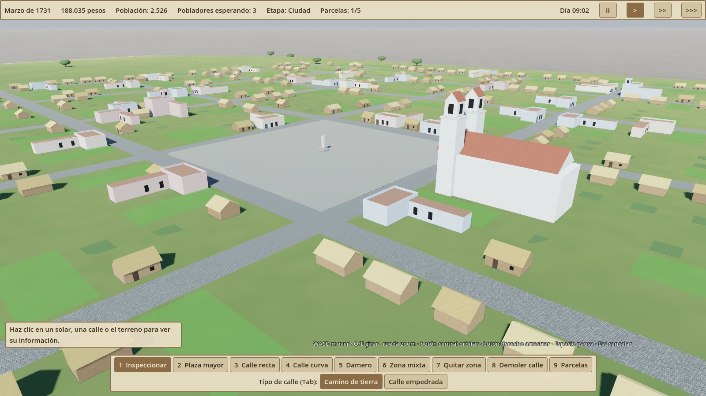
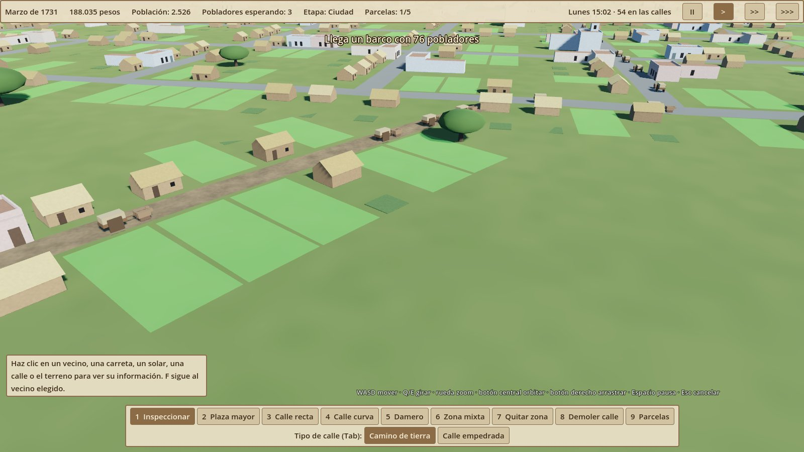
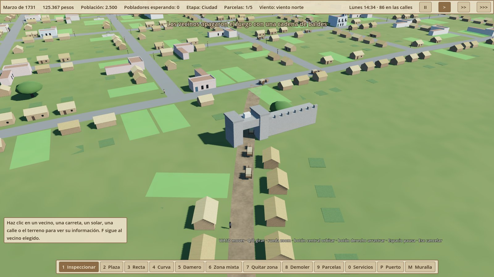
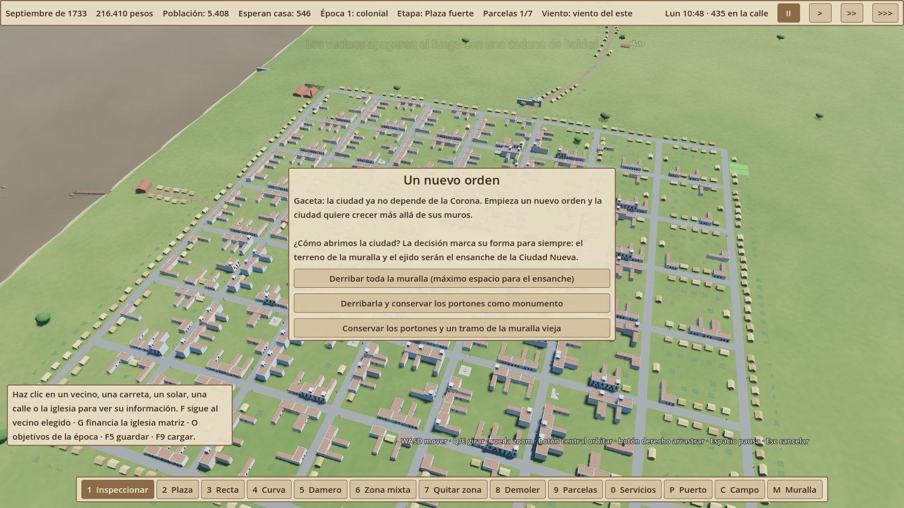
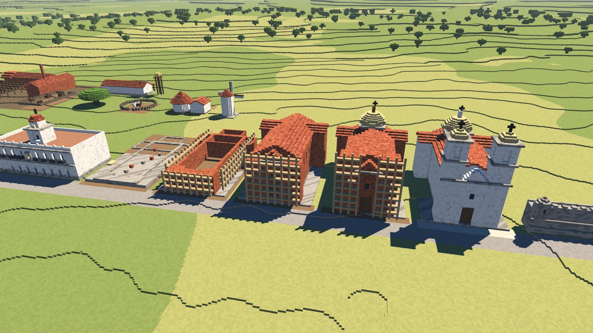
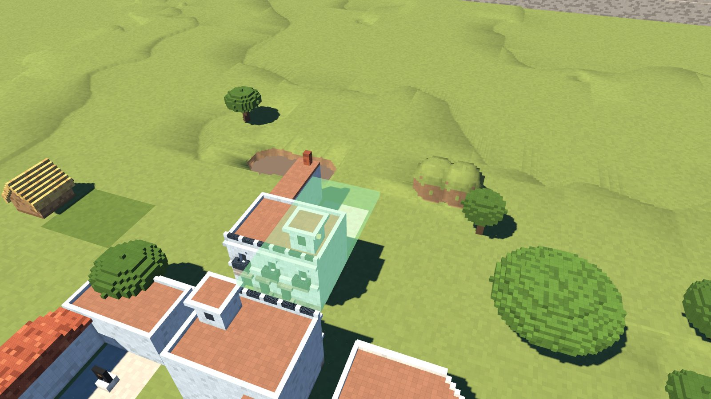

# City Sim 2027 (nombre provisional)

Constructor de ciudades 3D basado en agentes: un sucesor espiritual de los city builders de principios de los 2010, con mecánicas más modernas y una estética de "realismo estilizado".

Estética rioplatense a lo largo de las épocas. Ciudades del tamaño de Montevideo dentro de un país del tamaño de Uruguay. Empieza con una plaza fuerte colonial amurallada junto al río y evoluciona hasta la ciudad contemporánea, conservando en sus capas toda su historia. Sin combates: solo amenazas naturales y los cambios del mundo que llegan por el puerto.

**Fase actual:** prototipo 1 de la época colonial (Godot 4).

- [Documento de diseño (GDD)](docs/GDD.md): intención, pilares, estética, mecánicas base y preguntas abiertas.
- [Época 1: Plaza fuerte colonial](docs/epocas/01-colonial.md): diseño detallado de la primera época (trabajo actual).
- Borradores de las demás épocas: [2 Ciudad Nueva](docs/epocas/02-ciudad-nueva.md) · [3 Inmigración](docs/epocas/03-inmigracion.md) · [4 Art Déco y la Rambla](docs/epocas/04-art-deco-rambla.md) · [5 Modernismo](docs/epocas/05-modernismo.md) · [6 Contemporánea](docs/epocas/06-contemporanea.md)
- [Hoja de ruta](docs/HOJA_DE_RUTA.md)

Motor previsto: Godot 4.

## Versión de prueba (Linux y Windows)

`tools/empaquetar.sh` arma en `dist/` dos paquetes listos para probar, cada uno con el
prototipo jugable y el motor de vóxeles, lanzadores e instrucciones (`LEEME.txt`):

- `city-sim-2027-linux-x86_64.tar.xz` → `jugar.sh` y `motor-voxel.sh`
- `city-sim-2027-windows-x86_64.zip` → `jugar.bat`, `jugar-demo.bat`, `motor-voxel.bat`, `medir-fps.bat`

## Prototipo 1: época colonial





Qué incluye:
- Mapa de 24 × 24 km: península, bahía, cerro, arroyos con monte nativo, cuchillas y el río.
- Parcelas de 3 × 3 km: se empieza con una y se desbloquean más con la población.
- Fundación de la plaza mayor con la iglesia matriz.
- Calles rectas, curvas (se doblan con el ratón) y damero de cuadras de 84 m; cruces automáticos.
- Camino de tierra y calle empedrada; radio mínimo de curva según el tipo.
- Solares que siguen la calle (también en curvas), zona mixta con pincel.
- Crecimiento en tres niveles: rancho → casa de azotea → casa de altos con mirador.
- Pobladores que llegan en barcos, impuestos, etapas (fundación → villa → ciudad → plaza fuerte).
- Panel "¿Por qué no crece?" con la herramienta Inspeccionar.
- Ciclo día/noche: de noche solo brillan algunas ventanas con luz de vela.
- **Vecinos y carretas con comportamiento realista** ([detalle](docs/sistemas/agentes-y-conduccion.md)):
  rutinas diarias y semanales, rutas por tiempo medido que se aprenden, conducción con distancia
  de seguridad (IDM), cesión de paso en los cruces, adelantamiento prudente y temperamentos.
  Se puede inspeccionar a cualquier vecino y seguirlo con la cámara (F).

- **Agua:** pozos de balde, aljibes públicos y puestos de aguadores (junto a un arroyo). Los
  vecinos van a buscar agua y los aguateros reparten en carro. Las casas de azotea necesitan
  agua y las de altos, buena agua. Capa de datos de agua con la herramienta Agua (tecla 0).
- **Incendios:** los ranchos de paja se prenden con facilidad y el fuego salta a los vecinos a
  favor del viento (pampero, sudestada…). Con agua cerca, los vecinos forman una cadena de
  baldes; si no, la casa se quema y quedan ruinas unos meses.

- **Puerto (tecla P):** muelle con barraca en la costa; barcos de vela que fondean y lanchas que
  descargan pobladores y mercancías; las carretas traen cueros para embarcar; panel con los
  flujos del año. Sin muelle, los barcos desembarcan en la playa y llega menos gente.
- **Acontecimientos lejanos** (ficticios, con guiños históricos): guerra entre las Coronas del
  Norte, Reglamento de Comercio Libre, fiebre del cuero, bloqueo del río… cambian los flujos del
  puerto y se anuncian por la gaceta.
- **Muralla (tecla M):** se traza por tramos; donde cruza una calle se abre un portón con aduana.
  Las carretas se detienen a ser revisadas y pagan, y se forman colas en la entrada.
- **Serenos y faroles:** el puesto de serenos ilumina las calles cercanas; los serenos hacen la
  ronda toda la noche cantando la hora, y en las calles iluminadas los vecinos salen a la tertulia.



- **Iglesia matriz (tecla G):** gran proyecto en 5 fases (cimientos, muros, naves y techo,
  cúpula, torres) que se ven en obra con andamios y grúa; cada fase atrae más pobladores.
- **Campo (tecla C):** estancias con corral y ganado, y saladeros junto al agua. Las carretas llevan
  el ganado al saladero y los cueros salados al puerto. El saladero huele mal (baja el valor del
  suelo) y contamina los pozos cercanos.
- **Objetivos de la época (tecla O)** y **el nuevo orden:** con 3.000 habitantes, la matriz
  terminada y 300 cueros exportados, llega la gran decisión: derribar la muralla, conservar los
  portones como monumento o conservar también un tramo. Con eso empieza la época 2.
- **Guardar y cargar partida** (F5 / F9).
- **Epidemias y lazareto:** algunos barcos traen fiebre; con lazareto hacen cuarentena, sin él la
  fiebre se propaga de casa en casa (más rápido donde el agua es mala).
- **Ladrillos y pan:** el horno de ladrillos abastece las casas de azotea, las de altos y la
  iglesia; la atahona da pan, y sin pan los pobladores no se quedan.
- **Ampliar y modernizar edificios** ([detalle](docs/sistemas/edificios-ampliables.md)): al
  inspeccionar un pozo, aljibe, puesto, estancia, saladero, el puerto o la iglesia aparecen
  botones para agregar módulos (segunda cisterna, más serenos, galpón nuevo, muelle más largo,
  grúa…) o modernizarlo en el lugar (pozo → aljibe). Los módulos se ven en el modelo y cambian
  la simulación.



Pendiente: el contenido de la época 2 (ensanche, Ciudad Nueva), lazareto y epidemias, y
optimizar los agentes para ciudades de más de 5.000 habitantes.

## Motor de vóxeles (Rust)

En `engine/` está la primera versión del motor propio de vóxeles a la vista, escrito en Rust con
wgpu. Por ahora genera el mapa y una ciudad de prueba y guarda capturas
([detalle](docs/sistemas/motor-voxel.md)).

La estética de las estructuras está definida en [estetica-voxel.md](docs/sistemas/estetica-voxel.md):
vóxel de 0,5 m, kit modular (zócalo, cuerpo, pretil, vanos, rejas, balcones, techos de teja y paja),
desgaste por vóxel y detalle fino dibujado por material. Catálogo colonial completo, incluida la
iglesia matriz en sus 5 fases de obra.



Ya funciona como aplicación interactiva: ventana con cámara de constructor de ciudades, mundo que
se genera en hilos a medida que te movés (primer cuadro en menos de 1 s) y un modo sandbox para
colocar estructuras del catálogo, excavar y rellenar terreno.

```
cd engine
cargo run --release                                    # ventana interactiva
cargo run --release -- --msaa 1                        # más rápida sin GPU dedicada
cargo run --release -- --auto-test salida/             # recorrido automático con capturas
cargo run --release -- --shot captura.png              # una captura sin ventana
cargo run --release -- --scene catalogo --shot cat.png # catálogo de estructuras
```

Controles: WASD/flechas mover · Q/E girar · rueda zoom · botón central orbitar · botón derecho
arrastrar · clic izquierdo colocar estructura · clic derecho excavar · F rellenar · 1–9/Tab elegir
estructura · R rotar · [ ] hora del día · P pausar el día · F12 captura.



### Cómo ejecutarlo
1. Instala [Godot 4.3](https://godotengine.org/download) o superior.
2. Abre `project.godot` desde Godot y pulsa F5.

Controles: WASD mover · Q/E girar · rueda zoom · botón central orbitar · botón derecho arrastrar ·
1–9, 0, P y M herramientas · Tab tipo de calle o de servicio · R girar la plaza · [ ] tamaño del pincel · Espacio pausa ·
Esc cancelar.

Modo demostración (ciudad ya trazada y 5 años simulados):
```
godot --path . -- --demo --months=60
```

