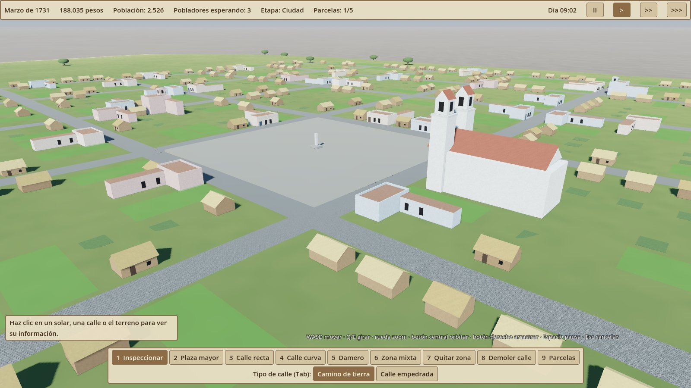

# City Sim 2027 (nombre provisional)

Constructor de ciudades 3D basado en agentes: un sucesor espiritual de los city builders de principios de los 2010, con mecánicas más modernas y una estética de "realismo estilizado".

Estética rioplatense a lo largo de las épocas. Ciudades del tamaño de Montevideo dentro de un país del tamaño de Uruguay. Empieza con una plaza fuerte colonial amurallada junto al río y evoluciona hasta la ciudad contemporánea, conservando en sus capas toda su historia. Sin combates: solo amenazas naturales y los cambios del mundo que llegan por el puerto.

**Fase actual:** prototipo 1 de la época colonial (Godot 4).

- [Documento de diseño (GDD)](docs/GDD.md): intención, pilares, estética, mecánicas base y preguntas abiertas.
- [Época 1: Plaza fuerte colonial](docs/epocas/01-colonial.md): diseño detallado de la primera época (trabajo actual).
- [Época 2: Ciudad Nueva](docs/epocas/02-ciudad-nueva.md) y [Época 3: Inmigración](docs/epocas/03-inmigracion.md): borradores. Épocas 4–6: pendientes.

Motor previsto: Godot 4.

## Prototipo 1: época colonial



Qué incluye:
- Mapa de 24 × 24 km: península, bahía, cerro, arroyos con monte nativo, cuchillas y el río.
- Parcelas de 3 × 3 km: se empieza con una y se desbloquean más con la población.
- Fundación de la plaza mayor con la iglesia matriz.
- Calles rectas, curvas (se doblan con el ratón) y damero de cuadras de 84 m; cruces automáticos.
- Camino de tierra y calle empedrada; radio mínimo de curva según el tipo.
- Solares que siguen la calle (también en curvas), zona mixta con pincel.
- Crecimiento en tres niveles: rancho → casa de azotea → casa de altos con mirador.
- Pobladores que llegan en barcos, impuestos, etapas (fundación → villa → ciudad → plaza fuerte).
- Panel "¿Por qué no crece?" con la herramienta Inspeccionar.
- Ciclo día/noche: de noche solo brillan algunas ventanas con luz de vela.

Pendiente para los siguientes pasos: agua (aljibes y aguadores), incendios, puerto y flujos,
agentes (vecinos y carretas) y serenos con faroles.

### Cómo ejecutarlo
1. Instala [Godot 4.3](https://godotengine.org/download) o superior.
2. Abre `project.godot` desde Godot y pulsa F5.

Controles: WASD mover · Q/E girar · rueda zoom · botón central orbitar · botón derecho arrastrar ·
1–9 herramientas · Tab tipo de calle · R girar la plaza · [ ] tamaño del pincel · Espacio pausa ·
Esc cancelar.

Modo demostración (ciudad ya trazada y 5 años simulados):
```
godot --path . -- --demo --months=60
```

