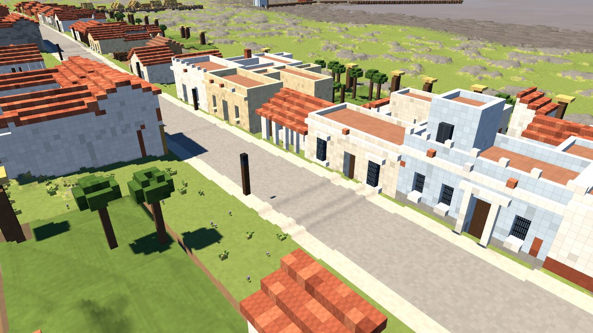
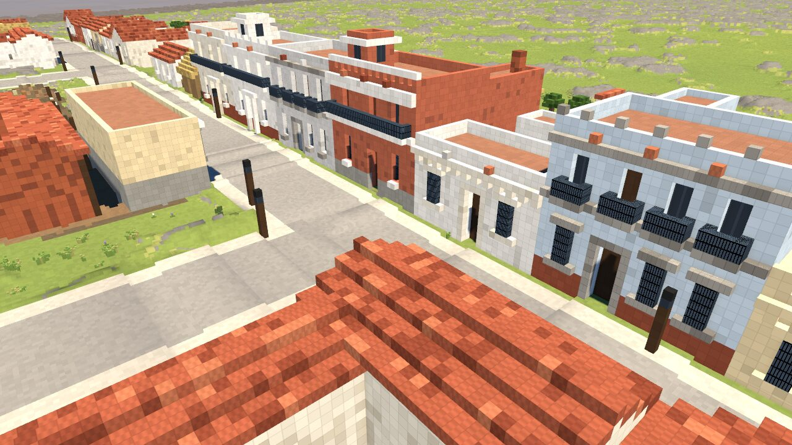
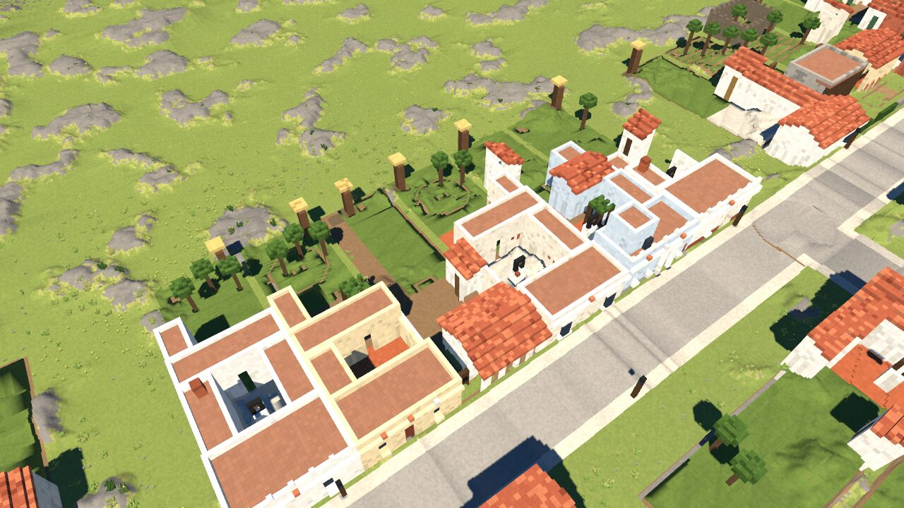
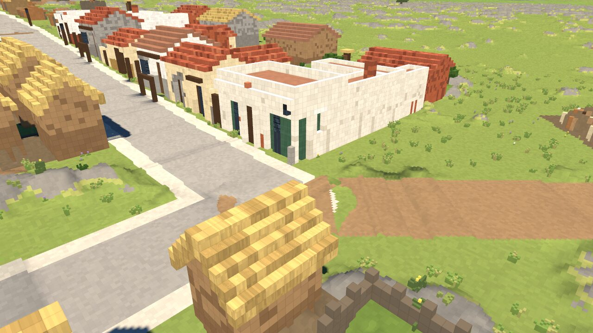
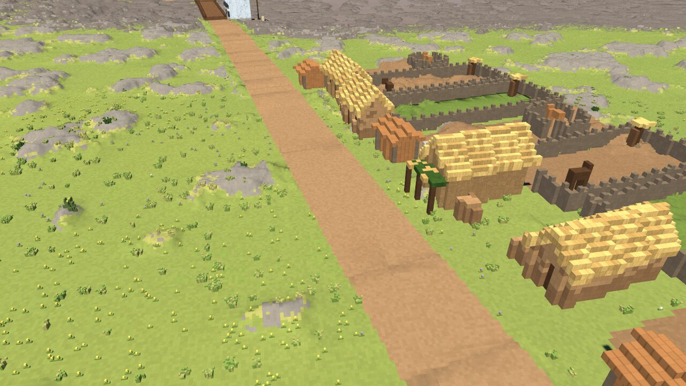
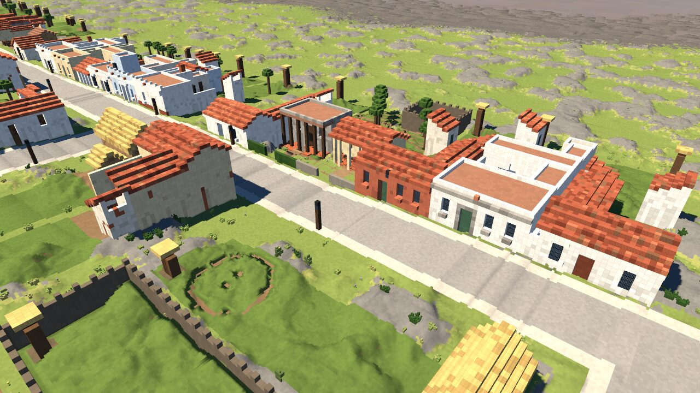

# Arquitectura colonial: variedad de las casas (1726–1830)

> Documento de sistema. Implementado en el motor: `engine/src/structures/estilo.rs`
> (parámetros), `engine/src/structures/casas.rs` (dibujo), `engine/src/city/arquitectura.rs`
> (contexto de cada solar) y `engine/src/city/arquitectura_tests.rs` (pruebas).
> Fuentes y estimaciones: [arquitectura-colonial-fuentes.md](arquitectura-colonial-fuentes.md)
> (la "guía"). Complementa a [estetica-voxel.md](estetica-voxel.md) y a
> [materiales-de-construccion.md](materiales-de-construccion.md).

## 1. Idea

En el Montevideo colonial **no todas las casas eran iguales**: convivían ranchos de cuero y de
barro, casas de piedra con techo de teja, casas de azotea con patio, casas de altos con
balcones de hierro, pulperías de esquina y quintas extramuros, y la mezcla cambió mucho entre
1726 y 1830. Antes, cada zona y nivel tenía un único dibujo con dos o tres variantes; ahora
cada casa sale de un **estilo** propio.

El estilo depende de cuatro cosas, todas guardadas o deducibles de la partida:

1. **La obra real** (sistema de materiales): de qué son las paredes y el techo, si hay cal y si
   hay hierro. Manda sobre todo lo demás.
2. **El contexto al levantarla** (`structures::estilo::Contexto`, guardado con la obra): año,
   clase y origen del hogar, esquina, barrio y cercanía del puerto, y la "tirada" contra la
   repetición.
3. **La semilla del solar.**
4. **La zona, la densidad y el nivel** (lo que el juego necesita: capacidad y empleos).

Marcas: **[F]** dato documentado en una fuente (de la guía); **[E]** estimación (de la guía o
de diseño del juego). Las mismas marcas están en los comentarios del código.

## 2. Tipologías implementadas

| Tipología (`Tipo`) | Cuándo sale | Rasgos | Marca |
|---|---|---|---|
| **Rancho de cuero** | Vivienda de nivel 1 con techo de cuero (preferido en 1726–40) | Palos esquineros, cueros cosidos, techo de cuero, fogón afuera, corral redondo | F (Cattaneo 1729: "cabañas de cuero de buey"); forma E |
| **Rancho** de adobe, terrón (quincha) o tablas | Vivienda de nivel 1; casa con techo de paja o cuero; pulpería de campaña (comercio de nivel 1 con paja) | 1 a 3 piezas en fila (4–11 m), alero a 2–2,5 m, paja a 45°, cumbrera paralela o perpendicular (20 %), enramada (30 %), horno de barro (25 %), cocina aparte (30 %), corral (10 % intramuros, 60 % extramuros), letrina | F (Gronardo 1726, De María 1800); medidas E |
| **Casa de teja** | Una planta con techo de teja | Frente de 7–12 m, alero a 3,5–4,5 m, cumbrera paralela (75 %) o hastial a la calle (25 %), en "L" con segunda crujía (55 % de las medias y ricas), galería al frente (5 %), pozo, chimenea rara (25 %) | F (Burgues 1726, De María: "piedra en bruto y techo de teja"); proporciones E |
| **Casa de azotea** | Una planta con azotea (sale con ladrillo o piedra y cal) | Fachada de 4,5–5,5 m, pretil de 0,5–1 m (liso, con pilarcitos o balaustrado), 1–3 gárgolas, zaguán (80 %), 1 o 2 patios con alas en "C" o "U", aljibe (25 % en 1770–1800, 60 % después), parral, fondo con galpón de teja (35 %), altillo (3–15 % según la época), mirador muy raro | F (~300 hacia 1800, influencia canaria, aljibes de fines del XVIII); E el resto |
| **Casa de altos** (y de tres plantas, rarísima) | Nivel 3 desde 1780, con ladrillo o piedra y cal | PB 4,5–5 m, PA 4–4,5 m, vanos alineados, balcones (ninguno 10 %, uno por vano 55 %, corrido 35 %) de hierro o de madera, impostas, portada (80 %), simetría (45 % antes de 1800, 75 % después), ala de dos plantas con galería de madera (casas de renta), tres plantas solo desde 1800 en el centro y casi nunca | F (fines del XVIII, ~60 hacia 1800, una de tres pisos); E el resto |
| **Casa grande de una planta** | Nivel 3 antes de 1780 (todavía no hay altos) | Casa de azotea o de teja de dos patios | F (secuencia de tipos, Delgado Dopazo) |
| **Cuartos de alquiler** | Vivienda de densidad alta, nivel 2, desde 1770 | Casa subdividida (una puerta por cuarto) o de inquilinato (fila de piezas a lo largo de un patio angosto, ropa tendida) | E (guía M: el conventillo es posterior) |
| **Pulpería / casa con tienda** | Comercio de nivel 1–2 | Puertas de tienda de dos hojas sin reja, reja de mostrador, letrero (15 % antes de 1800, 60 % después), depósito al fondo | F (pulperías de 1726, almacén de Alzáybar 1751); forma E |
| **Pulpería de esquina** | Comercio en un solar de esquina | Puerta en la arista con pilar de esquina (60 %), ochava (15 %, la reglamentaria es posterior) o puerta al frente (25 %); fachada lateral con ventanas, guardacantón | E |
| **Casa de altos con tienda** | Comercio de nivel 3 desde 1780 | Tienda en la planta baja, vivienda arriba | F (fines del XVIII); E |
| **Quinta** | Vivienda de nivel 2–3 extramuros desde 1770 (40–55 %) | Retirada de la calle, galería con pilares encalados u horcones, cerco de tuna o pirca con tranquera, parral, pozo con brocal, horno, frutales y huerta | F (Vidal 1816–18: quintas con frutales y vides); forma E |

Siguen con el dibujo del catálogo de antes (y el color de cal de su época y familia): la fonda
(15 % del comercio de nivel 2), la casa de comercio con recova, el depósito de frutos del país
junto al puerto (40 % del comercio de nivel 3 cerca del muelle) y todos los talleres e
industrias.

## 3. Parámetros por casa (`Estilo`)

Todo en vóxeles de diseño de 0,5 m. Los pesos son los de la guía (§6) salvo donde se dice.

- **Fachada:** frente edificado (el solar entero entre medianeras o un tramo libre con tapia y
  portón), retiro (ranchos y quintas), altura de la planta baja y de las altas, número de vanos
  (rancho 1–3, teja 2–4, azotea 2–5, altos 3–5 por planta), posición de la puerta (centro,
  descentrada o al extremo, con los pesos de §6.3), simetría (neoclásica desde 1800), zaguán
  (puerta rehundida 1 m, con montante de hierro en las casas buenas), ritmo con muro entre
  vanos e irregularidades de medio metro (el lleno domina).
- **Ventanas:** reja plana embutida (con postigo atrás), reja voladiza con base y remate (desde
  1780, ricos), o postigos de madera (sin hierro: cerrados o con una hoja abierta). Pesos por
  clase (§6.4). Alféizar o poyo desde el ornamento 1.
- **Ornamento 0–3** por clase y época (§6.4), con tope por materiales: sin revoque, como mucho
  1; adobe, tablas o barro sin revoque, 0. Decide cornisa (ninguna, una faja, dos molduras, con
  dentículos), pretil (liso, pilarcitos con macetones, balaustrado), portada (marco, pilastras
  con cornisa, pilastras con frontón escalonado; frontón solo en ricos desde 1790) y guardapolvos.
- **Materiales:** la piedra con cal se revoca (80 %) o queda en sillería a la vista (20 %, más
  en 1726–40); sin cal, mampostería. Ladrillo sin cal: ladrillo visto. Molduras, alféizares y
  losas de balcón de sillería solo si la obra es de piedra; si no, de cal (o ladrillo).
- **Color de la cal** (§4.2 y §6.5) con los pesos de cada época y el sesgo por clase (los pobres,
  más cal blanca y nada de añil; el celeste no aparece antes de 1760): blanca, hueso, ocre,
  rosado, almagre, celeste y gris perla. Molduras en blanco sobre muro de color (60 %). Zócalo
  (60 %): almagre, gris, ocre oscuro, el mismo color manchado o piedra. **Carpintería**: madera
  oscura 50 %, verde 20 % (30 % desde 1810), marrón rojizo 15 %, gris azulado 10 %, ocre 5 %; los
  pobres, madera.
- **Desgaste** (§4.3): años desde el blanqueo (pobres 3–10, medios 1–7, ricos 0–4) → manchas de
  humedad abajo y lavado arriba; revoque caído en parches (50 / 25 / 12 / 8 % de las casas según
  la clase) que deja ver la piedra, el ladrillo o el adobe; lamidos bajo las gárgolas (70 %);
  tejas nuevas, a medias o viejas con líquenes (25 / 50 / 25 %); paja vieja.
- **Planta:** crujía del frente, 0–2 patios (piso de losa, ladrillo o tierra según la clase),
  una o dos alas, crujía entre patios, segundo patio de servicio, galpón de teja o depósito al
  fondo, **ampliaciones** (0–2 cuartos agregados al fondo con otro tono de cal y otro techo: la
  casa que creció por etapas, §5.6), huerta con frutales o corral, letrina.
- **Altillo** (azotea; 3 % en 1770–1800, 8 % en 1800–15, 15 % en 1815–30, ×1,5 desde la clase
  modesta y ×0,5 en los pobres) y **mirador** (solo
  desde 1790, clase acomodada o principal, la mitad de la estimación de la guía: 0,5–3,5 % de las
  azoteas ricas y 2,5–7,5 % de las casas de altos, ×1,5 en el centro y junto al puerto) [E; el
  primero documentado es de 1848, F].
- **Farol** de hierro en la fachada (2 % antes de 1780, 10 % después, +15 % en las esquinas).

## 4. El origen de la familia

El estilo también depende del origen del hogar que levanta la casa (el hogar principal del
solar, el de más clase e ingresos; si todavía no vive nadie, un origen sorteado con el peso de
cada origen en las llegadas de la época, más los nacidos en la ciudad, sin contar las llegadas
forzadas por la trata). No son tipologías aparte sino **ajustes de pesos** sobre la variante,
guardados como datos en `structures::estilo::RASGOS` para extenderlos a las épocas siguientes
(cada fila tiene `desde` y `hasta`).

| Tradición | Orígenes | Ajustes | Marca y fuente |
|---|---|---|---|
| Criolla | Montevideo, Buenos Aires, interior | Más rejas y rejas voladas; más casas de medio patio | F para Buenos Aires: la "casa chorizo" es «la mitad de la casa colonial de patios» (guía §2.4); pesos E |
| Canaria | Canarias | Azotea preferida ×1,8; balcón de madera con tejadito en las casas de altos (60 %); carpintería verde +35 %; más cal blanca | F: la casa a patio con azotea es «de clara influencia canaria» (Delgado Dopazo 2004 según Carmona y Álvarez Lenzi). E: balcones de madera y carpintería verde son rasgos de las islas, no verificados en Montevideo |
| Gallega | Galicia | Piedra a la vista +30 %; cal blanca | E |
| Andaluza | Andalucía | Cal blanca +25 %; más rejas y voladizas | E |
| Norte de España | Cantábrico, País Vasco, Cataluña | +1 nivel de ornamento (40 %); piedra labrada | E |
| Lusa | Portugal, Brasil | Azotea ×0,45 (prefieren teja); alero de 1 m (80 %); colores fuertes (ocre, almagre, rosado, celeste) | F: casas de piedra portuguesas con techo a dos y cuatro aguas frente a las españolas de ladrillo y azotea en Colonia del Sacramento (guía §4.1). E: alero y colores. Los azulejos de fachada son del siglo XIX: quedan para la época siguiente |
| Guaraní | Pueblos de las misiones | Galería al frente o enramada +50 % | E: los corredores son propios de las casas de los pueblos de misiones; no verificado en Montevideo |
| Italiana | Italia | Molduras, cornisas, balaustradas y colores "pompeyanos" — **solo desde 1830** | E. En la colonia casi no hubo italianos: antes de 1830 no se aplica (la casa es la de la época) |
| Sin rasgos | África (las tres regiones de la trata), pueblos de la región, Francia, islas británicas y los orígenes de épocas posteriores | Ninguno | No se encontraron rasgos documentados para la ciudad colonial. Las personas africanas y afrodescendientes vivían en general en las casas de sus dueños, en ranchos o en cuartos (guía §5.2): no se inventa un estilo |

La ficha del solar muestra el tipo de casa y el año, y una línea con el origen cuando hay
rasgos: «Casa de azotea con zaguán, dos patios y aljibe, levantada en 1805» y «Casa de familia
canaria: azotea, balcón de madera y carpintería verde». La línea nombra solo los rasgos de la
tradición que esa casa muestra de verdad; si los materiales no dieron para ninguno, lo dice
(«sin los rasgos de su tradición (…)»).

## 5. Época y lugar

- **Techo preferido** (antes de elegir los materiales; el sistema de materiales decide con lo
  que hay): probabilidad de azotea de una casa de una planta 0 % antes de 1740, 10 % en
  1740–70, 30 % en 1770–1800, 35 % en 1800–15 y 45 % después (intramuros; ×1,4 en el centro,
  ×0,7 en las orillas, ×0,4 extramuros; × el ajuste de la tradición). Anclas: ~300 azoteas hacia
  1800 frente a una mayoría de teja (De María, F); curva E. Ranchos: cuero en vez de paja el 65 %
  en 1726–40, 15 % en 1740–70 y 4 % después (Cattaneo 1729, F; curva E).
- **Barrio** por la distancia a la plaza: centro (< 200 m), intramuros (< 550 m), orillas
  (< 850 m), extramuros (más lejos) [E: la península amurallada medía ~1 km]. **Puerto**: a menos
  de 350 m del muelle.
- **Esquina**: hay calzada a menos de 8 m del costado del solar, cerca del frente.
- **Clase**: la del hogar principal (pobre, modesta, acomodada, principal); en una casa nueva sin
  hogar, la probable para el nivel y el valor del suelo [E].

## 6. Regla anti-monotonía

Guía §6.6 [E]: dos vecinos sobre la misma calle no comparten más de 2 de estos 4 atributos
(tipología, color del muro, número de vanos, posición de la puerta) y su línea de cornisa
difiere al menos un vóxel. Al levantar una casa se prueban hasta 12 "tiradas" del estilo y se
guarda la que cumple con los vecinos ya edificados (o la que menos falla). Para los edificios
sueltos (ranchos y quintas, que no van entre medianeras) basta con que el volumen difiera. En la
prueba de una ciudad que crece en 1796, 98 de 99 pares de vecinos la cumplen.

## 7. Materiales primero

El estilo respeta la obra real (`los_materiales_mandan_sobre_el_estilo`):

- Sin ladrillo o piedra **y** cal no hay azotea ni altos (los altos además piden piedra o
  ladrillo con cal); con techo de paja o cuero, la casa es un rancho aunque el nivel sea de casa.
- Los colores van solo sobre el revoque: el ladrillo visto, el adobe, la quincha, las tablas y la
  mampostería se ven con su material. Las tablas no se revocan.
- Una casa sin piedra no tiene portada, alféizares ni balcones de sillería; una de adobe sin
  revoque no tiene molduras ni portada; sin hierro no hay rejas, balcones de hierro ni faroles
  (los balcones son de madera, si los hay).

## 8. Guardar, cargar y partidas viejas

El contexto (`Obra::contexto`) se guarda con la obra y todo lo demás es determinista: la partida
cargada dibuja las mismas casas (el recorrido de la demostración sigue dando IGUAL). Las obras de
partidas viejas no tienen contexto: cargan igual y se dibujan con un año supuesto (1750) y la
semilla, siempre del mismo modo (pueden verse distintas a como se veían antes). El contexto se
toma una sola vez, al levantar la obra: si se muda otra familia la casa no cambia de cara; si se
reconstruye (mejora, derrumbe), se toma de nuevo.

## 9. Rendimiento

Los cuerpos de las casas con estilo son **cajas huecas** (muros de 0,5 m, frente de 1 m, losa o
techo): por dentro no se ve nada. Medido en la ciudad de la demostración (272 edificios de
solares, en un hilo):

| | Vóxeles de los edificios | Tiempo de dibujo | Por edificio |
|---|---|---|---|
| Antes | 2.404.392 | 875 ms | 8.840 vóxeles, 3,2 ms |
| Ahora | 962.760 | 488 ms | 3.540 vóxeles, 1,8 ms |

Los 60 meses de crecimiento de la demostración aplican 1,22 M de vóxeles (antes 2,39 M) y la
partida cargada regenera 4,36 M (antes 5,71 M–5,84 M).

## 10. Paleta y shader

Doce materiales nuevos (la paleta del render pasó de 80 a 96 lugares): cal hueso, almagre y gris
perla con sus manchas, zócalos de almagre y ocre oscuro, carpinterías marrón rojiza, gris
azulada y ocre, y teja vieja con líquenes. El shader dibuja tableros y la junta de las dos hojas
en las carpinterías pintadas, y canales de teja también en la teja vieja.

## 11. Demostración

`motor --demo-ciudad <carpeta>` mide los edificios, saca tres vistas de cerca de la ciudad
crecida y arma seis calles de muestra (comercio y pulperías de 1795, ranchos de 1732 en las
orillas, casas de teja de 1760, de azotea de 1805, de altos de 1822 y quintas de 1812
extramuros) con capturas `motor-arq-*`. Con `MOTOR_SOLO_ARQ=1`, un recorrido corto solo con
eso.

## 12. Lo que falta

- Casas dañadas o abandonadas por los sitios de 1807 y 1811–14 (guía §5.7).
- Cuarteles, almacenes de bóveda y barracas de cueros con corrales como tipologías propias (hoy,
  el depósito del catálogo).
- Techo a cuatro aguas (portugués), alero con canecillos, balcón corrido de esquina, rejas con
  volutas, puertas con clavos y aldaba (por debajo de los 0,5 m: irían en el shader).
- Más tiradas en la regla anti-monotonía cuando el vecino se reconstruye después.
- Las épocas siguientes: azulejos luso-brasileños, italianizante, damero de mármol en los patios.
