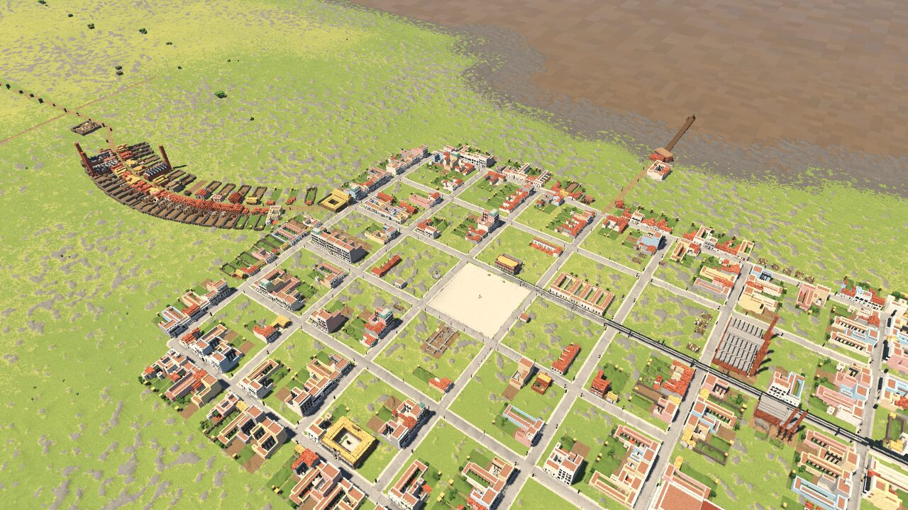
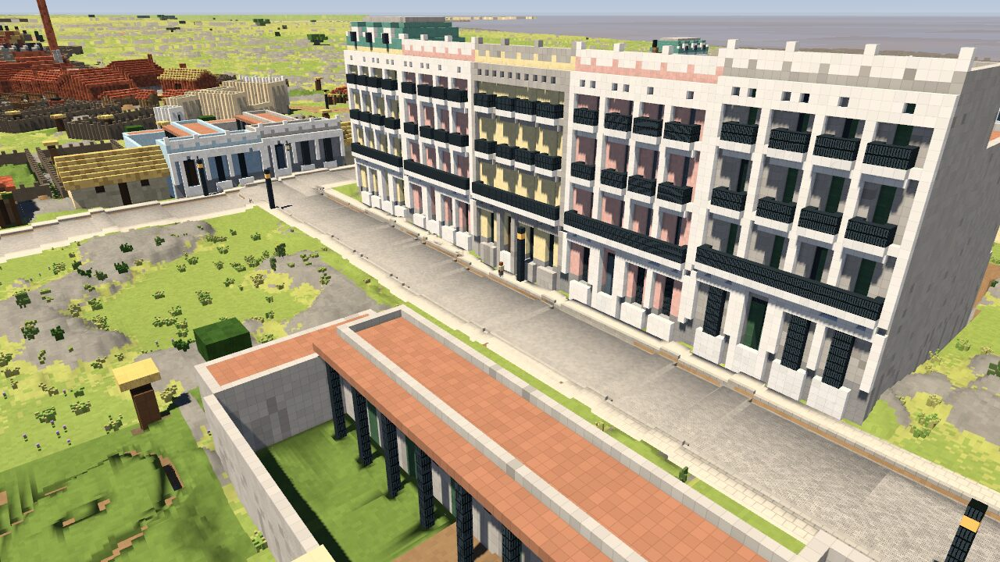
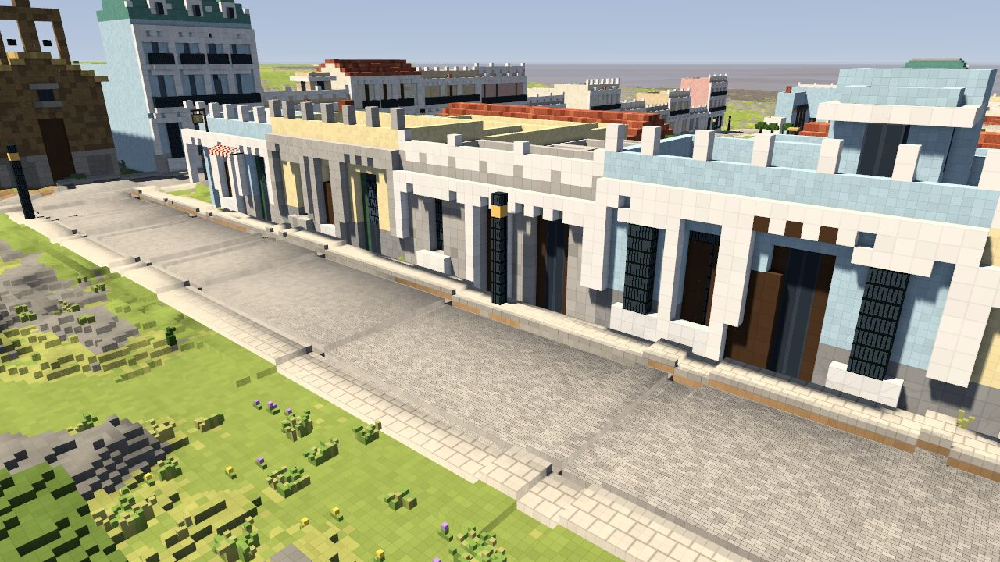
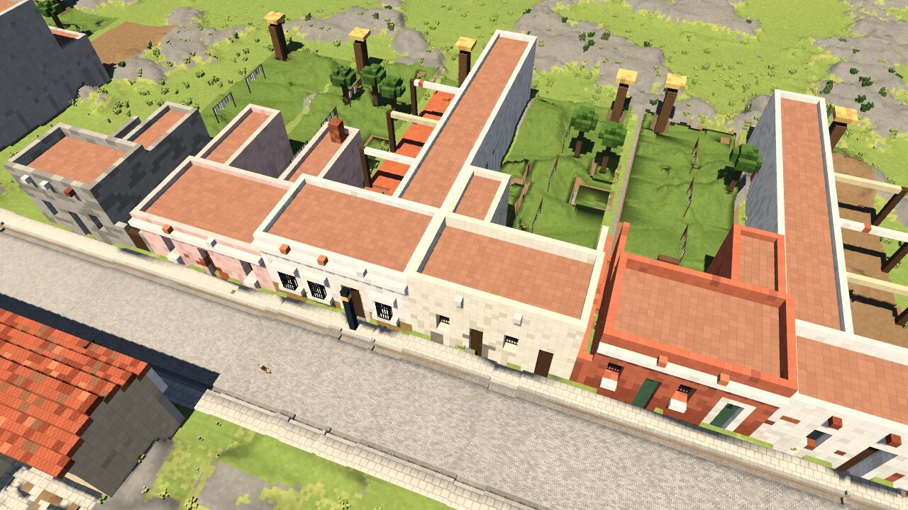
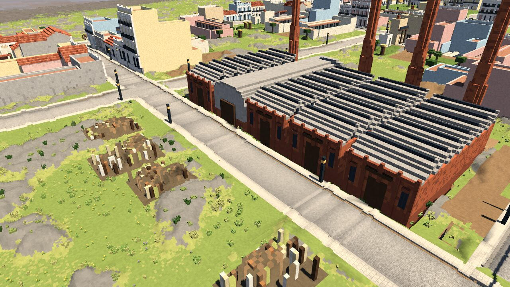
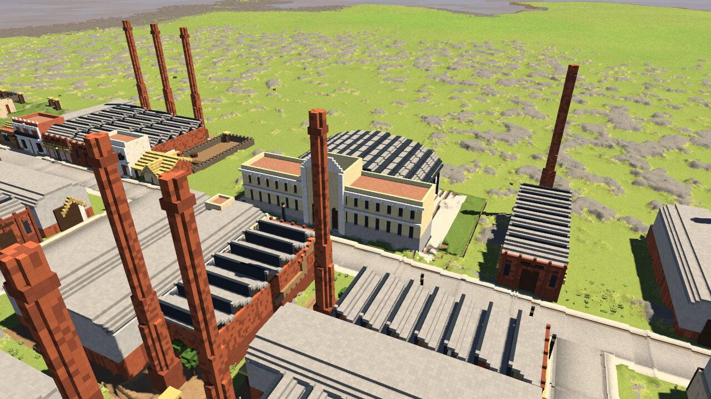
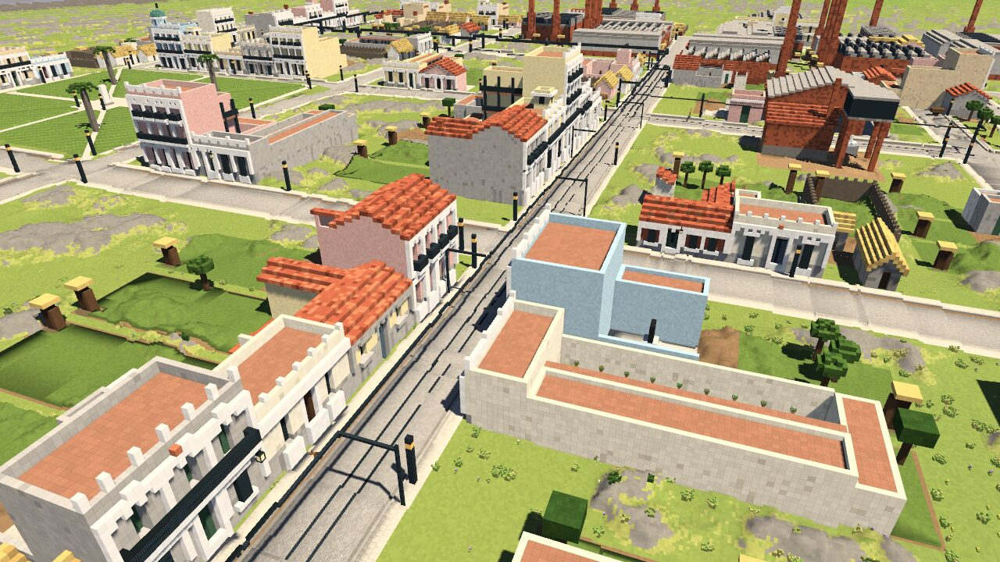
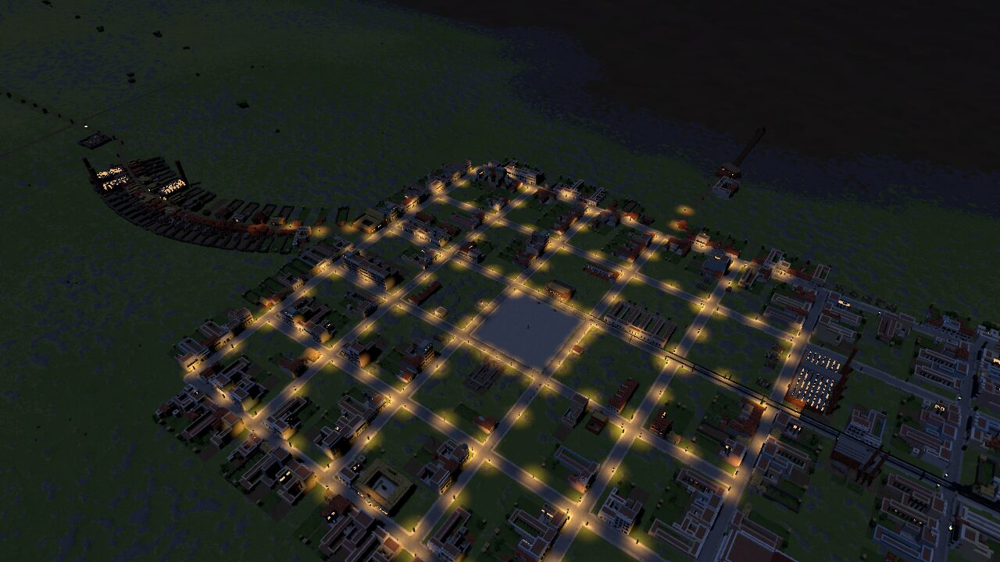

# Arquitectura de la época 3: Inmigración y Belle Époque (1870–1930)

> Guía de fuentes y decisiones del kit de vóxeles y los sistemas de la época 3 (casa standard,
> edificio de renta, almacén y bar de esquina, conventillo, fábrica, estación, usina eléctrica,
> tranvías, hotel de inmigrantes y puerto moderno). Complementa a
> [arquitectura-epoca2.md](arquitectura-epoca2.md) y a
> [../epocas/03-inmigracion.md](../epocas/03-inmigracion.md).
>
> Marcas: **[F]** dato documentado en una fuente citada abajo; **[E]** estimación de diseño
> del juego (proporciones, frecuencias, colores elegidos para que se lea en vóxeles).

---

## 1. Fechas y hechos verificados

| Hecho | Fecha | Fuente | Uso en el juego |
|---|---|---|---|
| Primer tren del Ferrocarril Central: Bella Vista (provisoria)–Las Piedras | 1 de enero de 1869 | [F] Wikipedia (es) «Estación Central General Artigas» | Acontecimiento **llegada del ferrocarril**: en el modo fiel, entre 1867 y 1869 (seguro en 1869) |
| La vía llega a Montevideo (hasta la actual estación Lorenzo Carnelli) | 16 de julio de 1871 | [F] ídem | `ANIO_INMIGRACION = 1870` (año redondo del cambio) |
| Central Uruguay Railway Co., registrada en Londres; opera del 1-1-1878 al 3-1-1949 (nacionalización) | 1876–1949 | [F] Wikipedia (en) «Central Uruguay Railway» | La decisión de la **concesión** a una compañía de ultramar |
| Estación Central de Montevideo, de Luis Andreoni (ingeniero), estilo Beaux-Arts; inaugurada el 23 de junio de 1897, abierta al público el 15 de julio | 1897 | [F] Wikipedia (es) «Estación Central General Artigas» | **Estación de ferrocarril**: cuerpo central más alto con arcos, frontón y reloj [la forma es E] |
| Primer tranvía a caballo de Montevideo (inaugurado el 25 de mayo de 1868, servicio regular desde el 1 de junio; primera estación en la plaza de Frutos; al principio, "ferrocarril a sangre") | 1868 | [F] blog *daos1964* «El primer tranvía a caballo en Uruguay»; Prensa Latina, «Un tranvía llamado Andrés» (2024); raicesuruguay.com, «Ferrocarril y Tranvía del Norte» | **Tranvía a caballo** con las cocheras |
| Empieza a funcionar el tranvía eléctrico | 1906 | [F] Wikipedia (en) «Timeline of Montevideo» | Las líneas se **electrifican** con una usina |
| Comienzo de la actividad eléctrica: la usina del Yerbal habilita el alumbrado con luz incandescente en Montevideo | 1886 | [F] Montevideo Portal, «UTE celebró… 110 años de historia» (cita de la presidenta de UTE) | **Usina eléctrica** y faroles eléctricos |
| Usinas del Arroyo Seco y del Yerbal (memoria de 1901); en 1912 la ley crea las "Usinas Eléctricas del Estado" | 1901–1912 | [F] UTE, *Memoria anual 1901*; IMPO, ley 4.273 de 1912 | Contexto de la usina; la estatización queda para la época 4 |
| Hotel de Inmigrantes abre | 1908 | [F] Wikipedia (en) «Timeline of Montevideo» | **Hotel de inmigrantes** |
| Puerto de Montevideo inaugurado | 25 de agosto de 1909 | [F] Wikipedia (es) «Puerto de Montevideo» (ficha) | **Puerto moderno** |
| Grandes obras del puerto terminadas | 1930 | [F] Wikipedia (en) «Timeline of Montevideo» | El puerto por fases queda pendiente |
| Población de Montevideo: 91.167 (1879) y 312.946 (1908, estimada) | 1879, 1908 | [F] Wikipedia (en) «Timeline of Montevideo» | Escala del crecimiento de la época (el motor juega ciudades más chicas) |
| Conventillo: "uso tardío de casas residenciales"; patio central con doble fila de habitaciones; una familia (o dos, separadas por una cortina) por pieza; baños escasos y comunes; "primer hogar de muchos inmigrantes recién llegados" | fines del XIX | [F] Wikipedia (es) «Conventillo» | **Conventillo**: la casa vieja dividida en piezas (misma fachada) |
| Conventillo Mediomundo (Barrio Sur), construido en 1885 y demolido en 1978; "cuna de la cultura afrouruguaya y el candombe" | 1885–1978 | [F] ídem | Nota de color; el candombe va en el sonido de la época (pendiente) |
| Casa standard o "casa chorizo": tipología dominante del ensanche; portal, zaguán y patios en hilera | fines del XIX | [F] Wikipedia «Casa chorizo»; FADU (ensanche de Montevideo) — ya citadas en la época 2 | **Casa standard** |

Fuentes que no se pudieron verificar y quedan fuera: el nombre del empresario de la usina del
Yerbal (un artículo de la AUDHE lo menciona cortado) y la fecha de 1909 de la usina del
Arroyo Seco. La inmigración por origen de la época 3 sigue con la tabla `INMIGRACION` de
`poblacion::origenes` (pesos [E], ver [poblacion.md](poblacion.md)).

---

## 2. Tipologías de la época 3 en el motor

Las casas se eligen como en las épocas anteriores (`structures::estilo::estilo`): sobre la
fachada neoclásica e italianizante de la época 2 (`fachada_neo`), la época 3
(`structures::epoca3::estilo3`, contexto `epoca == 2`) pone su tipología, sus colores y sus
remates. Sin revoque no hay fachada nueva.

| Nivel | Tipo (`tipo3`) | Qué se ve |
|---|---|---|
| 2 | **Casa standard / casa chorizo** | Crujía al frente con tres vanos (puerta al costado con zaguán y dos ventanas altas), pilastras, ménsulas, cornisa con dentículos y pretil balaustrado; detrás, las piezas en hilera sobre un patio lateral largo con galería de columnas de hierro fundido, baldosas de mármol en damero (o ladrillo), macetas; al fondo, cocina y baño y el fondo de tierra con la higuera [E] |
| 3 | **Casa de altos italianizante** | La casa de altos con los colores de la época y el balcón corrido de hierro fundido más frecuente (70 %) [E] |
| 3 (alta o clase alta) | **Edificio de renta** | Tres o cuatro plantas, comercio en la planta baja en la zona comercial, balcón corrido en el piso noble y balcones por vano arriba, guardapolvos con frontón, friso y cornisa fuerte; en la esquina, **cúpula** de pizarra o cobre verde (55 %) o **mansarda** con buhardillas (25 %); entre medianeras, mansarda (15 %); ala con galerías de hierro sobre el patio de aire y luz [E] |
| comercio, esquina | **Almacén y bar de esquina** | Ochava, dos puertas de tienda, mostrador, letrero y **toldo** de lona a rayas (modelo de detalle) [E] |
| (precario) | **Conventillo** | La casa vieja **con la misma fachada**; el patio lleno de piezas en hilera con su puerta y su ventanita, ropa tendida (modelo de detalle), revoque viejo y caído [F tipología; E forma] |
| industria | **Fábrica** y **galpón de chapa** | Galpón de ladrillo visto con techo de diente de sierra (caras vidriadas), frente con pilastras, ventanas en arco, portón y letrero, y la chimenea troncocónica de 32 m; o galpón de depósito con bóveda rebajada de chapa [E] |

### Colores [E]
La paleta de `docs/epocas/03-inmigracion.md` §11, con pesos: rosa viejo (#D4A79A) 24 %,
amarillo pálido (#E6D49E) 20 %, ocre claro y gris piedra 16 % cada uno, celeste gastado
(#A9C1C9) 12 %, hueso 12 %; molduras en blanco piedra (o gris piedra sobre hueso y amarillo);
cúpulas y mansardas en pizarra / cobre verde (#5E8C7E); hierro fundido negro. Cuatro
materiales nuevos en `palette.rs` (`ROSA_VIEJO`, `AMARILLO_PALIDO`, `CELESTE_GASTADO`,
`COBRE_VERDE`; queda una ranura libre de la paleta de la GPU).

### Modelos de detalle nuevos
`Id::Toldo` (toldo de lona a rayas de 3 m, con faldón y brazos de hierro) y `Id::RopaTendida`
(dos palos, la cuerda y siete prendas): se piden con `Frame::detalle` desde
`structures::epoca3::detalles3`.

---

## 3. Edificios de servicio

| Edificio | Qué tiene en vóxeles | Fuente |
|---|---|---|
| Estación de ferrocarril | Edificio de pasajeros de dos plantas en amarillo pálido con cornisas y ventanas, cuerpo central más alto con tres arcos, frontón escalonado y reloj; detrás, galpón de andenes de hierro y vidrio con costillas cada 4 m, tres andenes y cuatro vías | Fechas y arquitecto [F]; forma [E] |
| Usina eléctrica | Sala de máquinas de ladrillo con ventanales en arco y techo a dos aguas, sala de calderas de chapa, dos chimeneas de 30 m, la carbonera y el patio de transformadores | 1886 [F]; forma [E] |
| Cocheras de tranvía | Galpón largo con cuatro portones en arco y las vías que salen de cada uno, caballerizas al fondo y la oficina rosa | 1868 y 1906 [F]; forma [E] |
| Hotel de inmigrantes | Pabellón de dos plantas con letrero, mástil y bandera, alas de dormitorios con galería de hierro alrededor del patio, comedor al fondo, bancos y faroles | 1908 [F]; forma [E] |
| Puerto moderno | Muelle de piedra con bitas (del lado del agua), vías del puerto, tres grúas de pórtico de hierro sobre rieles con su cabina y el brazo hacia el agua, dos galpones de chapa, fardos y bolsas | 1909 [F]; forma [E] |

---

## 4. Sistemas de la época

- **Paso de la época 2 a la 3** (`city::epocas::epoca3`): 3.000 habitantes [E], teatro,
  ensanche y el acontecimiento de la llegada del ferrocarril (modo fiel: 1867–1869 [F: 1869];
  historia alternativa: teatro y 2.500 habitantes, 1/36 por mes). La decisión: **concesión**
  (canon de 25.000 pesos ahora y la estación gratis; los pasajes son de la compañía) o
  **construirla con dinero propio** (la estación cuesta 30.000 y los pasajes, 0,04 pesos por
  habitante y por mes, entran al tesoro) [E]. Pantalla de resumen y crónica como en la época 2.
- **Inmigración**: la tabla de llegadas de la época 3; la estación (×1,1), el hotel de
  inmigrantes (×1,2) y el puerto moderno (×1,25) multiplican las llegadas; las **oleadas**
  (*crisis en la Península*) las multiplican por 1,8 durante 8 meses, más probables en las
  décadas de 1880 y 1905–1913 en el modo fiel [E].
- **Conventillos**: con más de 40 personas sin casa (80 con hotel de inmigrantes), hasta 3
  casas viejas de familias modestas por mes, las más cercanas a la plaza o al puerto, se
  dividen en piezas: densidad alta (más familias, más insalubridad), misma fachada. La
  **inspección** de conventillos (botón en el panel de la época) frena las conversiones y
  cuesta 120 pesos por mes [E].
- **Alumbrado eléctrico** (`city::epocas::tranvias`): un farol eléctrico (columna de hierro de
  4,5 m con el globo) cada 35 m por las calles de la red de la usina, hasta 2 km; saca los de
  gas a menos de 24 m. Luz por la misma vía del render que la del gas (`luces_cerca`): 16 m de
  alcance e intensidad 1,6 (el gas, 11 m y 1,0). El shader no cambió; el tono es el cálido del
  gas (las lámparas de arco, más blancas, quedan pendientes) [E].
- **Tranvías**: cada cochera tiende dos líneas por la red de calles (Dijkstra): a la plaza
  mayor y a la punta más lejana de la red a su alcance (2,5 km). Rieles de hierro en la
  calzada (trocha de 1,435 m [F]); con una usina, postes de 6 m cada 30 m alternando de
  vereda, el brazo y el cable de contacto. Las líneas suben el valor del suelo a menos de
  300 m (hasta +0,07; la estación, hasta +0,08): así la ciudad crece hacia donde llegan [E].
- **Agua y saneamiento**: siguen las redes de la época 2 (agua corriente y colectores por la
  red de calles); las casas standard ya dibujan el baño adentro.

## 4b. Capturas (`MOTOR_EPOCA3=1 --demo-ciudad`)

## 5. Pendiente
- Coches de tranvía (a caballo y eléctricos) y trenes como agentes (la IA de agentes es de
  otra línea de trabajo); carros de reparto, organilleros y los primeros automóviles.
- El puerto por fases (diques, escolleras, dragado) con su carrera contra la ciudad de la
  otra orilla; frigoríficos grandes junto al puerto.
- Escuela pública, liceo, bomberos y policía profesionales, hospital de pabellones, cafés y
  clubes sociales, cines (están como tarjetas de "época 3" en Servicios).
- Planta potabilizadora y tanques de la red de agua de la época; la ampliación de la red de
  saneamiento de 1913.
- Las colectividades con mecánicas propias, la huelga general, la gripe de 1918, la
  exposición internacional y el crac (acontecimientos de la época).
- Luz de las lámparas de arco más blanca (un cambio en el render, que es de otra línea).
- Plátanos en las veredas, parques con lagos y glorietas, palmeras en los bulevares.
- La transición a la época 4 (trazado de la costanera).

## Fuentes
- Wikipedia (es), «Estación Central General Artigas»: https://es.wikipedia.org/wiki/Estaci%C3%B3n_Central_General_Artigas
- Wikipedia (en), «Central Uruguay Railway»: https://en.wikipedia.org/wiki/Central_Uruguay_Railway
- Wikipedia (en), «Timeline of Montevideo»: https://en.wikipedia.org/wiki/Timeline_of_Montevideo
- Wikipedia (es), «Puerto de Montevideo»: https://es.wikipedia.org/wiki/Puerto_de_Montevideo
- Wikipedia (es), «Conventillo»: https://es.wikipedia.org/wiki/Conventillo
- Montevideo Portal, «UTE celebró este miércoles en el Auditorio del Sodre 110 años de historia»: https://www.montevideo.com.uy/Negocios-y-Tendencias/UTE-celebro-este-miercoles-en-el-Auditorio-del-Sodre-110-anos-de-historia-uc835294
- UTE, *Memoria anual 1901*: https://www.ute.com.uy/sites/default/files/memorias/Memoria%20anual%201901.pdf
- IMPO, ley 4.273 de 1912 (Usinas Eléctricas del Estado): https://impo.com.uy/bases/leyes/4273-1912
- Blog *daos1964*, «El primer tranvía a caballo en Uruguay»: https://daos1964.blogspot.com/2022/10/el-primer-tranvia-caballo-en-uruguay.html
- Prensa Latina, «Un tranvía llamado Andrés» (2024): https://www.prensa-latina.cu/2024/03/23/un-tranvia-llamado-andres/
- raicesuruguay.com, «Ferrocarril y Tranvía del Norte»: https://www.raicesuruguay.com/raices/descargas/ferrocarrilytranvia.doc
- Wikipedia, «Casa chorizo» (ya citada en la época 2): https://en.wikipedia.org/wiki/Casa_chorizo
