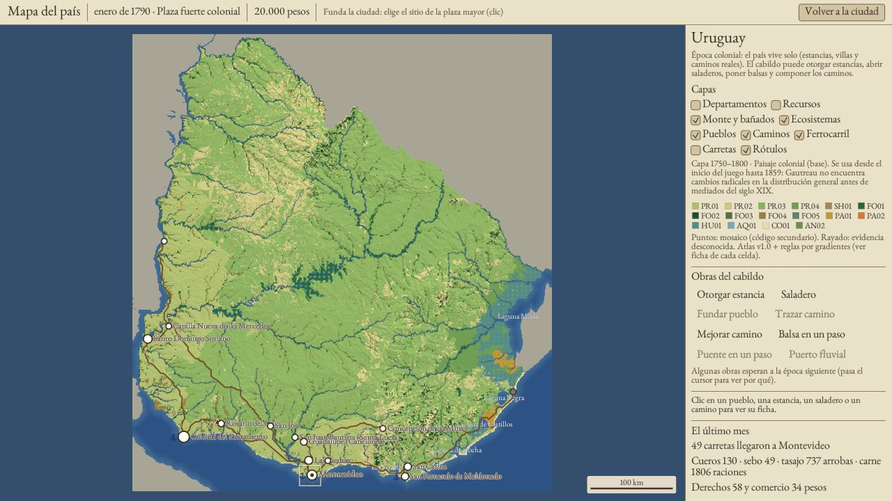
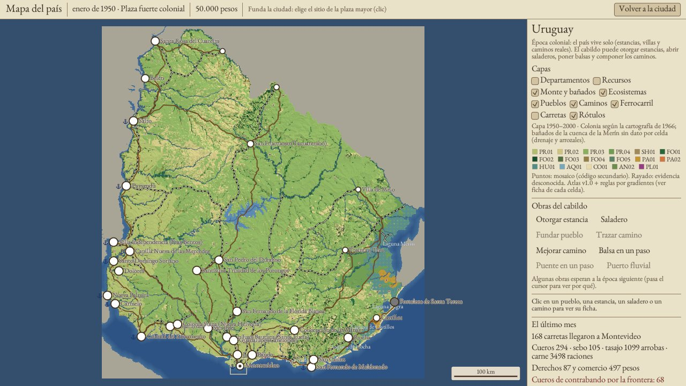
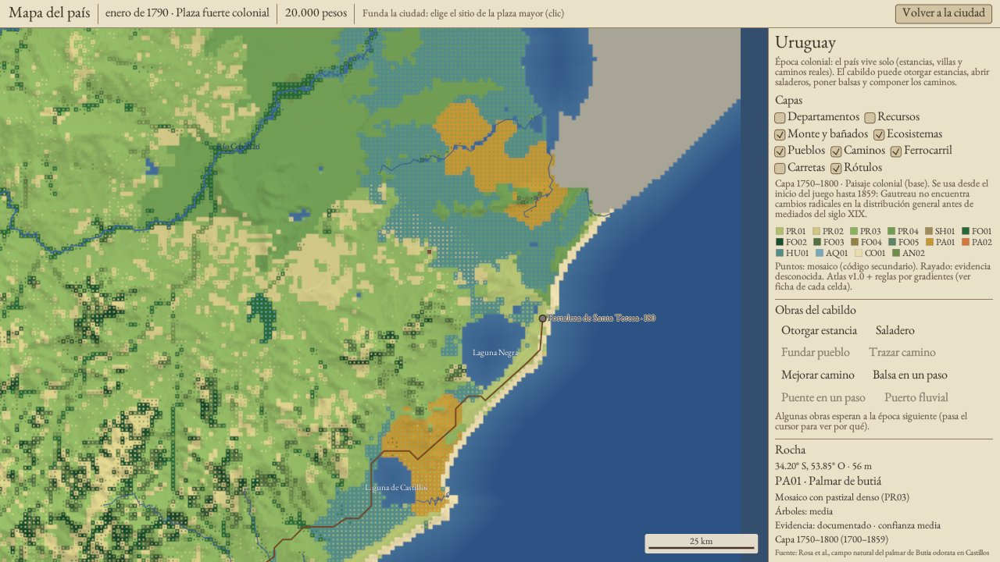
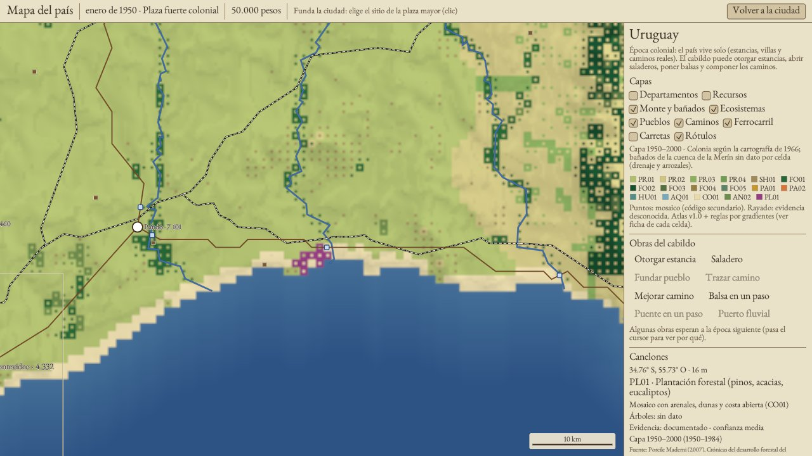
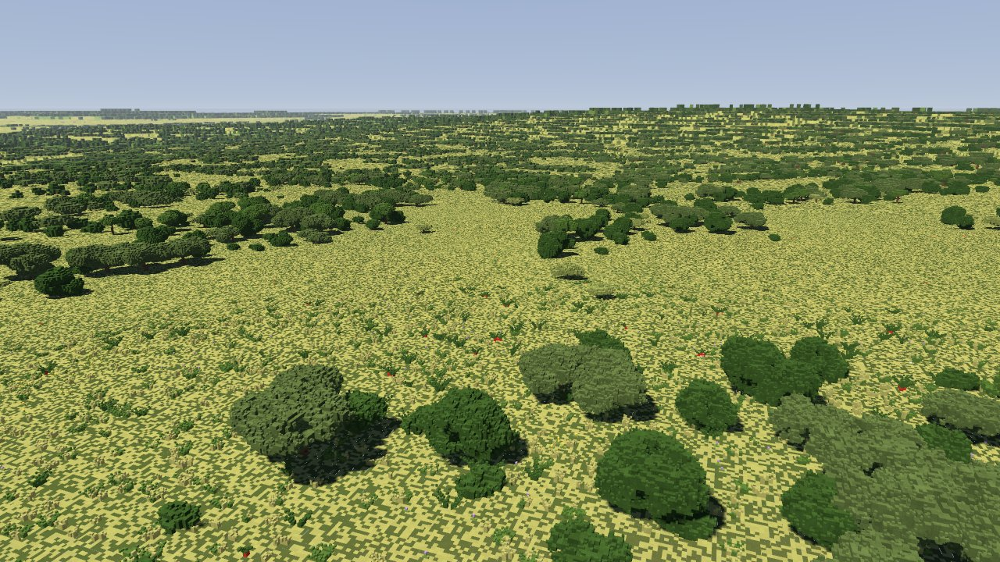
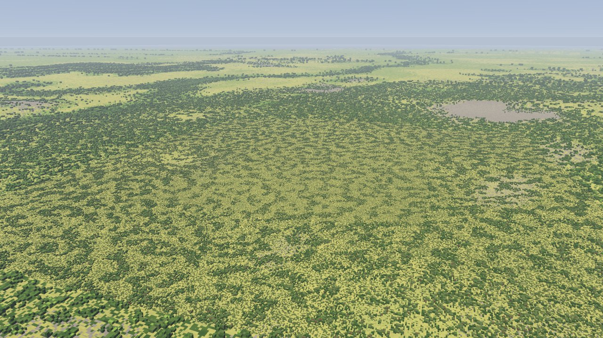
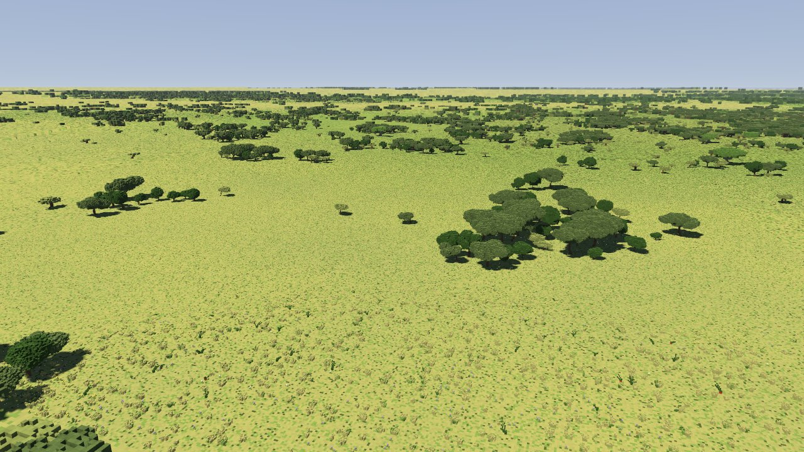
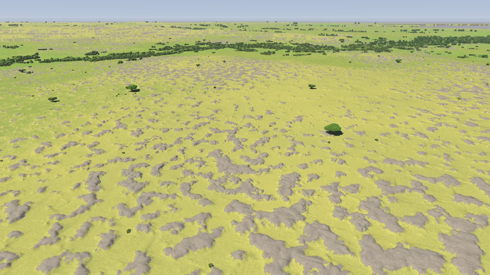
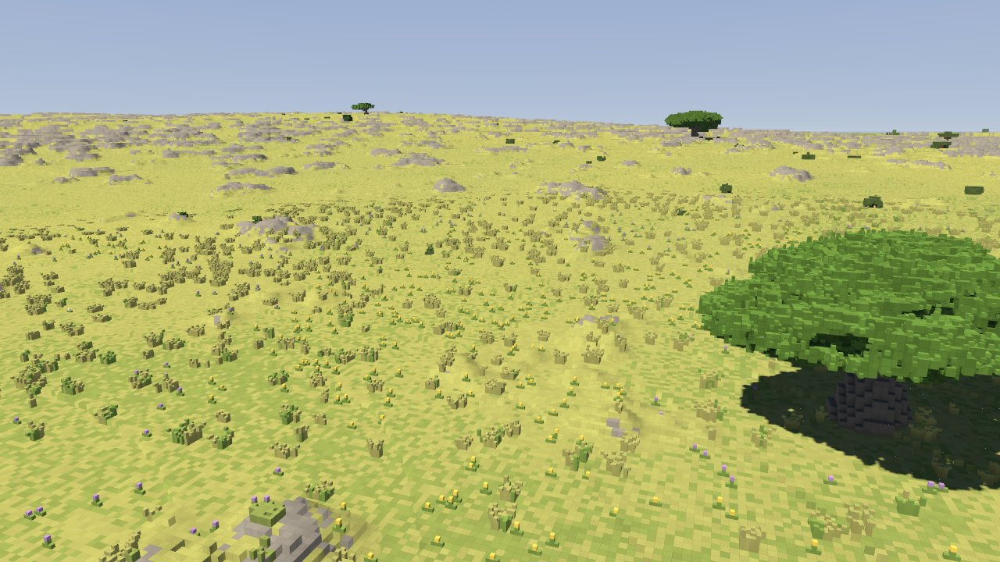

# Atlas ecológico: ecosistemas del Uruguay por período

> Documento de sistema. Estado: **implementado** en el constructor
> (`tools/mapa_real/atlas_ecologico.py`), los datos (`assets/mapas/uruguay/ecosistemas.bin` y
> `.json`, `assets/mapas/montevideo/ecosistemas.bin` y `ecosistemas_amplio.bin`) y el motor
> (`engine/src/ecosistemas.rs`; capa «Ecosistemas» del mapa del país; terreno y flora de la
> ciudad y el entorno en `terrain.rs` y `trees.rs`, marcados `// [atlas]`).
> Especificación de partida: *Atlas ecológico e histórico del Uruguay*, v1.0 (documento de
> trabajo aportado por el usuario, 23/11/2026), copia en [`docs/fuentes/`](../fuentes/Atlas_ecologico_historico_del_Uruguay.pdf).

Marcas: **[F]** dato con fuente leída; **[E]** estimación o decisión de diseño.











## Qué se tomó del atlas

El atlas no trae polígonos: es una especificación. De él se tomó:

1. **La leyenda** con sus códigos, tal cual, como números estables (no cambian nunca; los dos
   archivos y el motor usan los mismos). El atlas tiene **18 clases** (no 21):

   | n | Código | Clase | n | Código | Clase |
   |---|---|---|---|---|---|
   | 1 | PR01 | Pradera natural | 10 | FO05 | Monte psamófilo/costero |
   | 2 | PR02 | Pastizal ralo sobre suelos superficiales | 11 | PA01 | Palmar de butiá |
   | 3 | PR03 | Pastizal denso | 12 | PA02 | Palmar de yatay |
   | 4 | PR04 | Pastizal alto y denso | 13 | HU01 | Bañado / pastizal inundable |
   | 5 | SH01 | Chircal y matorral | 14 | AQ01 | Vegetación acuática y de orilla |
   | 6 | FO01 | Monte ribereño/fluvial | 15 | CO01 | Arenales, dunas y costa abierta |
   | 7 | FO02 | Monte de quebrada | 16 | SA01 | Blanqueales/suelos alcalinos |
   | 8 | FO03 | Monte serrano | 17 | AN01 | Sabana arbolada / arbolado disperso |
   | 9 | FO04 | Bosque parque / espinal | 18 | AN02 | Ecotono bosque-pradera |

   Extensiones del juego (no son del atlas, que pide no mezclar nativo con plantado ni con lo
   urbano): **40 PL01** plantación forestal, **41 UR01** área urbana, **42 TR01** cobertura
   transformada sin dato por celda. Los colores son de trabajo (el atlas dice que los suyos
   también lo son), ajustados para leerse sobre el mapa.
2. **La matriz regional** (§3) por departamento. Tacuarembó, Soriano y Colonia no figuran en
   la tabla: Tacuarembó va con «Rivera y noreste» y Soriano y Colonia con «litoral oeste»
   (donde el manual del MGAP ubica el bosque parque) **[E]**. La «costa platense y atlántica» es
   la franja de 6 km sobre el Río de la Plata y el océano **[E]**.
3. **Los gradientes** (§3): geología y profundidad del suelo, retención de agua, pendiente,
   distancia a cursos, inundabilidad, salinidad/viento y uso humano.
4. **Los campos por celda** (§7): código primario y secundario, densidad arbórea (ausente, muy
   baja, baja, media, alta; más «sin dato»), altura del dosel (nula sin fuente), evidencia
   (documentado / inferencia ecológica / desconocido), confianza (alta, media, baja) y fuente.
   La región sale del departamento; el período, de la capa.
5. **Los períodos** (§5) como capas completas con intervalo, sin interpolar.
6. **Las reglas de integridad** (§7), verificadas por pruebas.

## Formato

Un `.bin` por escala (formato `ECO1`): cabecera, y por capa el intervalo de años en que rige y
la grilla comprimida con zlib, 6 bytes por celda (primario, secundario, densidad, dosel en dm,
evidencia | confianza << 4, fuente). Leyenda, fuentes, capas, reglas, estadísticas y las cifras
de MapBiomas por departamento van en `assets/mapas/uruguay/ecosistemas.json`; la sección
`ecosistemas` de `assets/mapas/montevideo/meta.json` describe las grillas de la ciudad.

| Grilla | Tamaño | Celdas | Capas |
|---|---|---|---|
| País (la de `geologia_pais.bin`) | 510 × 557, ~1 km | 284.070 | 5 (490 KB) |
| Entorno de la ciudad (la de `contexto.bin`) | 741 × 741, 100 m | 549.081 | 2 (208 KB) |
| Entorno amplio (la de `amplio.bin`) | 601 × 601, 500 m | 361.201 | 2 (147 KB) |

### Capas por período (país)

| Rige | Período | Qué cambia |
|---|---|---|
| hasta 1859 | 1750–1800 | Base colonial. El juego arranca en 1726 con esta capa. Gautreau no encuentra cambios radicales de la distribución general antes de mediados del XIX **[F, vía el atlas §5]** |
| 1860–1899 | 1860–1900 | Igual, salvo el parque agregado en Colonia, que pasa a **desconocido** (no hay cifras entre 1835 y 1966) |
| 1900–1949 | 1900–1950 | **Forestación costera de Canelones** (PL01, plantación): 9 celdas, más de 800 ha entre Las Toscas y Parque del Plata **[F, atlas citando a Porcile]** |
| 1950–1984 | 1950–2000 | Colonia según la cartografía de 1966 (el parque agregado vuelve a pradera); bañados de la cuenca de la Merín con evidencia **desconocida** (drenaje y arrozales sin dato por celda) |
| desde 1985 | 1985–2025 | Lo observado: monte 2021 (documentado, alta), pastizales del MGAP, palmares, localidades (UR01); donde hoy no hay pastizal ni monte, TR01 (sin dato por celda) |

Las grillas de la ciudad tienen la base y, desde 1900, la plantación de Canelones (que cae en
el entorno amplio, 34 muestras). El terreno de la ciudad usa siempre la base (es el de 1726).

## Cómo se infiere cada clase (país)

Todo es inferencia por gradientes salvo donde se dice. «Monte» = fracción de la celda con
polígonos de la DGF 2021 de 30 ha o más (presencia observada hoy).

| Clase | Regla | Evidencia · confianza · fuente |
|---|---|---|
| PR01–PR04 | Comunidad de pastizal del raster del MGAP (30 m, 5 × 5 muestras por celda): «Pastizales del Este» → PR04; densos (basalto o centro-sur) → PR03; ralos → PR02. Donde hoy no hay pastizal (cultivo, forestación), la comunidad observada más cercana hasta 6 km (mismo sustrato); si no, PR01. Sin observación, pendiente ≥ 25 ‰ sobre basalto o cristalino → PR02 | inferido · media con observación, baja sin ella · pastizales / DINAMIGE |
| SH01 | Secundario: regiones donde el atlas nombra chircas o matorrales (Rivera y noreste, centro, sur), pendiente 12–45 ‰ sin monte | inferido · baja |
| FO01 | Monte a ≤ 1,5 km de un curso (ríos con nombre o drenaje de más de 40 km² del relieve de 1 km). Primario con monte ≥ 30 %, si no secundario. Valles de los embalses (en 1750 eran río): FO01 + AQ01 | inferido · media/baja · DGF 2021 |
| FO02 | Monte con relieve local ≥ 70 m en 3 km y pendiente ≥ 30 ‰ en el norte, noreste, sierras y este. Cerca (8 km) de Lunarejo, Valle Edén y Quebrada de los Cuervos: documentado | inferido · media; documentado · media cerca de los sitios · MGAP manual |
| FO03 | Monte en sierras del este, este y noreste con pendiente ≥ 22 ‰ o cristalino con relieve ≥ 45 m | inferido · media · DGF 2021 |
| FO04 | Monte lejos de cursos y en llano en el litoral, el norte y el centro (el atlas: «manchas de bosque parque» en el centro) | inferido · media · DGF 2021 |
| FO05 | Monte a ≤ 3 km de la costa sobre arenas o por debajo de 15 m | inferido · media |
| AN02 | Monte que no entra en las anteriores (manchas fuera del litoral y las sierras) | inferido · media/baja |
| HU01 | Bañados de la IDE ≥ 35 % de la celda; además, planicies de menos de 15 m y 6 ‰ de la cuenca de la Merín sobre aluviones (bañados más extensos antes del drenaje) | inferido · media (IDE) / baja (Merín) |
| AQ01 | Secundario en celdas con 20 % o más de agua y en los bañados con agua | inferido |
| CO01 | ≤ 2 km de la costa sobre arenas litorales (DINAMIGE 71, 72, 73, 76) o ≤ 1 km y menos de 10 m; FO05 de secundario si hay algo de monte | inferido · media sobre arena, baja si no |
| SA01 | Secundario: terrazas llanas (< 8 ‰, < 60 m) a ≤ 15 km del Río Uruguay en el litoral y el norte, fuera del basalto | inferido · baja |
| PA01 | Celdas aptas (< 60 m, < 30 ‰, bañado < 50 %, a más de 1,5 km del mar) de Rocha cerca de Castillos, Aguas Dulces, Barra de Valizas, San Luis al Medio y 18 de Julio, hasta **70.000 ha** **[F: Rosa et al.]**; el orden suma a la distancia la altura, la pendiente (llanos bajos, suelos pesados y húmedos, MGAP §3.5) y un ruido suave de semilla fija, para que el borde siga el terreno y no sea un círculo | documentado · media a ≤ 6 km de esas localidades; inferido · baja más lejos · Rosa et al. |
| PA02 | Núcleos de Quebracho (1.560 ha) y Guichón (310 ha) con su área de 2013 **[F: Bortolini y Brazeiro]**; secundario en suelos arenosos y bien drenados (Tacuarembó, Guichón, Mercedes, Salto) a ≤ 8 km, hasta una décima del rango de extensión de 1.450 km² **[E]** | documentado · media a ≤ 2 km; inferido · baja |
| AN01 | **No se asigna**: el atlas pide una fuente ecológica específica y no la hay | — |

**Colonia** (el único caso cuantificado del atlas): el monte no ribereño pasó de ~271 km²
(11,3 %) en planos de 1821–1835 a 107 km² (4,5 %) en 1966 en una zona del departamento
**[F, atlas citando a Gautreau]**. En el país, el monte no ribereño de Colonia que ve la DGF 2021
suma 66 km²; para la base se multiplica por 271/107 (168 km²), agregando parque (FO04, densidad
media, cobertura supuesta de 25 % por celda **[E]**) alrededor de los parches que quedan, en
llano, lejos de los cursos y de la costa: 407 celdas, inferido, confianza baja. Es un resultado regional: no se aplica a otro departamento.

**Densidad arbórea**: con monte observado, por las clases de Gautreau (2006, nota 297) **[F]**:
menos de 10 % pradera o arbustal, 10–40 % monte parque abierto, más de 40 % monte cerrado →
baja / media / alta. Pradera sin monte: «muy baja» (árboles sueltos; los testimonios de 1726
describen campos casi sin árboles). Dunas y bañados: ausente. Lo demás, «sin dato».

**Altura del dosel** (solo con fuente): FO02 20 m (estrato superior 20–25 m, MGAP §3.3) **[F]**;
FO05 4,8 m (3,5–6 m, máx. 8, MGAP §3.6) **[F]**; PA02 8 m (adultos de 6–10 m, Bortolini y
Brazeiro) **[F]**; FO03 3 m y FO01 del sur y el este 5 m (Carrere 1990, ver
`monte-1726-fuentes.md`) **[F]**. El resto queda nulo (sin fuente).

## Ciudad y entorno

Las mismas reglas, con datos más finos:

- **Entorno (100 m)**: monte de la reconstrucción de 1726 del juego (`bosque_contexto.bin`):
  ≥ 35 % FO01, 12–35 % AN02 (ecotono con FO01 de secundario); pastizal del raster del MGAP si
  se observa, si no por **CONEAT**: roca a la vista ≥ 8 % o índice de productividad < 55 → PR02,
  ≥ 110 → PR03, lo demás PR01; chircal (SH01) secundario en laderas de 30–90 ‰ sin monte y
  donde la roca pasa el 15 %; bañados y playas de los biomas oficiales; dunas por la distancia
  al río y la geología.
- **Entorno amplio (500 m)**: monte 2021 de 3 ha o más (`amplio_cobertura.bin`): FO03 en el
  cristalino de las sierras (pendiente ≥ 70 ‰ o relieve ≥ 60 m, por encima del fondo del valle),
  FO01 en el fondo de los valles, FO04 en Colonia y el centro, AN02 lo demás; PR02 en el
  cristalino empinado; costa y bañados como en el país.

### En el motor

- `TerrainGen::ecosistema(x, z)`: la celda de la capa base (entorno o amplio, con el punto
  corrido al azar por vóxel para que los bordes sean bandas).
- **Pradera** (`biome`): PR02 más seca (pastizal ralo), PR03 algo más verde, PR04 verde.
- **Entorno amplio** (`wide_biome`): FO03 mosaico de monte, roca y pasto seco; PR02 pasto
  seco con piedra; FO04 copas separadas sobre la pradera; FO05 macizos entre la arena; CO01
  arena; HU01 bañado; AN02 monte y pasto verde mezclados.
- **Árboles** (`trees_in`): **monte serrano** en bosquecillos redondos separados por pradera
  (coronilla, molle, tala, canelón, espinillo), bajos (55 % de la altura), en FO03; ahí también
  el monte del raster de 2021 se ralea fuera de los bosquecillos (`raster_forest`), así la sierra
  no queda cubierta de monte (el atlas: «no cubrir toda la sierra de árboles»); **bosque parque / espinal** con árboles separados
  (espinillo, tala, algún ombú; 3,5 % de las celdas de 7 m, ~1 cada 1.400 m²) en FO04 y menos en
  AN02 o con FO04 de secundario; **chircas** en manchas donde hay SH01. La **chirca** es una
  especie nueva en `trees.rs` (mata baja y redonda de 1,5 m, verde grisácea, cuatro variantes).
- **Cámara**: sin partida (paisaje del mapa real) la cámara puede ir al entorno amplio
  (`session.rs`, hasta ±150 km); en el juego sigue dentro del mapa.
- **Costo** (llvmpipe, 1280 × 720, `MOTOR_VISTAS=atlas motor --mapa real --auto-test`): las
  vistas del mapa jugable quedan en 3,8 M triángulos; el monte serrano de cerca, 9,3 M (antes de
  ralear el monte del raster eran 21,9 M: la sierra quedaba cubierta de monte cerrado); el parque
  de Colonia, 5,5 M.
- El mapa jugable casi no cambia: su monte sigue siendo el de 1726 (4,2 % de la tierra); suma
  chircas en las laderas y la pradera de los suelos superficiales más seca.
- **Palmeras**: el entorno amplio va de 57,8° a 54,6° O y de 33,5° a 36,2° S: no llega a los
  palmares de Rocha (Castillos, 53,9° O) ni a los de yatay (Paysandú). No se agregó la palmera
  en vóxeles; los palmares solo se ven en el mapa del país.

### Mapa del país

Capa **Ecosistemas** (casilla en el panel; apaga la de recursos): el color de la clase con la
luz del relieve, el secundario como un punto en cada celda (mosaico) y la evidencia
desconocida rayada. La leyenda muestra las clases de la capa del período del año; la ficha de
una celda dice código, nombre, mosaico, árboles, dosel, evidencia, confianza, período y fuente,
y desde 1985 las cifras de MapBiomas del departamento (sin compararlas con las históricas). Los
embalses se dibujan como agua desde el año de su represa.

## Resultados (capa base, celdas de ~1 km²)

PR03 107.896 · PR01 23.502 · PR02 17.903 · FO01 9.484 · HU01 4.722 · PR04 3.094 · FO04 2.386
(407 del parque agregado en Colonia) · AN02 1.858 · FO02 1.658 · FO03 1.559 · PA01 709 · CO01 630 ·
FO05 46 · PA02 20. Desde 1985: TR01 50.217 (pradera transformada sin dato por celda), UR01 2.187.
Las celdas con algo de monte de la DGF suman ~5 % del país, como la cifra del MGAP (5,2 % de la
superficie agropecuaria) **[F]**.

Para comparar (sin mezclar métodos): MapBiomas col. 4 da, por ejemplo, para Colonia 287 → 267 km²
de bosque natural (1985 → 2025) y 2.141 → 1.119 km² de pastizal natural **[F]**.

## Fuentes

Leídas:

- *Atlas ecológico e histórico del Uruguay*, v1.0 (documento de trabajo, 23/11/2026).
- P. Gautreau, tesis doctoral (Université de Lille 1, 2006):
  <https://pepite-depot.univ-lille.fr/LIBRE/Th_Num/2006/50376-2006-Gautreau.pdf> — clases de
  densidad leñosa (nota 297) y de altura (nota 296), concentración del monte (las sierras del
  este y del norte, las galerías del Cuareim, Arapey, Daymán, Queguay, Yí, Tacuarembó y Río
  Negro con 3–7 %, la mayor parte del país con menos de 3,6 %), progresión leñosa 1966–2004 en el
  sector de Minas, palmar de yatay de Quebracho y de Porrúa. **No** se encontró en la tesis la
  cifra de Colonia (271 → 107 km²): se toma del atlas.
- P. Gautreau, *El manejo del monte nativo: un tema a pensar dentro del predio rural*
  (cdn.biodiversidadla.org).
- MGAP-DGF, *Actualización del Manual de Manejo de Bosque Nativo en Uruguay*, 1.ª ed., abril de
  2018 (<https://www.gub.uy/ministerio-ganaderia-agricultura-pesca/book/15199/download>), cap. 3:
  tipos de bosque (fluvial, parque y blanqueales, quebrada, serrano, palmares, psamófilo) con
  ubicación, estructura y alturas.
- MGAP-DGRN, Cartografía de pastizales del Uruguay (raster de 30 m, 5 comunidades):
  <https://descargas.mgap.gub.uy/DGRN/Comunicaciones/Pastizales%20del%20Uruguay.zip> y la página
  «Campo natural» del MGAP (nombres de las cinco comunidades). La correspondencia del valor 1
  («Pastizales del Este») con la comunidad V (altos y densos) es **[E]**.
- S. V. Bortolini y A. Brazeiro, *Distribución, abundancia y estado de conservación de los
  palmares de Butia yatay en Uruguay* (MGAP, 2020): tres núcleos (Quebracho 1.560 ha, Santo
  Domingo 826 ha, Guichón 310 ha), rango de 1.450 km², 27 km² ocupados, adultos de 6–10 m,
  Mujica y Porrúa desaparecidos.
- Rosa et al., campo natural del palmar de butiá de Castillos (Agrociencia Uruguay;
  alice.cnptia.embrapa.br): ~70.000 ha en Castillos y San Luis, 50–600 palmas por hectárea.
- MapBiomas Uruguay, colección 4, estadísticas por departamento 1985–2025
  (`mapbiomas-uruguay-collection-4-lulc.xlsx`, página de descargas de estadísticas).
- Los datos que ya tenía el juego: DGF 2021, bañados y MDT de la IDE, geología de DINAMIGE,
  CONEAT, hidrografía y localidades del MTOP.

No se pudieron leer:

- Gautreau, *La evolución histórica de los montes nativos del actual Uruguay* (PDF del
  Zoológico de Montevideo): el servidor responde «Acceso restringido» (403) y WebFetch se cortó
  por tiempo.
- Lezama et al. (PDF del repositorio de la UBA): 401. Se usó en su lugar el raster oficial del MGAP.
- Porcile Maderni (2007): no se buscó el original; la forestación de Canelones sale del atlas.
- MapBiomas por píxel (mapas anuales de 30 m): requiere Google Earth Engine o descargas grandes;
  solo se usaron las estadísticas.
- Jardín Botánico de Montevideo, «Palmeras y palmares» (403).

## Límites

- Nada de esto es un mapa histórico validado: es la especificación del atlas aplicada con
  reglas por gradientes a datos de hoy. La base de 1750 parte del monte de 2021 (Gautreau y el
  MGAP muestran que el monte serrano y parte del fluvial **crecieron** en las últimas décadas,
  y que el parque se perdió sobre todo en Colonia y Soriano): fuera de Colonia no se corrige.
- Las cifras de cobertura no se trasladan de una fecha a otra; el único ajuste cuantitativo es
  el regional de Colonia.
- Los palmares de butiá se reparten por cercanía a localidades documentadas hasta el área
  documentada; la forma real de los palmares no está en las fuentes leídas. Santo Domingo
  (yatay) no se ubicó; India Muerta no se confirmó como palmar.
- Los sitios de quebrada tienen coordenadas aproximadas **[E]**.
- En la escala de 1 km las galerías angostas (< 200 m) son secundarias o no aparecen.
- El terreno de la ciudad usa siempre la capa base; los períodos solo se ven en el mapa del país.

## Pruebas

`ecosistemas::tests`: códigos estables y leyenda completa (y la misma que el JSON);
reglas de integridad en las tres grillas (evidencia, confianza y fuente válidas en todas las
celdas, ninguna plantación, área urbana ni cobertura transformada antes de 1900, sin AN01,
desconocido nunca con confianza alta, lo documentado con fuente, lo plantado sin dosel nativo);
forestación de Canelones solo desde 1900 y en su costa; palmares de butiá solo en Rocha y de
yatay solo en Paysandú y Río Negro, con su área; quebradas documentadas con FO02; lectura
determinista. `terrain::tests::ecosistemas_del_atlas_en_el_terreno`: monte serrano bajo en las
sierras de Maldonado, chircas solo en el chircal, pastizal ralo más seco, árboles deterministas.
El constructor es determinista (dos corridas dan los mismos bytes).

## Cómo regenerar

```
python3 tools/mapa_real/atlas_ecologico.py --pastizales "/ruta/Pastizales del Uruguay.tif" \
    --cache /ruta/cache/del/pais --mapbiomas /ruta/mapbiomas-uruguay-collection-4-lulc.xlsx
```

Necesita `numpy`, `Pillow`, `pyproj` y `openpyxl` (este último solo para MapBiomas). La caché
del país da las localidades del MTOP (`mtop_localidades.geojson`). Tarda unos 12 s.
