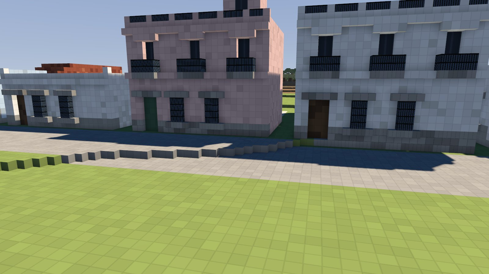
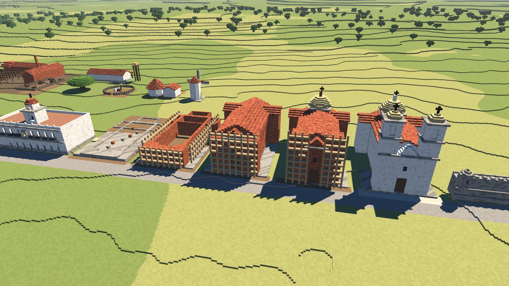

# Estética de las estructuras en vóxeles

> Documento de dirección de arte. Complementa a [motor-voxel.md](motor-voxel.md) y a la
> [época colonial](../epocas/01-colonial.md) (secciones 4 y 12).
> Estado: **implementado en el motor** para la época colonial (`engine/src/structures/`).



## 1. Idea

**Vóxeles a la vista, arquitectura reconocible.** Cada bloque de 0,5 m de la obra se nota (bordes,
tono por bloque, oclusión ambiental), pero las proporciones, los materiales y los detalles
son los de la arquitectura colonial rioplatense: fachadas sobre la línea de la calle, cal,
rejas voladas, azoteas con pretil, teja, paja, piedra.

Tres reglas guían todo:
1. **La silueta y el color del techo se leen desde lejos.** El resto se pierde con gracia.
2. **Profundidad antes que color.** Un vano rehundido medio metro (con su sombra) dice más
   que una ventana pintada.
3. **Nada perfectamente nuevo.** Cada material tiene variación por bloque y desgaste.

## 2. Escala: ¿hace falta un vóxel más fino que 0,5 m?

**Decisión (actualizada):** el mundo usa vóxeles de **0,25 m** (terreno, monte, flora baja,
calles y puentes), pero los edificios se siguen **diseñando** en vóxeles de 0,5 m
(`lod::DESIGN_VOXEL`): cada vóxel de diseño ocupa un bloque de 2 × 2 × 2 vóxeles del mundo,
y el shader marca bordes y tinte por vóxel de diseño en los materiales de obra. Así el
catálogo no cambió y las medidas reales son las mismas. El detalle menor que 0,5 m de los
edificios lo sigue dibujando el shader por material. Ver
[motor-voxel.md §16](motor-voxel.md#16-vóxel-de-025-m).

**Por qué 0,5 m alcanza para la obra** (medidas coloniales → vóxeles de diseño):

| Elemento | Medida real | Vóxeles |
|---|---|---|
| Altura de planta baja | 4,5–5 m | 9–10 |
| Altura de planta alta | 4 m | 8 |
| Puerta / zaguán | 1,5 × 3 m | 3 × 6 |
| Ventana | 1 × 2 m, antepecho de 1 m | 2 × 4, desde y = 2 |
| Zócalo | 1 m | 2 |
| Pretil | 0,5–1 m | 1–2 |
| Muro de fachada | 0,5–0,9 m | 1–2 (el vano se rehunde 1) |
| Frente de solar | 12 m | 24 |
| Cuadra | 84 m | 168 |

Lo que **no** entra en 0,5 m son los barrotes de las rejas (2–3 cm), los canales de las
tejas, las hebras de la paja y las juntas de la sillería. Para eso hay dos caminos:

- **Micro-vóxeles de 0,25 m en los edificios** (descartado por ahora; el mundo ya es de
  0,25 m, pero los edificios solo ocupan bloques de 2 × 2 × 2: la medida que sigue era con el
  almacén viejo, hoy son ~5 bytes por vóxel). Medido en la escena
  de la ciudad: 4,3 millones de vóxeles editados ocupan unos 260 MB, unos **80 bytes por
  vóxel editado** contando todas las copias por nivel de detalle. A 0,25 m serían 8 veces
  más (~34 millones) → **~2,7 GB** solo de ediciones, más un nivel de detalle extra y del
  orden de 4 veces más triángulos cerca de la cámara. No es viable con el almacenamiento
  actual.
- **Detalle por material en el shader** (elegido). Cero memoria extra: el número de
  material viaja en el vértice y el shader dibuja barrotes cada 12,5 cm, canales de teja de
  25 cm, hebras de paja, juntas de sillares, el damero de azulejos de las cúpulas y el borde
  de los cueros estaqueados. Se apaga con la distancia (por `fwidth`) para no hacer ruido.

Si más adelante el almacenamiento pasa a ser por chunks comprimidos (paleta + RLE) en vez
de un `HashMap` de ediciones, conviene volver a medir los micro-vóxeles solo para el nivel 0.

**Orientación:** los edificios se alinean a los cuatro ejes cardinales. En vóxeles, una casa
girada 17° se ve "serruchada". Las calles curvas del prototipo se resolverán con solares
escalonados a lo largo de la curva (cada solar recto), como en las ciudades reales.

## 3. Paleta y desgaste

El desgaste se aplica al construir, vóxel a vóxel, con un hash determinista de la posición
y la semilla del edificio (`structures::weather`):

| Material | Variantes | Regla |
|---|---|---|
| Cal (blanca, ocre, rosa viejo, celeste) | manchada | 7 % de los bloques; **35 % en las tres hiladas de abajo** (la humedad sube del suelo) |
| Teja | oscura, clara | 22 % oscura, 12 % clara: techo con tonos, no plano |
| Paja | vieja | 30 % más oscura |
| Adobe | húmedo | la hilada del suelo siempre, y 20 % del resto |
| Madera | oscura | 30 % |
| Ladrillo | oscuro | 30 % |
| Piedra (sillería) | oscura | el tono cambia **por sillar** (dos vóxeles en tresbolillo), no por vóxel |

Además el shader varía el tono de cada bloque un ±8 % y marca sus bordes, como en todo el
mundo de vóxeles. La paleta completa está en `engine/src/palette.rs`.

**Proporción de revoques en la ciudad colonial:** la cal blanca domina (50 %); ocre, rosa
viejo y celeste (cada uno ~17 %) dan la variedad de fachada sin perder la unidad.
Desde la variedad de la arquitectura, los colores de cal de las casas siguen los pesos de cada
época y clase de la guía de fuentes (ver [arquitectura-colonial.md](arquitectura-colonial.md)).

## 4. Lectura a distancia

El motor reduce las ediciones a cada nivel de detalle quedándose con el vóxel fino **más
alto** de cada celda. Por eso el diseño prioriza lo que se ve desde arriba:

| Nivel | Vóxel | Qué se conserva |
|---|---|---|
| 0–1 | 0,25–0,5 m | Todo: vanos rehundidos, rejas, balcones, cornisas, desgaste, dibujos del shader |
| 2 | 1 m | Ventanas y puertas (1–1,5 m de ancho), balcones, mirador, chimeneas |
| 3 | 2 m | Silueta, color del techo (teja, azotea, paja), pretiles, patios |
| 4+ | 4 m o más | Masa del edificio y color del techo: la "textura" de la ciudad desde lejos |

Consecuencias de diseño:
- **El techo es la firma de cada tipo**: azotea rojiza con pretil blanco (casa de azotea),
  azotea con mirador (casa de altos), paja amarilla (rancho), teja a dos aguas (galpones,
  iglesia, estancia), cúpula ocre (iglesia).
- Los patios llevan baldosa clara y las huertas verde: de lejos, la manzana se lee como
  la manzana colonial (casas al frente, patios y fondos verdes adentro).
- Los dibujos finos del shader desaparecen a lo lejos y queda el color medio del material.

## 5. Sistema modular de kits

Cada edificio se arma sobre un **marco** (`Frame`): `u` a lo largo del frente, `w` hacia el
fondo (0 = línea de calle, negativo = vereda), `y` hacia arriba. Las piezas:

| Capa | Piezas (`engine/src/structures/mod.rs`) |
|---|---|
| **Zócalo** | `zocalo` (revoque húmedo o piedra, 2 hiladas), `foundation` (en laderas el zócalo baja hasta el terreno) |
| **Cuerpo** | `fill`, `ring` (muros y patios), `opening` (vano rehundido) |
| **Coronación** | `cornisa` (hilada volada), pretil con pilastras o balaustrada, almenas |
| **Aberturas** | `window_reja` (vidrio rehundido + reja volada + alféizar + guardapolvo), puertas y zaguanes con dintel de piedra, `balcony` (losa volada y baranda de 1 m), `arch` (arco de medio punto) |
| **Techos** | `gable` (teja a dos aguas, pendiente 1:2 ≈ 27°, hastiales en el material del muro), `thatch_roof` (paja a 45°, gruesa, alero caído), media agua, `cone`, `dome` |
| **Elementos** | `chimney`, `aljibe` (brocal, boca y arco de hierro), mirador, `fence` y `round_fence` (palo a pique), `scaffold` (andamios), `ombu`, `animal` |

Las variantes son **procedurales y deterministas**: cada edificio recibe una semilla y de
ella salen el revoque, el lado del zaguán, el balcón corrido o los balcones sueltos, el
remate del pretil, la media agua del fondo, el horno o el corral. La misma semilla siempre
da la misma casa (hay un test que lo verifica).

## 6. Catálogo colonial implementado

`engine/src/structures/colonial.rs`:

| Estructura | Rasgos |
|---|---|
| Rancho | Adobe con hilada húmeda, paja a dos aguas, retirado de la calle, horno de barro, huerta, corral de palo a pique |
| Casa de azotea | Sobre la línea de la calle, zócalo, zaguán, rejas voladas, cornisa, pretil, ala lateral, patio de baldosa con aljibe, chimenea; variante con media agua de teja |
| Casa de altos | Dos plantas, zócalo de piedra, cornisas, puertas-ventana con balcones (sueltos o corrido), pretil con balaustrada, mirador |
| Pulpería de esquina | Ochava con la puerta y el letrero, reja de mostrador, ventana lateral, palenque y barrica en la vereda |
| Cabildo | Recova de arcos con galería de 3 m, balcones, escudo, pretil, torre con reloj, campanario y cupulín |
| Iglesia matriz | 5 fases de obra (abajo) |
| Muralla | Talud, cordón, adarve, almenas; portón con arco, pilastras, escudo y hojas abiertas; garita volada con cupulín |
| Muelle y barraca | Cubierta sobre pilotes hasta el lecho del río, bolardos, lancha amarrada; galpón de ladrillo con teja, portón y fardos |
| Saladero | Galpón abierto y depósito, grasería con chimenea y calderos, tendederos de cueros, corral con ganado |
| Casco de estancia | Casa encalada con galería de horcones y media agua, aljibe, mangrullo, corral redondo con caballos, ombú |
| Atahona | Construcción redonda con techo cónico, depósito con bolsas de harina, carro |
| Molino de viento | Torre encalada, capucha de teja, aspas con lona |

**La iglesia matriz por fases** (el gran proyecto de la época):

| Fase | Qué se ve |
|---|---|
| 1. Cimientos | Planta marcada en piedra, sillares y ladrillos acopiados, arena |
| 2. Muros | Muros de **ladrillo** a media altura, andamios en tres lados |
| 3. Naves con techo | Muros completos, teja en nave, crucero y ábside, frontón, puerta en arco, andamio en la fachada |
| 4. Cúpula | Tambor con ventanas, cúpula de azulejo, linterna y cruz; andamios en las torres a medio hacer |
| 5. Torres | Torres con campanarios en arco y cupulines; **todo revocado a la cal**, sin andamios |



## 7. El kit a lo largo de las épocas

Las mismas piezas cambian de material y proporción; las épocas posteriores agregan piezas.

| Época | Cambios del kit |
|---|---|
| 1. Colonial | Lo descrito arriba |
| 2. Ciudad Nueva | Pilastras y frontis neoclásicos, balaustradas de piedra, ventanas más altas, faroles a gas en la fachada, quintas con galería |
| 3. Inmigración | Fachada italianizante: cornisas con ménsulas, pretiles calados, puertas de hierro y vidrio, cúpulas de esquina, casa de patios en hilera, conventillo |
| 4. Art Déco | Volúmenes escalonados, bandas horizontales, ventanas en esquina, balcones curvos (en vóxeles, escalonados), primeros edificios de 6–10 plantas |
| 5. Modernismo | Hormigón, pilotis, balcones corridos, ladrillo visto y bóvedas (guiño a la tradición uruguaya del ladrillo armado) |
| 6. Contemporánea | Vidrio, madera, terrazas verdes, rehabilitaciones que conservan la fachada colonial y suman pisos atrás |

## 8. Ver el catálogo

```
cd engine
cargo run --release -- --scene catalogo --shot catalogo.png
cargo run --release -- --scene ciudad --shot ciudad.png
```

Capturas: `voxel-catalogo.jpg`, `voxel-casas-cerca.jpg`, `voxel-iglesia-fases.jpg`,
`voxel-cabildo.jpg`, `voxel-muralla.jpg`, `voxel-ciudad.jpg`, `voxel-noche.jpg`
(en `docs/capturas/`).

## 9. Pendiente

- Las juntas del terreno (escalones de un vóxel) se ven como líneas oscuras en las
  laderas; es un tema del terreno, no de las estructuras.
- Los arcos de 4 vóxeles de ancho apenas se redondean: los arcos grandes (portón, iglesia)
  se leen bien; los de la recova, más como vanos rectos.
- La garita de la muralla es legible pero tosca.
- Interiores: no hay (los edificios son macizos). La recova y la galería de la estancia
  son los únicos espacios abiertos.
- Faltan los kits de las épocas 2 a 6 y las piezas para solares escalonados en calles curvas.

## Medidas reales de la traza

La ciudad se construye a tamaño real, con las medidas de la traza colonial de Montevideo
(vara castellana = 0,866 m). Valen igual en el prototipo y en el motor.

| Elemento | Medida | Equivale a |
|---|---|---|
| Cuadra (entre ejes de calle) | 86,6 m | 100 varas |
| Calle empedrada (calzada + veredas de 1,5 m) | 10,4 m | 12 varas |
| Camino o calle de tierra | 8,7 m | 10 varas |
| Plaza mayor | 76 m de lado | una manzana |
| Solar | 12 m de frente × 38 m de fondo | 14 varas; el fondo llega al medio de la manzana |
| Planta baja / planta alta | 4,5–5 m / 4 m | — |
| Rancho | 6–7,5 × 4,5–5,5 m, 2,5 m de pared | — |

Las casas ocupan el frente del solar sobre la línea de la calle; el fondo queda para el patio,
la huerta y el corral, como en las casas de patio de la Ciudad Vieja.
