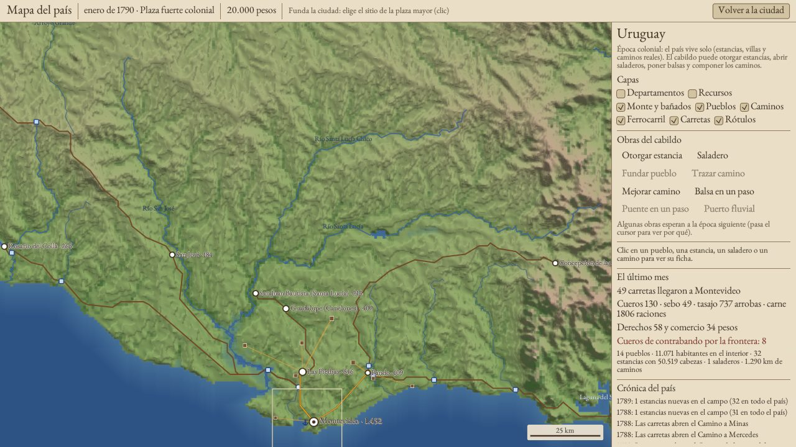
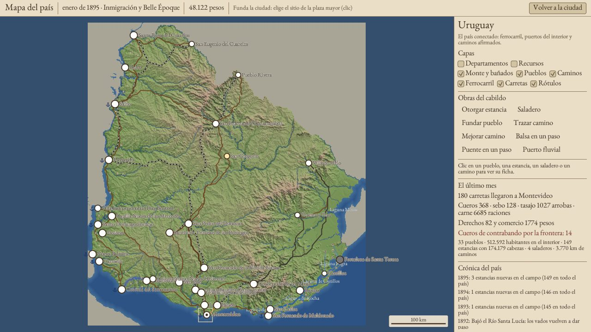
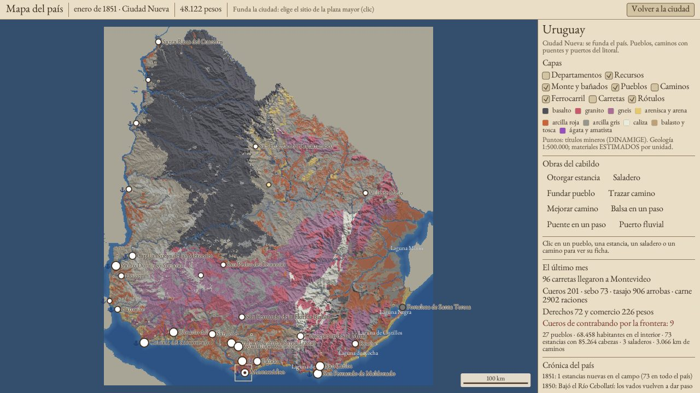
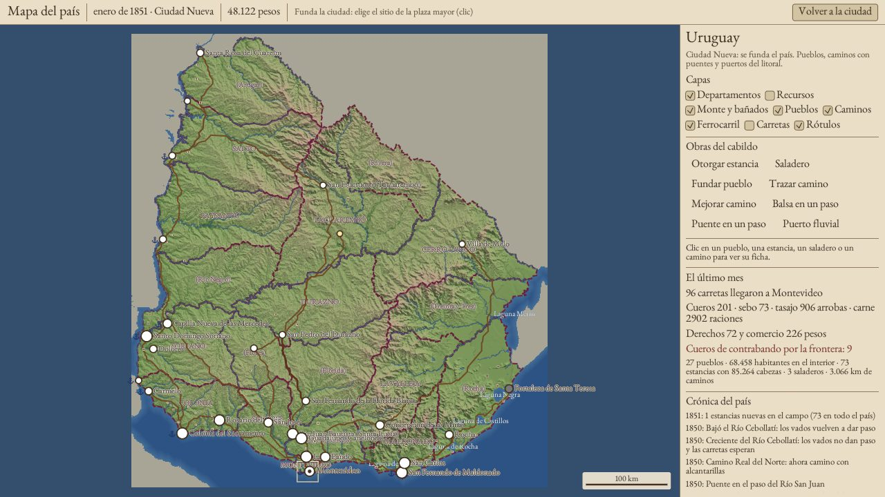

# Mapa del país (escala país)

> Documento de sistema. Estado: **primera capa jugable en el motor** (`engine/src/pais/`).
> Diseño general en [GDD §4.9](../GDD.md) («Dos escalas: la ciudad y el país»). Datos en
> `assets/mapas/uruguay/`, armados por `tools/mapa_real/construir_pais.py` y
> `tools/mapa_real/historia_pais.py`. Consultado el 18/11/2026.







## Qué es

El Uruguay entero (510 × 557 celdas de ~1 km) alrededor de la ciudad del jugador. No se
simula casa por casa: cada pueblo es un nodo con población (su pago entero), las estancias
tienen ganado, los saladeros faenan y las carretas llevan cueros, sebo, tasajo y ganado en pie
al puerto de Montevideo por la red de caminos. Lo que llega es el **aporte del interior**, que
la ciudad suma a su economía el mes siguiente (producción de cueros, sebo y carne, derechos
del tasajo y comercio con los pueblos). Lo que queda lejos y cerca de la frontera se va de
contrabando al Brasil.

Se abre con **M**, con el botón «Mapa del país» (arriba a la derecha) o desde el menú de pausa;
**Esc** o «Volver a la ciudad» vuelve. La ciudad sigue siendo su propia parte de la partida.

## Decisión: mapa estilizado, no vóxeles

A escala país una celda mide 1 km: un vóxel por celda serían cubos de un kilómetro, y el mundo
en streaming del motor (niveles de detalle, columnas, sombras, Hi-Z) está atado al marco de la
ciudad (24 km más el entorno amplio de 300 km). Rehacerlo para 500 km era mucho trabajo y
chocaba con el otro frente (época 2). Además el jugador necesita **leer** el país: rótulos,
caminos, pasos de río, flujos de carretas, departamentos y recursos. Por eso el mapa del país
es un **plano estilizado** dibujado con egui sobre una textura del relieve (3 píxeles por
celda) pintada **en terrazas** de 15 m con luz del noroeste (como vóxeles vistos desde arriba),
con hipsometría suave, monte en bloques de una celda, bañados rayados, agua con profundidad
y lo de afuera (Argentina, Brasil) llano y apagado. La textura se arma una vez por modo
(relieve o recursos, con o sin cobertura) y por los embalses que existen ese año.

## Datos y fuentes

| Dato | Fuente | Resultado |
|---|---|---|
| Relieve | IDE Uruguay, WCS `raster__mdt_pais_30m_4326` (MDT 30 m), recortes de 1° con `scaleFactor=0.1` (~300 m), 30 recortes; media de 4 × 4 muestras por celda | `relieve.bin` (máx. 451 m a 1 km) |
| Agua (Río Uruguay, Río de la Plata, Atlántico, Laguna Merín, lagunas costeras, embalses) | MTOP, WFS `dnv_sgcm:hidro_pg` con `area>500000` (`https://geoservicios.mtop.gub.uy/geoserver/wfs`) | `capas.bin` canal 0 y 1 |
| Departamentos (19) | MTOP, WFS `geoportal_capas_base:departamentos` | canal 2, contornos en `mapa.json` |
| Ríos con nombre (50: Negro, Uruguay, Yí, Santa Lucía, Cebollatí, Tacuarembó, Queguay, Cuareim…) | MTOP, WFS `rec_hidrograficos:cursos_nav_flot` (cursos navegables y flotables) | canal 5 y líneas en `mapa.json` |
| Vías férreas (515 tramos) y estaciones | MTOP, WFS `inf_tte_ttelog_ferroviario:via_prin_act`, `via_prin_inactivas`, `afe_estaciones`, `afe_estaciones_inactivas` | `mapa.json` (`vias` con año) |
| Puertos de hoy (referencia) | MTOP, WFS `inf_tte_ttelog_fluvial:puertos` | `mapa.json` |
| Localidades (para ubicar los pueblos históricos) | MTOP, WFS `dnv_sgcm:localidades_polig` | posiciones de `historia.json` |
| Bañados | IDE, WFS `hidrografia:banado_a` | canal 3 |
| Monte nativo | DGF 2021, SNIG ArcGIS REST `DGF/Monte_Nativo_2021`, polígonos ≥ 30 ha (3175) | canal 4 |
| Geología y títulos mineros | ya en `assets/datos/uruguay/` ([recursos-de-uruguay.md](recursos-de-uruguay.md)) | capa de recursos |
| Fundación de los pueblos | artículos de Wikipedia en español de cada localidad (WebFetch) | `historia.json` |
| Años del ferrocarril | Wikipedia, «Ferrocarril en Uruguay»; Canelones (1872) | `historia_pais.anio_via` |

**Qué no funcionó:** la API de Wikipedia (`es.wikipedia.org/w/api.php`) respondió 429 todo el
tiempo (se usaron las páginas por WebFetch); `ideuy:hidro_cnsolidada_l` e
`hidrografia:hidro_c_linea` de la IDE cortaron la conexión; algunas capas del MTOP dan 400 si
se pagina sin orden (se bajan de una vez); el WFS de la IDE no tiene departamentos. No se
encontró una fuente con el trazado de los caminos reales.

**Atribución** (en `mapa.json`, `atribucion`, y al pie del panel del mapa): relieve IDE Uruguay;
bañados IDE; departamentos, agua, ríos navegables, vías, estaciones, puertos y localidades
MTOP; monte nativo MGAP-DGF (SNIG). Licencia de Datos Abiertos del Uruguay.

### Grilla y archivos

La misma grilla que `geologia_pais.bin`: la celda (c, f) es lon = −58,5 + 0,0107 c, lat =
−30,05 − 0,009 f (≈ 1,005 × 0,999 km). 177.429 celdas de tierra del país (el Uruguay tiene
~176.000 km²).

- `relieve.bin`: `uint16` LE, metros = valor / 10 − 100. En los embalses, el valle de antes de
  la represa (interpolado desde la orilla, 4 m más bajo).
- `capas.bin`: 8 bytes por celda: agua natural, embalse (índice + 1), departamento, bañado,
  monte, río con nombre, pendiente (‰), libre.
- `mapa.json`: grilla, rectángulo del mapa de la ciudad, departamentos, embalses con año,
  ríos, lagunas, vías, estaciones, puertos de hoy, conteos, fuentes y atribución.
- `historia.json`: pueblos, caminos (con su trazado), puertos, estancias y saladeros de
  muestra, años de creación de los departamentos.

**Embalses con año** (antes son valle con su río): Rincón del Bonete 1945, Baygorria 1960,
Canelón Grande 1956, Salto Grande 1979 (celdas del Río Uruguay fuera del país a más de un km
del eje, entre 30,8° y 31,3° S), India Muerta 1980, Palmar 1982, Paso Severino 1987. Las
lagunas sin nombre de menos de 3 km² (tajamares y represas de riego) no se dibujan.

### Pueblos por fecha

DOCUMENTADO = el artículo de la localidad (que cita a los historiadores locales). Las
posiciones salen de las localidades del MTOP (32 de 33) o de la tabla.

| Pueblo | Año | Nota |
|---|---|---|
| Colonia del Sacramento | 1680 | portuguesa (Manuel Lobo); española desde 1777 |
| Santo Domingo Soriano | 1718 | reducción; al sitio actual en 1726 (desde 1624 en otros lugares) |
| Montevideo | 1726 | la ciudad del jugador |
| Las Piedras | 1744 | 8 de marzo de 1744 |
| Maldonado | 1755 | Viana; Pérez Montero dice fines de 1757 |
| Fortaleza de Santa Teresa | 1762 | portuguesa, tomada en 1763 |
| San Carlos | 1763 | Cevallos |
| Paysandú | 1772 | tradición (el «paso de Paisandú» figura en 1754) |
| Rosario del Colla | 1775 | Benito Herosa |
| Santa Lucía | 1781 | pobladores en 1781, cabildo en 1783 |
| Guadalupe (Canelones) | 1783 | 24 de abril de 1783 |
| Minas | 1783 | Pérez del Puerto |
| San José | 1783 | 1 de junio, Eusebio Vidal |
| Mercedes | 1788 | Castro y Careaga |
| Pando | 1788 | |
| Rocha | 1793 | Pérez del Puerto |
| Melo | 1795 | Agustín de la Rosa |
| Dolores, Belén | 1801 | ESTIMADO (sin verificar) |
| Trinidad (Porongos) | 1804 | |
| Florida | 1809 | |
| Carmelo | 1816 | Artigas |
| Salto | 1817 | fuerte de San Antonio 1757-1763; población permanente 1817 |
| Durazno | 1821 | Rivera |
| Bella Unión | 1829 | Rivera, con los guaraníes de las Misiones |
| Nueva Palmira | 1831 | ESTIMADO |
| Tacuarembó | 1832 | Bernabé Rivera |
| Artigas | 1852 | Carlos Catalá |
| Treinta y Tres | 1853 | |
| Fray Bentos | 1859 | Villa Independencia |
| Nueva Helvecia | 1862 | ESTIMADO |
| Castillos | 1866 | ESTIMADO |
| Rivera | 1867 | |

El pedido mencionaba «Canelones (Guadalupe 1783)» y «Maldonado (1755?)»: los dos quedan
confirmados con matices (Maldonado 1755-1757).

### Caminos, puertos, estancias y saladeros (ESTIMADO salvo nota)

- **33 caminos** de pueblo a pueblo con el año del pueblo más nuevo (Camino Real a la Colonia,
  a Maldonado, Real del Norte, de la costa del Uruguay, a Minas, a Cerro Largo…). La existencia
  de la ruta es la de la red de la época; el **trazado** se busca sobre el relieve real (A*:
  pendiente, ríos cruzados de frente, lejos de bañados y del extranjero).
- **Puertos** que embarcan a Montevideo: Montevideo, Colonia (desde 1777: antes es
  portuguesa), Maldonado (1757); los del litoral desde 1830 (vapores).
- **Saladeros**: Medina en el Colla 1781 y la fábrica de extracto de Fray Bentos 1863
  (DOCUMENTADOS); Paysandú y Salto (años aproximados). **Estancias** de muestra: las Huérfanas
  (jesuitas), la del Rey, la de Medina; las demás aparecen solas alrededor de los pueblos.
- **Ferrocarril**: Bella Vista–Las Piedras 1869, Santa Lucía 1872, Durazno 1874, Paso de los
  Toros 1887, Tacuarembó 1891, Rivera 1892, Minas 1888, Trinidad 1888 (DOCUMENTADOS); litoral,
  este, Mercedes, Colonia, Fray Bentos, La Paloma y ramales industriales ESTIMADOS.
- **Departamentos**: años de creación de la historia administrativa conocida (los seis de 1816;
  Paysandú, Cerro Largo y Durazno 1828; Tacuarembó, Salto y Minas 1837; Florida 1856; Río Negro
  1868; Rocha 1880; Artigas, Rivera y Treinta y Tres 1884; Flores 1885), ESTIMADOS: sin
  verificar en esta corrida. Antes de su año el rótulo va entre paréntesis.

## Ecosistemas (capa del atlas)

Capa «Ecosistemas» con la leyenda del *Atlas ecológico e histórico del Uruguay* y una capa por
período (1750–1800 hasta 1985–2025); la ficha de cada celda dice código, evidencia, confianza y
fuente. Ver [atlas-ecologico.md](atlas-ecologico.md).

## Simulación (`engine/src/pais/mod.rs`, `rutas.rs`)

Cada mes de la ciudad (el país sigue su calendario; `Game::update`):

1. **Historia**: en enero entran los pueblos, caminos, puertos, estancias y saladeros de su año;
   alrededor de cada pueblo aparecen estancias según su población (hasta 8 cerca, en pradera).
2. **Eventos** (ESTIMADO): sequías regionales (más en verano; si la ciudad está en sequía, el
   sur) que bajan la pastura al 55 %; crecientes de un río grande (más en otoño e invierno) que
   cortan sus **vados** y demoran las balsas.
3. **Ganado**: crece 2,2 % por mes × pastura (pradera llana; menos en bañado, monte o sierra)
   hasta 5000 cabezas × pastura. Los saladeros compran hasta su capacidad a las estancias a
   menos de 120 km.
4. **Red** (`Red::armar`): Dijkstra desde Montevideo, los puertos abiertos (barco a 100 km por
   día) y, desde la época 3, las estaciones del ferrocarril (300 km por día). Caminos a 10, 16,
   22 o 30 km por día según el nivel (huella, camino real, con alcantarillas, afirmado); vado 0,3
   días (cortado con creciente), balsa 0,5 (2 con creciente), puente 0. A campo traviesa, 8 km
   por día.
5. **Carretas**: cada estancia y saladero manda su carga por la mejor ruta. Se pierde 1 % por
   día (hasta la mitad); lejos (más de 8 días) y cerca de la frontera, una parte se va de
   contrabando (mucho más en la colonia). El ganado en pie solo llega al abasto desde menos de
   12 días.
6. **Pueblos**: crecen con la conexión a la capital, las estancias cercanas y el puerto; la
   capacidad y el crecimiento suben con cada época (calibrado al orden de los censos:
   interior ~66.000 en 1850 y ~510.000 en 1895 en la simulación).
7. **Aporte** a la ciudad: cueros, sebo, carne, derechos del tasajo (8 % de 1 peso la arroba)
   y comercio con los pueblos.

El ganado del juego es una muestra (las estancias del juego son grupos): 174.000 cabezas en
1895 contra millones en la realidad. Los números se ajustaron para no desbordar la economía de
la ciudad.

## Acciones y épocas

| Obra | Costo | Época |
|---|---|---|
| Otorgar estancia (merced de tierras) | 400 | todas; en pradera, a más de 6 km de otra |
| Saladero | 2500 | desde 1781; junto a un río o la costa |
| Balsa en un paso | 300 | todas |
| Mejorar camino | 10 pesos/km por nivel | hasta camino real en la colonia, con alcantarillas en la época 2, afirmado después |
| Fundar pueblo | 3000 | Ciudad Nueva en adelante; a más de 15 km de otro |
| Trazar camino (entre dos pueblos, trazado automático) | 6 pesos/km | Ciudad Nueva en adelante |
| Puente | 1500 + el ancho | Ciudad Nueva en adelante |
| Puerto fluvial | 4000 | Ciudad Nueva en adelante; sobre un río navegable o la costa |

La época sale del año (`Epoca::del_año`, modo fiel a la historia). Los botones bloqueados
dicen por qué al pasar el cursor.

## Guardar y cargar

La partida guarda `pais` aparte de `ciudad` (`SaveFile::pais`, opcional). Una partida vieja sin
país lo simula hasta su fecha al cargar (determinista). El aporte del último mes viaja con el
país y se le devuelve a la ciudad al cargar.

## Recorrido y capturas

```
motor --demo-pais carpeta --size 1280x720
```

Capturas del país en 1726, 1790, 1851 y 1895, de cerca y de lejos, con departamentos y
recursos; obras en la colonia (estancia y balsa sí, pueblo y camino no) y en la Ciudad Nueva
(pueblo, camino, puente, mejora); y «guardar y cargar el país: IGUAL · dos años después:
IGUAL».

## Calles y solares que esquivan los arroyos (`engine/src/city/cauces.rs`)

- **Solares**: ningún punto del solar en el cauce ni en una orilla de 2,5 m más el medio ancho
  del arroyo (hasta 10 m más), ni en un bañado o una laguna oficial (`Lots::valid`).
- **Damero**: sus calles se cortan a 4 m de las orillas (sin puentes; los pedazos de menos de
  20 m se descartan). Un cruce con puente se sigue haciendo con la calle recta o curva.
- **Aviso al trazar**: junto al cursor, qué arroyo cruza la calle (con su nombre oficial) y el
  largo del puente, o cuántos metros pisa un bañado.

## Pruebas

`pais::tests`: geografía real (tierra, departamentos, Laguna Merín, ríos, Bonete por año,
caminos que unen sus pueblos), pueblos por fecha (y los años verificados), carretas al puerto
y aporte a la economía de la ciudad (también por `Game::update`), días de viaje con caminos
mejores, crecientes y puentes, épocas y acciones, guardado determinista y partidas viejas,
imagen del mapa. `city::cauces::tests`: solares fuera de cauces, orillas y bañados; damero
cortado y aviso del trazado; damero sobre un arroyo sin puentes.

## Pendiente

- Pueblos jugables en detalle (ciudades secundarias), ferrocarril trazado por el jugador
  (época 3), represas, rutas nacionales y parques eólicos (épocas 4-6), multijugador.
- Relieve de la Argentina y el Brasil (hoy llanos), Río Uruguay al norte de Salto como agua
  (hoy línea), bañados de `area_humeda_a`.
- Trazado de los caminos reales con cartografía histórica; censos por pueblo; sequías y
  crecientes documentadas; diligencias y postas (época 2) y agentes visibles en los caminos.
- Que el aporte del interior alimente también los saladeros y el comercio exterior por producto
  de `desarrollo` (hoy entra como recursos y líneas del presupuesto).
- La época del país sigue el año; cuando la ciudad tenga su propia época (época 2 jugable),
  conectarla en `pais::epoca_de`.
