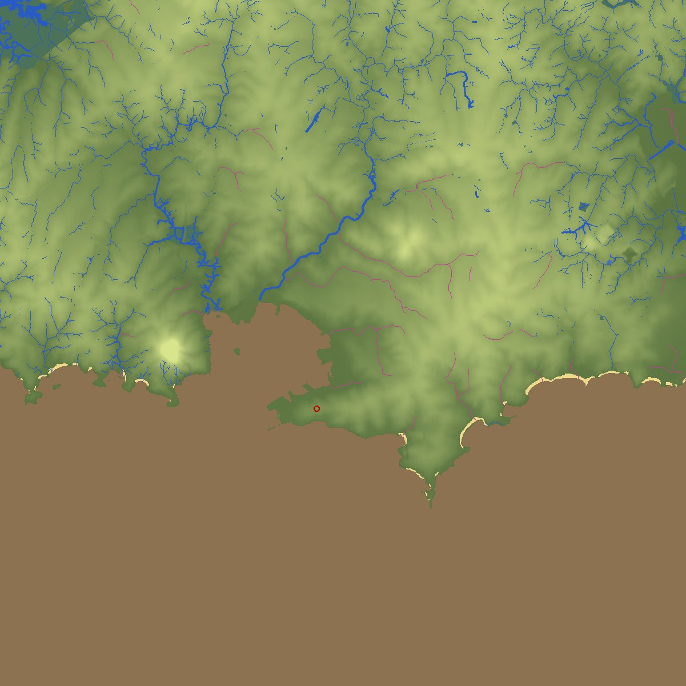

# Mapa real: Montevideo (escala ciudad) y Uruguay (escala país)

> Documento de sistema. Estado: **Montevideo implementado en el prototipo** como mapa por
> defecto. El mapa del país es solo diseño.

## Qué es

El mapa por defecto del prototipo ya no es inventado. Es el **relieve real de Montevideo**: la
península de la Ciudad Vieja, la bahía, el Cerro, los arroyos Miguelete y Pantanoso, Punta
Carretas y la costa del Río de la Plata. Cubre 24 × 24 km, igual que antes (8 × 8 parcelas de
3 km). La plaza mayor se sugiere en la Ciudad Vieja, junto a la Plaza Matriz real.

El mapa ficticio del primer prototipo sigue disponible:

```
godot --path . -- --mapa=ficticio
```




## Fuente y atribución

- **Elevación**: [Terrain Tiles](https://registry.opendata.aws/terrain-tiles/) de Mapzen/Tilezen en
  AWS (formato *terrarium*, zoom 13, unos 15,7 m por píxel a esta latitud).
- Esos tiles combinan, entre otras fuentes, **SRTM** (NASA), **GMTED2010** (USGS), **ETOPO1**
  (NOAA) y modelos nacionales. **La atribución es obligatoria**: tiene que aparecer en los
  créditos del juego. Texto sugerido:
  > Datos de elevación: Terrain Tiles de Mapzen/Tilezen en AWS, que incluyen SRTM (NASA),
  > GMTED2010 (USGS), ETOPO1 (NOAA) y otras fuentes.
- La misma frase está en `assets/mapas/montevideo/meta.json` (`atribucion`).
- No se usa OpenStreetMap. Los arroyos se calculan del relieve (ver abajo), así que no hay datos
  de OSM ni su licencia ODbL en el juego.

## Archivos

| Archivo | Contenido |
|---|---|
| `tools/mapa_real/construir_mapa.py` | Constructor reproducible (Python 3 + numpy + Pillow) |
| `assets/mapas/montevideo/altura.bin` | Mapa jugable: 1201 × 1201 muestras cada 20 m (2,9 MB) |
| `assets/mapas/montevideo/contexto.bin` | Entorno de 6 km alrededor, cada 100 m (361 × 361, 0,26 MB) |
| `assets/mapas/montevideo/arroyos.json` | Trazado de los arroyos en metros locales, el más largo primero |
| `assets/mapas/montevideo/meta.json` | Origen, escala, codificación, sitio de fundación, Cerro, atribución |
| `docs/capturas/mapa-real-relieve.jpg` | Vista previa del relieve que genera el constructor |

**Codificación** de los `.bin`: `uint16` little-endian, filas de norte a sur, columnas de oeste a
este; `metros = valor / 200 − 50` (resolución de 5 mm, rango −50 a 277 m).

**Coordenadas**: metros locales, x hacia el este, z hacia el sur, (0, 0) en la esquina noroeste
(lat −34,778, lon −56,325). Proyección equirectangular local: 91 414,5 m por grado de longitud y
110 938,5 m por grado de latitud. A 24 km el error frente a una proyección exacta es menor a un
metro, despreciable para el juego.

Puntos de referencia (también en `TerrainGen`):

| Punto | x, z (m) | Nota |
|---|---|---|
| Plaza Matriz real | 11 098, 14 289 | |
| `FOUNDING_SITE` (sugerido) | 11 297,7, 14 348,9 | Cuadra de 100 m más llana (1,75 m de desnivel) a menos de 400 m de la Plaza Matriz. Parcela inicial (3, 4) |
| `CERRO` | 5 923,7, 12 269,8 | 127 m en el mapa (134 m reales; el suavizado lima la cumbre) |

## Proceso

1. **Bajar tiles** (z13) que cubren el mapa más 6 km de entorno, a una carpeta de caché.
2. **Mosaico y muestreo bilineal** en la grilla local (20 m el mapa, 100 m el entorno).
3. **Limpiar el agua** (`limpiar_agua`):
   - el agua conectada con el borde sur es el Río de la Plata (incluye la bahía). Su fondo se
     reemplaza por una pendiente suave según la distancia a la costa (máximo 7,5 m), porque la
     batimetría de los tiles cerca de la costa trae bandas horizontales que se veían a través del
     agua;
   - las celdas bajas que no conectan con el río son pozos del modelo (muy comunes en zona
     urbana): se rellenan a 1,5 m.
4. **Suavizar la tierra** (`suavizar_tierra`): SRTM mide techos y copas de árboles, no el suelo.
   Mediana de 5 × 5 y media de 3 × 3, solo en tierra y sin mover la costa. Sin esto, la ciudad
   actual aparecía como manchas de roca empinada en 1726.
5. **Arroyos**: relleno de depresiones (*priority flood*), dirección de flujo D8, acumulación,
   umbral de 6 km² de cuenca, trazado de las líneas, simplificación (Ramer–Douglas–Peucker) y
   suavizado (Chaikin). Se descartan los tramos de menos de 600 m.
6. **Sitio de fundación**: busca alrededor de la Plaza Matriz la cuadra más llana que esté toda
   por encima de 2 m.

### Decisiones

- **Ventana**: 24 km cuadrados con la Ciudad Vieja en la parcela (3, 4), el Cerro y toda la bahía
  adentro y el río ocupando el sur, como en el mapa ficticio. La desembocadura del Carrasco queda
  justo afuera, al este.
- **Zoom 13 y grilla de 20 m**: la resolución real del dato es de unos 30 m (SRTM); más zoom solo
  agranda el archivo.
- **Arroyos calculados y no dibujados a mano**: es reproducible y no depende de OSM. El precio son
  algunos tramos rectos en las zonas planas (artefacto de D8) y tributarios que terminan cerca
  del cauce principal sin tocarlo.
- **El cauce en el juego**: `height()` hunde 1,6 m el terreno a menos de 30 m del arroyo y el agua
  se dibuja como una cinta a la altura del relieve sin cauce (−0,2 m). La cinta se acerca un poco
  a la cámara en el *shader* (`view_bias`) para que la malla lejana, más gruesa que el cauce, no
  la corte en pedazos.

## Cómo regenerar

```
python3 tools/mapa_real/construir_mapa.py --cache /ruta/a/una/carpeta/vacia
```

- Baja unos 100 tiles (≈ 1,6 MB) la primera vez; después usa la caché.
- Escribe en `assets/mapas/montevideo/` (se cambia con `--salida`) y la vista previa en
  `docs/capturas/mapa-real-relieve.jpg`.
- Si cambian el sitio de fundación o el Cerro (lo imprime al final, y queda en `meta.json`), hay
  que copiar los valores a las constantes de `scripts/world/terrain_gen.gd`.
- Para otra ciudad: cambiar `LAT_N`, `LON_W`, `PLAZA_MATRIZ` y `CERRO` y la carpeta de salida.

**Exportar**: los `.bin` y `.json` no son recursos de Godot. Para que entren en las versiones
exportadas, `export_presets.cfg` tiene que incluir `assets/mapas/*` en `include_filter`. Si
faltan, el juego avisa y usa el mapa ficticio.

## API en Godot (`TerrainGen`)

Sin cambios para el resto del código: `height`, `is_land`, `arroyo_distance`, `arroyos`,
`MAP_SIZE`, `TILE_SIZE`, `TILES`. Nuevo:

- `real`: si se cargó el mapa real.
- `founding_site()`, `cerro()`: según el mapa en uso. `founding_site_default()` (estática) sirve
  antes de crear el generador (lo usa `Parcels` para la parcela inicial).
- `is_water(x, z)`: río o arroyo. Calles y solares deberían usarlo para no construir sobre un
  arroyo (pendiente).
- `raw_height`, `arroyo_water_height`: relieve sin cauce y nivel del agua del arroyo.

## Plan para el motor de vóxeles (Rust)

1. Leer `meta.json` (serde) y los dos `.bin` (`u16::from_le_bytes`), con la misma función de
   muestreo bilineal. Es el mismo formato, así que no hace falta otro constructor.
2. Reemplazar la función de altura procedural del generador de chunks por el muestreo. Un vóxel
   de 1 m sobre una grilla de 20 m: interpolación bilineal más un ruido fino (±0,3 m) para que
   no se vean las facetas.
3. Arroyos: rasterizar `arroyos.json` por chunk (distancia al segmento, igual que en Godot) para
   hundir el cauce y poner vóxeles de agua.
4. A más largo plazo, un `.bin` de 5 m para la Ciudad Vieja (con otra fuente: el modelo de
   elevación nacional del Uruguay de la IDE, si la licencia lo permite).

## Plan para el mapa del país (escala país, diseño)

| Capa | Fuente posible | Resolución |
|---|---|---|
| Relieve | Los mismos Terrain Tiles a zoom 8–9 | 150–300 m |
| Costa, ríos Uruguay, Negro y Santa Lucía, lagunas | Del relieve + correcciones a mano (o Natural Earth, dominio público) | — |
| Departamentos, pueblos y caminos históricos | Dibujados a mano por época (alternativa histórica: no copiar el trazado actual) | — |

- El país (unos 450 × 450 km) no se simula casa por casa: es una **simulación agregada** por
  departamento (población, producción, caminos y puertos). La única ciudad simulada en detalle
  es la del jugador (Montevideo por defecto).
- El mapa del país se usa para el comercio (estancias, saladeros, carretas, puertos del río
  Uruguay), las épocas (ferrocarril, rutas) y los eventos naturales (sequías por región,
  crecientes del Santa Lucía y el Negro).
- El constructor sirve con otros parámetros: zoom 8, paso de 250 m, umbral de cuenca de unos
  2000 km² para los ríos.

## Problemas conocidos

- La costa es dentada a esta resolución (20 m): se nota de cerca.
- Algunos arroyos tienen tramos rectos (zonas planas) y tributarios cortados cerca del cauce
  principal.
- En la vista lejana el agua de los arroyos refleja el cielo y se ve grisácea.
- Calles y solares todavía no consultan `is_water`: se puede construir sobre un arroyo.
