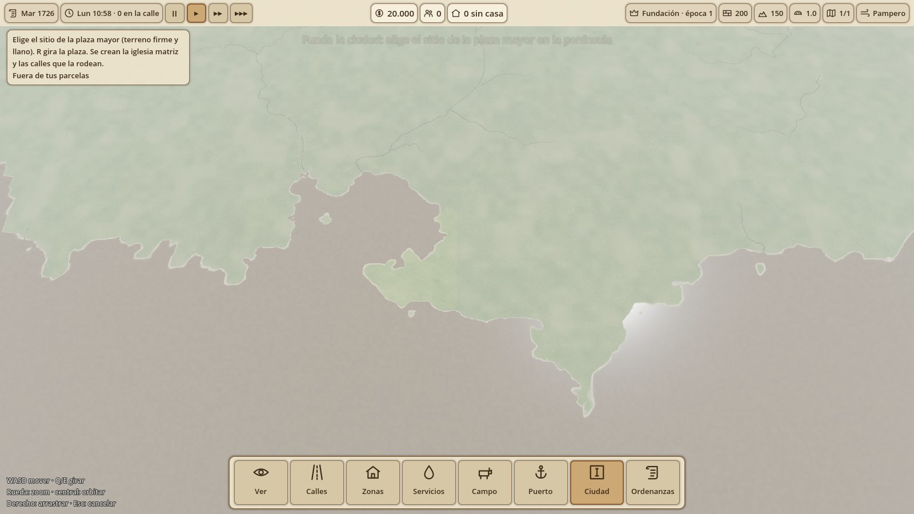
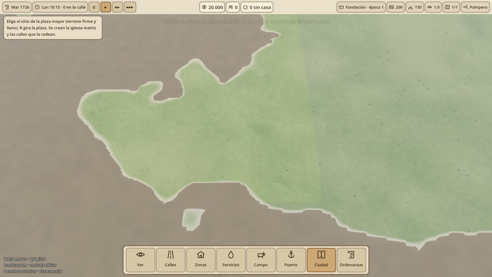
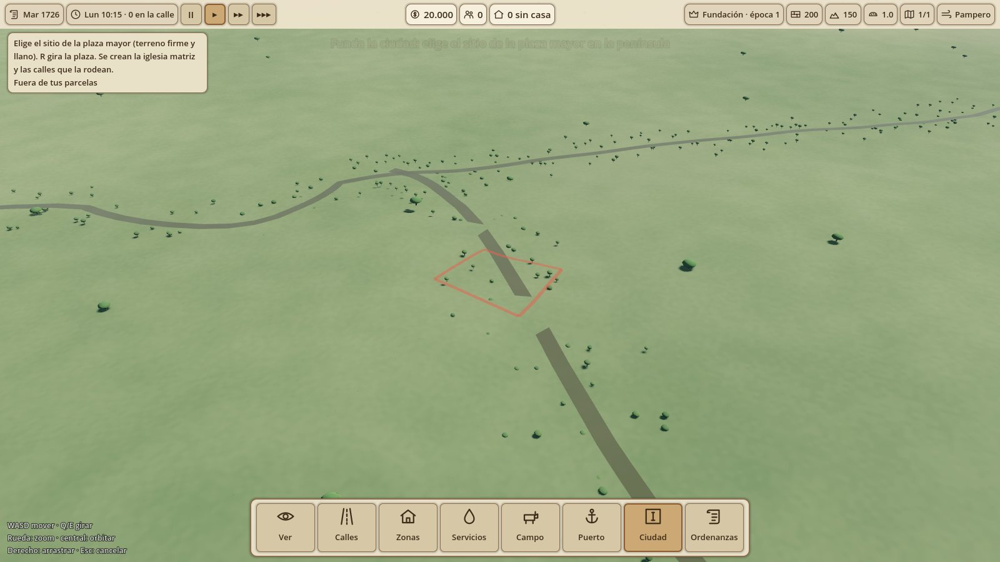
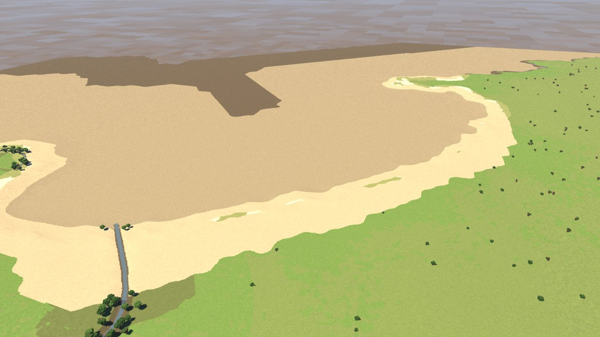
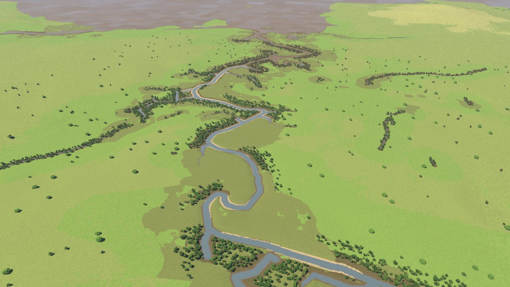
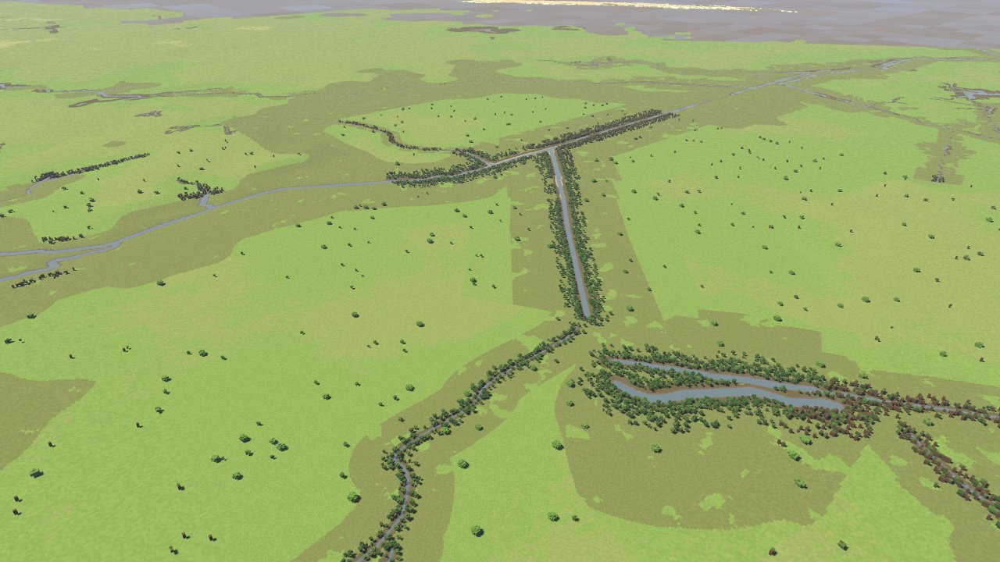
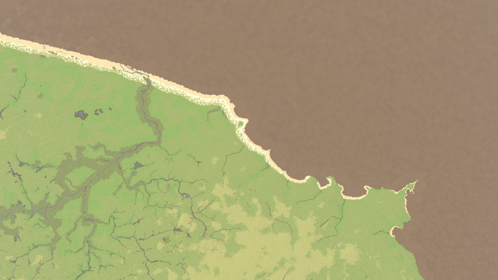
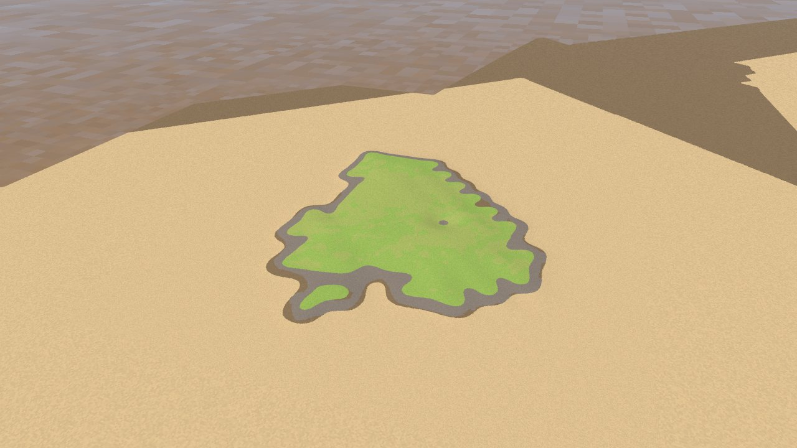

# Mapa real: Montevideo (escala ciudad) y Uruguay (escala país)

> Documento de sistema. Estado: **Montevideo implementado en el prototipo** como mapa por
> defecto. El mapa del país está en [mapa-pais.md](mapa-pais.md).

## Qué es

El mapa por defecto del prototipo ya no es inventado. Es el **relieve real de Montevideo**: la
península de la Ciudad Vieja, la bahía, el Cerro, los arroyos Miguelete y Pantanoso, Punta
Carretas y la costa del Río de la Plata, con la hidrografía oficial de la IDE Uruguay: los
arroyos y cañadas con sus nombres, las playas, los bañados, las islas y las lagunas. Cubre 24 × 24 km, igual que antes (8 × 8 parcelas de
3 km). La plaza mayor se sugiere en la Ciudad Vieja, junto a la Plaza Matriz real.

El mapa ficticio del primer prototipo sigue disponible:

```
godot --path . -- --mapa=ficticio
```






## Fuentes y atribución

Todo sale de la **Infraestructura de Datos Espaciales del Uruguay (IDE Uruguay, Presidencia de
la República)**, por sus servicios OGC en `mapas.ide.uy`:

| Dato | Capa (servicio) | Uso en el juego |
|---|---|---|
| Relieve | `raster__mdt_pais_30m_4326`, Modelo Digital del Terreno del Uruguay, 30 m (WCS `geoserver-raster/wcs`) | `altura.bin`, `contexto.bin` |
| Cursos de agua | `hidrografia:eje_curso_de_agua_l` y `hidrografia_urbana:eje_curso_de_agua_l` (WFS `geoserver-vectorial/wfs`) | `arroyos.json`, `arroyos_contexto.json`, nombres |
| Ancho de los arroyos anchos | `hidrografia:curso_de_agua_a`, `hidrografia_urbana:curso_de_agua_a` | ancho de cada punto |
| Playas | `hidrografia:playa_a`, `hidrografia_urbana:playa_a` | `biomas.bin` = 1 |
| Bañados y áreas húmedas | `hidrografia:banado_a`, `hidrografia:area_humeda_a` (y las urbanas) | `biomas.bin` = 2 |
| Bancos de arena | `hidrografia:banco_de_arena_a` (y la urbana) | `biomas.bin` = 3 |
| Lagos y lagunas | `hidrografia:lago_laguna_a` | `biomas.bin` = 4, alturas |
| Islas | `hidrografia:isla_a` | `biomas.bin` = 5, alturas |
| Cerros y cuchillas | `ideuy:cerros_ide`, `ideuy:cuchillas_y_sierras` | `nombres.json` |
| Monte nativo | Cartografía de Bosque Nativo 2021 (MGAP-DGF), servicio ArcGIS REST del SNIG `DGF/Monte_Nativo_2021`; áreas urbanizadas `ideuy:areas_urbanizadas_3` (IDE) | `bosque*.bin` (ver [vegetacion-historica.md](vegetacion-historica.md)) |

- La hidrografía nacional es la cartografía **1:50.000**; en las zonas urbanas (Montevideo, Ciudad
  de la Costa, Las Piedras…) la capa nacional tiene huecos y los cubre la capa **urbana**, más
  detallada. Se usan las dos.
- No se usan (obras modernas): `embalse_tajamar_a` (tajamares y represas), `canal_l`,
  `eje_canal_l`.
- **Licencia** (verificado el 17/11/2026): el `GetCapabilities` del WFS de la IDE declara
  `Fees: NONE` y `AccessConstraints: Licencia de Datos Abiertos Uruguay`
  (<https://www.gub.uy/agencia-gobierno-electronico-sociedad-informacion-conocimiento/sites/agencia-gobierno-electronico-sociedad-informacion-conocimiento/files/documentos/publicaciones/licencia_de_datos_abiertos_0.pdf>).
  Esa licencia de AGESIC permite, en general, usar, modificar y redistribuir los datos (también
  con fines comerciales) citando la fuente. El WCS del relieve declara `AccessConstraints: NONE`.
  Solo se verificó la declaración de los servicios, no el texto del PDF: conviene leerlo antes de
  publicar el juego.
- **La atribución es obligatoria**: tiene que aparecer en los créditos del juego. Texto (también en
  `meta.json`, `atribucion`):
  > Datos de elevación: Modelo Digital del Terreno del Uruguay, Infraestructura de Datos Espaciales
  > (IDE Uruguay, Presidencia de la República). Hidrografía (cursos de agua, playas, bañados, áreas
  > húmedas, bancos de arena, lagunas e islas), cerros y cuchillas: IDE Uruguay, servicio WFS
  > (hidrografía nacional 1:50.000 y urbana). Licencia de Datos Abiertos del Uruguay.
- No se usa OpenStreetMap (ni su licencia ODbL). Los Terrain Tiles de AWS siguen disponibles con
  `--fuente aws`, con su propia atribución (SRTM, GMTED2010, ETOPO1).







## Archivos

| Archivo | Contenido |
|---|---|
| `tools/mapa_real/construir_mapa.py` | Constructor reproducible (Python 3 + numpy + Pillow) |
| `assets/mapas/montevideo/altura.bin` | Mapa jugable: 1201 × 1201 muestras cada 20 m (2,9 MB) |
| `assets/mapas/montevideo/contexto.bin` | Entorno de 25 km alrededor, cada 100 m (741 × 741, 1,1 MB) |
| `assets/mapas/montevideo/amplio.bin` | Entorno amplio: 300 × 300 km alrededor del mapa, cada 500 m (601 × 601, 0,7 MB; `metros = valor / 100 − 50`). Ver [Entorno amplio](#entorno-amplio) |
| `assets/mapas/montevideo/amplio_cobertura.bin` | Bañado y monte nativo del entorno amplio: 2 bytes por muestra (0..255), misma grilla (0,7 MB) |
| `tools/mapa_real/construir_entorno_amplio.py` | Constructor del entorno amplio (aparte: no hace falta rehacer el mapa) |
| `assets/mapas/montevideo/biomas.bin` | Biomas oficiales en la grilla del mapa (1201 × 1201, `uint8`) |
| `assets/mapas/montevideo/biomas_contexto.bin` | Biomas oficiales en la grilla del entorno (741 × 741) |
| `assets/mapas/montevideo/bosque.bin`, `bosque_contexto.bin` | Monte nativo reconstruido para 1726: cobertura de copas `uint8` (valor / 255) en las dos grillas. Ver [vegetacion-historica.md](vegetacion-historica.md) |
| `assets/mapas/montevideo/bosque_actual.bin` | Monte nativo de hoy (DGF 2021) en la grilla del mapa, solo de referencia |
| `assets/mapas/montevideo/arroyos.json` | Cauces del mapa jugable (y 1 km alrededor), el más largo primero |
| `assets/mapas/montevideo/arroyos_contexto.json` | Cauces del entorno con nombre o de más de 5 m de ancho (solo el motor) |
| `assets/mapas/montevideo/nombres.json` | Arroyos, cerros, cuchillas e islas con nombre, para rótulos |
| `assets/mapas/montevideo/meta.json` | Origen, escala, codificación, fundación, Cerro, fuentes, atribución, conteos |
| `docs/capturas/mapa-real-relieve.jpg` | Vista previa del constructor (relieve, biomas, cauces oficiales en azul y del relieve en violeta) |

**Codificación** de los `.bin` de altura: `uint16` little-endian, filas de norte a sur, columnas de
oeste a este; `metros = valor / 200 − 50` (resolución de 5 mm, rango −50 a 277 m).

**`biomas.bin`**: un `uint8` por muestra, mismo orden: `0` nada, `1` playa, `2` bañado o área
húmeda, `3` banco de arena, `4` laguna o lago (agua), `5` isla (tierra). Si se superponen gana, de
menor a mayor prioridad: isla, bañado, playa, banco, laguna.

**`arroyos.json`**: `{"arroyos": [[[x, z, ancho], …], …], "nombres": [...], "fuente": [...]}`.
`nombres` y `fuente` son listas paralelas opcionales (nombre oficial con mayúsculas normales o
`null`; `"ide"` o `"relieve"`). El motor y Godot leen `arroyos`; el motor también `nombres`.

**`nombres.json`**: `{"nombres": [{"nombre", "tipo" (arroyo, cañada, río, cerro, cuchilla, isla),
"x", "z", "en_mapa", "fuente", …}]}`. Los arroyos llevan el punto medio de su tramo más largo y el
largo total (`largo_m`); las cuchillas, su línea simplificada (`linea`); el cerro, su altura.

**Coordenadas**: metros locales, x hacia el este, z hacia el sur, (0, 0) en la esquina noroeste
(lat −34,778, lon −56,325). Proyección equirectangular local: 91 414,5 m por grado de longitud y
110 938,5 m por grado de latitud. Los datos vectoriales están en EPSG:5382 (SIRGAS-ROU98 / UTM
21S); se piden al WFS ya reproyectados (`srsName=EPSG:4326`, con el bbox también en EPSG:4326) y
se pasan a metros locales con la misma fórmula que el relieve, así que no hace falta pyproj. A
24 km el error frente a una proyección exacta es menor a un metro.

Puntos de referencia (también en `TerrainGen`):

| Punto | x, z (m) | Nota |
|---|---|---|
| `FOUNDING_REAL` (sugerido) | 11 097,7, 14 308,9 | Cuadra de 100 m más llana junto a la Plaza Matriz |
| `CERRO_REAL` | 5 923,7, 12 269,8 | 129 m en el mapa (132 m según `cerros_ide`) |
| Isla de las Ratas | ≈ 8 300, 12 300 | `isla_a`, 3,2 ha |
| Isla de Flores | ≈ 36 200, 18 400 | `isla_a`, 15 + 6 ha, en el entorno |

## Proceso

1. **Relieve**: recorte del MDT nacional (WCS) y muestreo en la grilla local (20 m el mapa, 100 m
   el entorno). El MDT deja el agua sin dato.
2. **Limpiar el agua** (`limpiar_agua`): el agua conectada con el borde sur es el Río de la Plata
   (con la bahía) y su fondo baja suave según la distancia a la costa (máximo 7,5 m); las celdas
   bajas que no conectan con el río son pozos del modelo y se rellenan a 1,5 m. Media de 3 × 3 en
   tierra para quitar el escalonado del MDT.
3. **Hidrografía oficial** (`--hidrografia ide`): baja las capas por WFS (bbox del mapa y el
   entorno, de a 5000 objetos con `startIndex`, con reintentos porque el servidor corta
   conexiones) y las guarda en la caché como GeoJSON.
   - **Islas** (`isla_a`): donde el MDT dice agua se levanta un domo bajo (hasta 4 m, 60 m de
     borde). En la grilla de 100 m las islas de menos de 50 ha se engrosan una celda (si no, la de
     Flores queda como celdas sueltas). Las islas de la lista `ISLAS` (a mano) solo se agregan si la
     capa no trae ninguna cerca: hoy la capa trae las dos (Ratas y Flores) y la lista no se usa.
   - **Lagunas** (`lago_laguna_a`): las bajas (nivel ≤ 1 m) se hunden bajo el agua; las altas quedan
     llanas a su nivel y el motor pinta la superficie como agua de arroyo (el motor dibuja el agua
     solo como un plano a 0 m). Se descartan las de menos de 1 ha (tajamares y piletas) y las de
     `LAGOS_MODERNOS` (canteras de los Lagos de Carrasco y Lomas de Solymar, lago del Parque Rivera,
     piletas junto a la refinería de La Teja). Las lagunas de la capa urbana no se usan. En el mapa
     jugable queda una sola (1,4 ha): Montevideo casi no tenía lagunas naturales.
   - **Biomas**: playas, bañados y áreas húmedas, bancos de arena, lagunas e islas se rasterizan
     (polígonos con huecos, Pillow) en las dos grillas.
   - **Cursos de agua** (`eje_curso_de_agua_l`: los ejes, que también cruzan los cauces anchos
     dibujados como polígono): se toman `cat` 3 (cauce natural), 5 (brazos del Santa Lucía) y, en la
     capa nacional, 7 (tramos cortos de conexión). En la capa urbana `cat` 7 son las cunetas de las
     calles (135 000 tramos con forma de damero) y se descartan. Se descartan los canales
     (`CANAL MALVÍN`, `CANAL MANGA`). Donde las dos capas se superponen (Pantanoso, Miguelete) se
     queda la nacional. Los tramos (cortados cada pocos cientos de metros) se unen en polilíneas
     sin cruzar confluencias ni mezclar nombres, y se simplifican (RDP de 3 m en el mapa y 8 m en
     el entorno).
   - **Ancho** de cada punto: si el arroyo tiene polígono (`curso_de_agua_a`), 2 · área /
     perímetro del polígono; si no, la fórmula de la cuenca acumulada en el relieve
     (`ancho_cauce`, 1,5 m + 1,4 m · √km²), un 30 % más angosto si es intermitente (`hyc` = 6).
     Entre 1,5 y 60 m, suavizado a lo largo del cauce. La capa no trae orden de Strahler.
   - **Huecos de la capa oficial**: en la ciudad actual los arroyos están entubados y no figuran
     (Arroyo de los Pocitos, Arroyo Seco, Quitacalzones…), pero en 1726 corrían a cielo abierto.
     Donde no hay ningún cauce oficial a menos de 300 m se agregan los arroyos calculados del
     relieve con más de 1 km² de cuenca, alargados aguas abajo hasta tocar un cauce oficial
     (`"fuente": "relieve"`).
   - **Nombres**: los arroyos con nombre (punto medio del tramo más largo), el Cerro, las
     cuchillas y las dos islas.
4. **Sitio de fundación**: busca alrededor de la Plaza Matriz la cuadra más llana que esté toda
   por encima de 2 m.

Conteos de la última corrida (objetos de la IDE en el mapa más el entorno): 176 693 tramos de
curso de agua (nacional + urbana, cunetas incluidas), 2824 polígonos de cauce, 90 playas,
423 bañados y áreas húmedas, 5 bancos de arena, 50 lagunas, 147 islas, 1 cerro, 3 cuchillas. En
el juego: 2694 cauces en `arroyos.json` (636 km; 42 del relieve; 336 con nombre) y 6150 en el
entorno (2430 km); 110 ha de playa y 666 ha de bañado dentro del mapa jugable.

### En el motor (`engine/src/terrain.rs`)

- `biomas.bin` y `biomas_contexto.bin` van embebidos (`include_bytes!`), con los tamaños de
  `meta.json`. `official_biome(x, z)` elige entre las cuatro muestras vecinas el código con más
  peso bilineal, con el punto corrido unos metros por ruido: el borde de una playa sigue una
  curva y no los escalones de 20 m.
- En `biome()` los biomas oficiales mandan sobre las reglas: playa → arena (húmeda junto al agua),
  bañado → bañado con claros de pasto, banco de arena → arena, laguna → agua de arroyo, isla →
  biomas de siempre (con orilla de piedra).
- **Médanos solo detrás de playas oficiales**: `beach_factor` compara la distancia a la playa
  oficial más cercana con la distancia al agua; la franja de médanos (`dune_belt`) se multiplica
  por ese factor. Donde la costa no tiene playa (Ciudad Vieja, Cerro, bahía) la orilla es de
  piedra si es empinada o de barro si es llana.
- Sin árboles en playas, bañados, bancos de arena ni lagunas. El monte ribereño, las especies,
  las formas de los árboles y la flora baja están en [vegetacion-historica.md](vegetacion-historica.md).
- El cauce de un arroyo que baja del nivel del río se pinta como arroyo (agua) y no como fondo
  del río.
- Carga también `arroyos_contexto.json` y los nombres (`TerrainGen::arroyo_nombres`).

### Decisiones

- **Ventana**: 24 km cuadrados con la Ciudad Vieja en la parcela (3, 4), el Cerro y toda la bahía
  adentro y el río ocupando el sur. La desembocadura del Carrasco queda justo afuera, al este.
- **Capa oficial y no relieve para los arroyos**: el trazado es el real (con sus nombres) en vez
  de los tramos rectos del D8. El relieve solo rellena los huecos de la ciudad actual.
- **Ancho por cuenca**: la capa no trae el orden del cauce; `cat` y `hyc` solo distinguen el tipo
  y si es permanente o intermitente.
- **Godot** lee solo `arroyos.json` (el entorno tiene demasiados cauces para su generador de
  cintas y árboles).

## Entorno amplio

Desde lo alto, o desde un borde del mapa mirando hacia afuera, la tierra terminaba en una línea
recta contra el plano del río: el entorno de 100 m (`contexto.bin`) llega a 25 km del mapa y el
último anillo de detalle del motor, a unos 25 km de la cámara. Ahora hay una **tercera grilla**,
gruesa, que llega a 150 km del centro del mapa en todas las direcciones: Colonia y San José al
oeste, Florida al norte, Maldonado, las sierras de las Ánimas (432 m en la grilla) y Punta del
Este al este y, cruzando el Río de la Plata, la costa argentina de Magdalena, Punta Indio y la
bahía de Samborombón.

| Dato | Fuente | Resultado |
|---|---|---|
| Relieve de Uruguay | MDT de 30 m de la IDE (WCS `raster__mdt_pais_30m_4326`), pedido ya reducido por el servidor (`scaleFactor=0.25`, ~120 m) en 21 recortes de medio grado, recortados a la cobertura del MDT (al sur de −34,997° el servidor da 404) | `amplio.bin` |
| Relieve de Argentina | **Copernicus DEM GLO-90** (ESA, 90 m, superficie), recortes de 1° de `copernicus-dem-90m.s3.amazonaws.com` (12 de 16; los que faltan son mar). El mar viene en 0 exacto. Solo al sur y al oeste del río (lat < −34,85°, lon < −56,5°), donde la IDE no tiene tierra | `amplio.bin` |
| Bañados | IDE, WFS `hidrografia:banado_a` (y `area_humeda_a` si el servidor responde: en la última corrida cortó todas las conexiones y quedó afuera) + bañados del relieve: tierra de menos de 4 m, llana, a menos de 3 km del agua (así entra Samborombón) | `amplio_cobertura.bin`, byte 0 |
| Monte nativo | DGF 2021 por el SNIG (la misma capa que `bosque.bin`), polígonos de 3 ha o más, simplificados por el servidor (`maxAllowableOffset`), 5531 polígonos; cobertura × 1,5 (más monte en 1726 que hoy, como en el mapa) | `amplio_cobertura.bin`, byte 1 |

Atribución de Copernicus (va en `meta.json`, sección `amplio`): © DLR e.V. 2010-2014 y © Airbus
Defence and Space GmbH 2014-2018, provisto bajo COPERNICUS por la Unión Europea y la ESA.

**Proceso** (`construir_entorno_amplio.py`): muestras de 100 m (5 × 5 por celda) de los dos
modelos; una celda es tierra si lo es más de la mitad de sus muestras, con la altura media de
las de tierra (mínimo 0,6 m). Los pozos de una o dos celdas se rellenan. El agua toma el fondo
por distancia a la tierra como el resto del mapa (de −0,4 a −7,5 m). Altura máxima 470 m: por eso
la codificación es de 1 cm (`valor / 100 − 50`, hasta 605 m) y no la de `altura.bin` (que llega a
277 m). La sección `amplio` de `meta.json` tiene la grilla, las fuentes y la nota; el constructor
del mapa la conserva al reescribir `meta.json`.

```
python3 tools/mapa_real/construir_entorno_amplio.py --cache /ruta/a/una/carpeta [--sin-hidrografia]
```

La primera vez baja ~16 MB del MDT, ~55 MB de Copernicus y las capas (minutos); después usa la
caché. `--sin-hidrografia` no pide los bañados a la IDE (si el servidor no responde).

### En el motor

- `terrain.rs`: tres grillas que se funden sin escalón: el mapa (20 m) → el entorno (100 m, con
  la transición de 400 m de siempre) → el amplio (500 m): los últimos 3 km de la grilla del
  entorno (`WIDE_BLEND`) se mezclan con la amplia, alturas, distancia al agua y monte.
  `RealMap::ctx_weight` da el peso.
- Más allá de la grilla de 100 m solo se usa el relieve (bicúbico) con una ondulación de ±6 m en
  kilómetros; las costas de piedra, médanos, restingas y cauces se apagan con el mismo peso (sus
  datos no llegan hasta ahí, y el vóxel mide 64 m o más). Antes, fuera del entorno, las grillas
  se muestreaban con el índice recortado y el último valor se estiraba en líneas rectas.
- Biomas del entorno amplio (`wide_biome`): arena en la costa, bañado y monte según la cobertura,
  roca en las laderas empinadas de las sierras, pradera más seca en las cuchillas. En la
  transición se mezclan vóxel a vóxel con los del entorno.
- Fuera de la grilla amplia (más de 150 km del centro; el juego no llega ahí con 11 niveles) el
  relieve se funde en 15 km (`WIDE_FADE`) con una llanura de ruido suave, o con el agua si el
  borde es agua: nada se estira.
- Memoria: cuatro grillas de 601² en `f32` (alturas, distancia al agua, bañado, monte), 5,8 MB.
- Tests: `el_entorno_amplio_tiene_la_geografia_real` (Florida, San José, las Ánimas, Maldonado,
  el mar frente a Piriápolis, el medio del río, Punta Indio) y
  `sin_cortes_entre_las_grillas_del_mapa_el_entorno_y_el_amplio` (altura continua a 1 m a cada
  lado de los cuatro bordes de las tres grillas, sin escalones en la transición, y fuera de la
  grilla amplia una llanura y no el borde estirado).

La costa argentina está a unos 100 km de Montevideo: con el radio de dibujo actual (~90 km) y la
bruma no se llega a ver, como en la realidad (desde Montevideo, la otra orilla queda bajo el
horizonte). Sirve para que, al alejarse, el río tenga otra orilla y no un borde.

## Cómo regenerar

```
python3 tools/mapa_real/construir_mapa.py --cache /ruta/a/una/carpeta
```

- La primera vez baja el MDT (19 MB) y 16 capas por WFS (≈ 250 MB de GeoJSON, sobre todo las
  cunetas de la capa urbana); después usa la caché y tarda menos de un minuto.
- `--hidrografia relieve` vuelve a los arroyos calculados del relieve y no escribe los biomas (el
  motor los necesita: no conviene mezclar).
- Escribe en `assets/mapas/montevideo/` (se cambia con `--salida`) y la vista previa en
  `docs/capturas/mapa-real-relieve.jpg`.
- Si cambian el sitio de fundación o el Cerro (lo imprime al final, y queda en `meta.json`), hay
  que copiar los valores a las constantes de `scripts/world/terrain_gen.gd` y `terrain.rs`.
- Para otra ciudad: cambiar `LAT_N`, `LON_W`, `PLAZA_MATRIZ`, `CERRO`, `ISLAS`, `LAGOS_MODERNOS` y
  la carpeta de salida.

**Exportar**: los `.bin` y `.json` no son recursos de Godot. Para que entren en las versiones
exportadas, `export_presets.cfg` tiene que incluir `assets/mapas/*` en `include_filter`. Si
faltan, el juego avisa y usa el mapa ficticio.

## API en Godot (`TerrainGen`)

Sin cambios para el resto del código: `height`, `is_land`, `arroyo_distance`, `arroyos`,
`MAP_SIZE`, `TILE_SIZE`, `TILES`. Nuevo:

- `real`: si se cargó el mapa real.
- `founding_site()`, `cerro()`: según el mapa en uso. `founding_site_default()` (estática) sirve
  antes de crear el generador (lo usa `Parcels` para la parcela inicial).
- `is_water(x, z)`: río o arroyo. Calles y solares deberían usarlo para no construir sobre un
  arroyo (pendiente).
- `raw_height`, `arroyo_water_height`: relieve sin cauce y nivel del agua del arroyo.

## Plan para el motor de vóxeles (Rust)

1. Leer `meta.json` (serde) y los dos `.bin` (`u16::from_le_bytes`), con la misma función de
   muestreo bilineal. Es el mismo formato, así que no hace falta otro constructor.
2. Reemplazar la función de altura procedural del generador de chunks por el muestreo. Un vóxel
   de 1 m sobre una grilla de 20 m: interpolación bilineal más un ruido fino (±0,3 m) para que
   no se vean las facetas.
3. Arroyos: rasterizar `arroyos.json` por chunk (distancia al segmento, igual que en Godot) para
   hundir el cauce y poner vóxeles de agua.
4. A más largo plazo, un `.bin` de 5 m para la Ciudad Vieja (con otra fuente: el modelo de
   elevación nacional del Uruguay de la IDE, si la licencia lo permite).

## Plan para el mapa del país (escala país, diseño)

> Hecho de otra manera: ver [mapa-pais.md](mapa-pais.md) (MDT de la IDE a 1 km, capas del
> MTOP, historia a mano con fuentes). Lo de abajo queda como el plan original.

| Capa | Fuente posible | Resolución |
|---|---|---|
| Relieve | Los mismos Terrain Tiles a zoom 8–9 | 150–300 m |
| Costa, ríos Uruguay, Negro y Santa Lucía, lagunas | Del relieve + correcciones a mano (o Natural Earth, dominio público) | — |
| Departamentos, pueblos y caminos históricos | Dibujados a mano por época (alternativa histórica: no copiar el trazado actual) | — |

- El país (unos 450 × 450 km) no se simula casa por casa: es una **simulación agregada** por
  departamento (población, producción, caminos y puertos). La única ciudad simulada en detalle
  es la del jugador (Montevideo por defecto).
- El mapa del país se usa para el comercio (estancias, saladeros, carretas, puertos del río
  Uruguay), las épocas (ferrocarril, rutas) y los eventos naturales (sequías por región,
  crecientes del Santa Lucía y el Negro).
- El constructor sirve con otros parámetros: zoom 8, paso de 250 m, umbral de cuenca de unos
  2000 km² para los ríos.

## Problemas conocidos

- La costa es dentada a esta resolución (20 m): se nota de cerca.
- Algunos cauces oficiales del bañado del Carrasco son canales rectos del siglo XX que la capa no
  distingue de los naturales (solo se descartan los que se llaman «Canal»).
- La red oficial es densa (636 km de cauces en el mapa jugable, muchas cañadas intermitentes);
  en 1726 varias serían solo bajos húmedos.
- Los arroyos del relieve que rellenan la ciudad actual pueden quedar a unos metros del cauce
  histórico (son D8 sobre un MDT de 30 m).
- La Isla de Flores (fuera del mapa jugable) se ve solo de lejos: la cámara no sale del mapa.
- Entorno amplio: la costa a 500 m es escalonada de cerca (solo se ve a decenas de km); el monte
  de Maldonado es el de hoy (DGF 2021 × 1,5), sin la reconstrucción de 1726 del mapa; la capa
  `area_humeda_a` de la IDE no bajó (el servidor cortaba las conexiones) y los bañados salen de
  `banado_a` y del relieve. En Argentina el modelo es de superficie (Copernicus), no de suelo.
- Calles y solares de Godot todavía no consultan `is_water`: se puede construir sobre un arroyo
  (en el motor sí: ver [mapa-pais.md](mapa-pais.md#calles-y-solares-que-esquivan-los-arroyos)).
