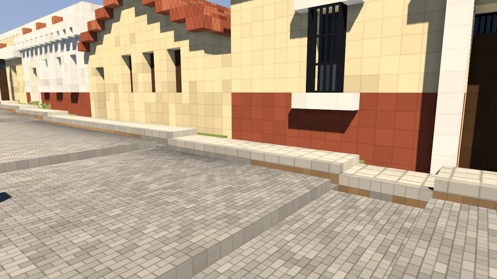
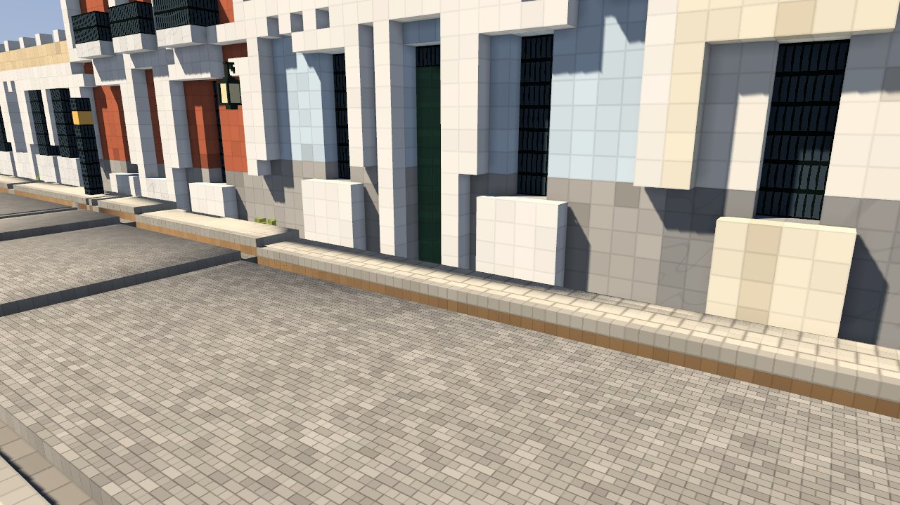
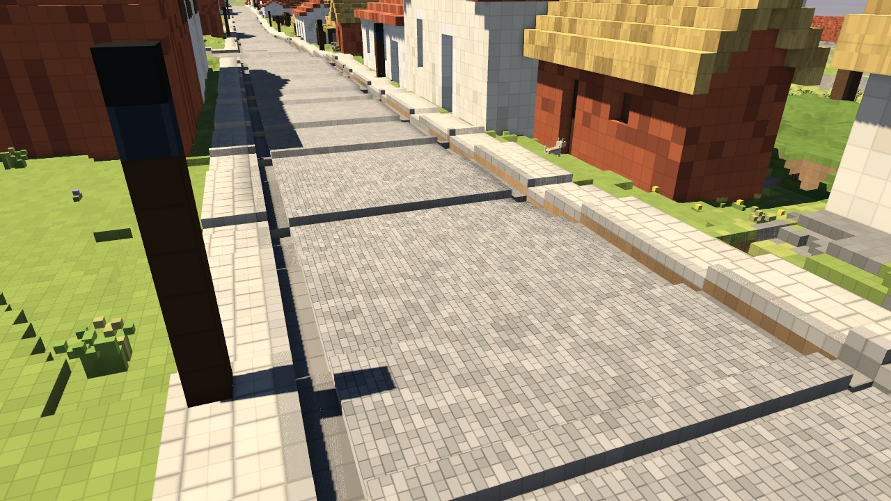
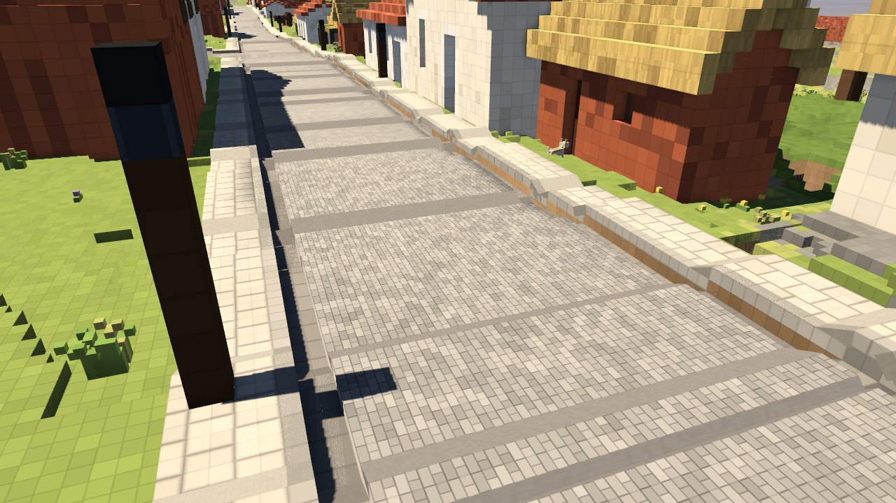

# Modelos de detalle (micro-vóxeles de 1/16 m)

> Código: `engine/src/detalle/` (biblioteca, paletas, ropa, animación),
> `engine/src/render/shaders/agentes.wgsl` (dibujo). Personas y animales en
> `docs/sistemas/personajes-y-animales.md`.

## La regla de resolución

Lo que no necesita vóxeles chicos se queda como está: terreno de 0,25 m, edificios en módulos de
0,5 m, flora baja en micro-vóxeles de 0,125 m. Lo que queda mucho mejor con vóxeles más chicos
—personas, animales, carretas, faroles, toneles, brocales, botes, letreros— usa **modelos de
detalle** de **1/16 m (6,25 cm)**.

**Por qué 1/16 y no 1/12:**

- Es potencia de dos y cae en la misma grilla que todo lo demás: 4 por vóxel de terreno, 2 por
  micro-vóxel de flora, 8 por módulo de edificio. Las aristas de un modelo coinciden con las de
  la calzada y las de la flora (con 1/12 no coinciden nunca y se ve el desfase al lado de un
  cordón o un escalón).
- Una persona de 1,70 m son 27 vóxeles de alto: cabeza de 4×5×4, brazos de 2, sombrero con ala.
  Con 1/12 serían 20: ya no entran el ala del sombrero, las vueltas de la casaca ni la trenza.
- **El costo no depende del tamaño del vóxel**: cada modelo se pinta en una grilla y al armarse
  se funde en cajas (fusión voraz por parte y color). Lo que se dibuja son cajas, y su cantidad
  depende de cuántas piezas distintas tiene el modelo (≈ 25 por persona), no de cuántos vóxeles.
  Bajar a 1/32 solo costaría más cajas donde se pintara más detalle. Los vóxeles se ven igual:
  el shader le da a cada vóxel de 1/16 su matiz (±5 %) y un borde apenas más oscuro, que se
  apagan entre 25 y 70 m para que no titilen.

## Cómo se arma un modelo

`detalle::Lienzo` es una grilla 3D chica (por ejemplo 16 × 60 × 12 para una persona). Se pinta
por datos, en código, con lo último pintado encima de lo anterior:

- `caja(parte, ranura, a, b)`, `centrada(...)` (simétrica en x), `par(...)` (la misma caja a
  izquierda y derecha, para piernas, brazos y patas), `borrar(...)`;
- `cilindro_y` / `cilindro_x` (toneles, barricas, brocales redondos);
- `girada(...)`: una caja fuera de la grilla, girada alrededor del pivote de su parte (los rayos
  y la llanta de las ruedas, la lanza apoyada en el suelo); `rueda(...)` arma una rueda entera
  (llanta de n tramos, rayos y maza) con ~20 cajas giradas.
- `pivote(parte, punto)`: alrededor de qué gira cada parte.

`armar()` funde la grilla en cajas (`CajaM`: esquinas en micro-vóxeles, ranura, parte) y arma el
`Modelo`. Las cajas de una misma grilla nunca se pisan (prueba
`las_cajas_de_la_grilla_no_se_pisan_y_cubren_lo_pintado`).

**Ranuras de color** (`detalle::r`): piel, pelo, ropa, calzón, sombrero, capa, calzado, acento,
pelaje, pelaje oscuro, crin, madera, madera oscura, cuero, hierro, claro. El modelo no tiene
colores; cada instancia trae su `Paleta` (16 colores): la ropa de cada vecino, el pelaje de cada
animal, la pintura de cada bote (`modelos::paleta(id, semilla)`, `ropa::paleta`).

**Partes** (`Parte`): fijo, cabeza, brazos, piernas, cuatro patas, cola y dos ruedas. Cada una
gira alrededor de su pivote: giro alrededor de y (la cabeza que mira) e inclinación alrededor de
x (piernas, patas, la cabeza que baja a pastar, las ruedas).

## La biblioteca

| Modelo | Cajas | Notas |
|---|---|---|
| Caballo / ensillado | 38 / 51 | criollo de 1,40 m a la cruz; recado con pellón, cincha, estribos y cabezada; 7 pelajes |
| Vaca / overa / buey | 37 / 49 / 37 | ganado criollo con astas en lira; el buey más grande, con giba y astas largas; 5 pelajes |
| Oveja, perro, gallina | 18, 23, 17 | |
| Carreta de bueyes / estacionada | 217 / 213 | ruedas de 2,1 m de 12 rayos, toldo de cueros en arco con costuras, lanza y yugo; parada, la lanza en el suelo |
| Carro | 63 | dos ruedas, varas, bolsas y un barril, pescante |
| Bote | 130 | bote de remos de 5 m: proa aguda, bancadas y remos, casco pintado |
| Farol de aceite / de gas | 16 / 21 | colonial en poste con brazo; el de gas (columna de hierro con anillos y apoyo de escalera) queda listo para la época 2 |
| Tonel, barrica | 75, 49 | duelas y aros de hierro |
| Banco, palenque, cruz, veleta | 4, 3, 5, 15 | |
| Brocal de aljibe | 22 | mármol, arco de hierro forjado, roldana y balde |
| Pozo con roldana | 42 | brocal de piedra, horcones, travesaño, roldana, soga y balde |
| Letrero de pulpería | 20 | tabla pintada colgada de un brazo |
| Rejas, faroles de fachada, macetas, llamadores | 5 – 44 | los piden las casas (ver abajo) |
| Carro aguatero | 131 | [ia] la pipa acostada a lo largo con aros de hierro, canilla atrás y un balde colgado; dos ruedas y las varas |
| Aparejo del sereno | 13 | [ia] farol de mano encendido (izquierda) y chuzo con moharra (derecha): partes de los brazos de un hombre adulto |
| Picana, balde en la mano | 4, 13 | [ia] en la mano derecha (sigue al brazo) |
| Silla de paja | 9 | [ia] asiento a 0,5 m y respaldo |
| Personas (19 atuendos × de pie / montado / sentado) | 13 – 66 | ver `personajes-y-animales.md`; sentada desde la v0.12.x |

Toda la biblioteca: **3161 cajas, 61 KB** (con los detalles de las fachadas, los oficios y las 19 personas sentadas; antes 2432 cajas, 47 KB), armada una vez al primer uso (`detalle::biblioteca()`).

## Dibujo

Una instancia de **48 bytes** por caja (`detalle::Caja`): pivote en el mundo, giro, desde el
pivote hasta el centro del piso de la caja, inclinación, tamaño y color (el cuarto byte: 0 = caja
lisa de lejos; otro = micro-vóxeles con esa semilla de matiz). El vertex shader arma las 6 caras,
inclina la caja alrededor del pivote de su parte y la gira; luz del sol, sombras en cascadas
recibidas (`sombras.wgsl`), luz del cielo, niebla, curvatura y `curva_tonal` como el resto.
Mismo pipeline y mismo búfer que los vecinos (`Renderer::set_agents`), subido cada cuadro solo si
cambió.

**Sombra de contacto:** los modelos todavía no proyectan sombra en los mapas de cascadas (que se
guardan entre cuadros; redibujar la cascada cercana cada cuadro por los que se mueven costaría
más que todo el resto). Debajo de cada modelo va una elipse suave (una instancia con alto 0),
corrida hacia donde no da el sol y más tenue de noche, dibujada en una segunda pasada que solo
oscurece lo que ya hay (mezcla `dst × (1 − a)`, sin escribir profundidad).

## Detalles fijos: la API para los demás sistemas

```rust
use crate::detalle::{Detalles, Id};
let mut d = Detalles::default();
d.poner(Id::FarolAceite, Vec3::new(x, suelo, z), giro, semilla);   // base en el suelo, giro en rad (0 = +z)
d.quitar(|i| /* por ejemplo, los del solar demolido */ false);
d.cajas(centro_de_la_vista, &mut cajas);                          // los de menos de 140 m, con su sombra
```

`Detalles` guarda las instancias por zonas de 64 m; no se guarda con la partida (cada sistema lo
rehace desde su propio estado). La ciudad tiene uno general (`city.agentes.detalles`), que se
dibuja con los vecinos; la escena de la ciudad (pulperías, estancias, muelle, plaza) se deriva
sola en `agentes::fauna` y se rehace cuando cambia su firma (solares, servicios, año, clima).

**Para agregar un modelo:** una variante en `detalle::Id` (y en `Id::TODOS`), su función en
`detalle/modelos.rs` pintada en un `Lienzo`, su paleta en `modelos::paleta`. Las pruebas de
`detalle/tests.rs` revisan todos los modelos (cajas no vacías, ranuras válidas, pivotes adentro,
tamaños razonables).

## Detalles de las fachadas: los constructores de edificios piden modelos

Los edificios se arman con vóxeles de 0,5 m (`structures/`); lo fino de las fachadas queda tosco
a esa escala. Desde la v0.11.x las casas de los solares de la ciudad piden **modelos de
detalle** para las rejas, los faroles de fachada, las macetas de los balcones y los llamadores:

1. **El pedido.** `Edits` lleva `detalles: Option<Vec<PedidoDetalle>>`. El constructor llama a
   `Frame::detalle(e, Id, u, y, w, giro, semilla)` con la posición en el marco del solar
   (vóxeles de diseño con fracción; w = 0 es la cara de la fachada, el modelo mira a la calle).
   Si quien construye no dibuja detalles (`detalles = None`: catálogo, sandbox, escenas), el
   pedido no hace nada y el constructor usa sus vóxeles de siempre (la reja de vóxeles con el
   dibujo de los barrotes en el shader, el farol de dos vóxeles). Así nada cambia fuera de la
   ciudad.
2. **El giro con el solar.** `voxelize::build_rotated_det` (los solares de la ciudad, en
   `city::build_lot`) arma la casa en el marco alineado y pasa cada pedido a metros del mundo
   con la misma transformación que el re-muestreo de los vóxeles (continua), girando también
   su rumbo: las casas giradas a cualquier ángulo llevan sus rejas en su lugar.
3. **La ciudad los guarda por solar** (`City::fachadas`, `DetallesFachadas`): con la cantidad
   de vóxeles que tenía el edificio al pedirlos. No se guardan con la partida (salen de
   voxelizar el solar al cargar, como los edificios). Si el solar se demolió, se quemó, se hizo
   basural o se rehízo por otro camino, su lista de vóxeles cambió y sus detalles dejan de
   dibujarse: no hace falta tocar cada camino de demolición. Lo que se dibuja (`vigentes`) se
   arma de nuevo solo cuando cambia la firma de los solares, y va con los vecinos y los
   animales en el mismo búfer (`session.rs`, a menos de 140 m de la cámara).
4. **Sin geometría repetida.** Donde va el modelo, el constructor no pone el vóxel de reja ni
   el del farol: la ventana queda con su vidrio (y en la reja volada, con el alféizar y el
   sombrerete de piedra o de cal, que siguen en vóxeles).

| Modelo | Cajas | Dónde y cuándo |
|---|---|---|
| Reja plana (2 m y 2,5 m) | 26 | Ventanas de la planta baja de las casas con reja plana (`Estilo::reja`): barrotes cada 12 cm, marco y dos planchuelas metidas en el muro [E] |
| Reja volada (2 m y 2,5 m) | 44 | Las de reja volada: jaula de medio metro con frente y costados de barrotes, base, techo y ménsulas de hierro [E]. Como antes, nunca antes de 1780 |
| Farol de brazo | 20 | El farol de fachada de la colonia (`Estilo::farol`: hierro, más en las esquinas y desde 1780) |
| Farol de gas de brazo | 22 | En la Ciudad Nueva desde 1853 (la usina de los Ísola, ver `arquitectura-epoca2.md`): casas ricas y almacenes de esquina, con hierro, ~45 % [E] |
| Maceta | 23 | Barro cocido con un geranio (rojo, rosado o blanco) en los balcones de las casas de clase media para arriba: 35 % de los lugares en la colonia, 55 % en la Ciudad Nueva [E] |
| Llamador | 5 | Aldaba de hierro o llamador de bronce en la puerta principal de las casas con hierro, de clase media para arriba [E] (en la Ciudad Nueva, solo si la puerta no queda abierta al zaguán) |

Las rejas de la fachada neoclásica (hierro fundido, de alto variable) siguen en vóxeles. En la
demostración colonial (`motor --demo-ciudad`), las calles de muestra piden 77 rejas planas, 29
planas altas, 9 voladas, 3 faroles de brazo, 17 macetas y 56 llamadores; en la de la época 2,
la ciudad crecida tiene ~110 rejas, 60 faroles, 212 macetas y 111 llamadores.




**Desde la v0.12.x** (`[ia]` en `structures/casas.rs`):

| Modelo | Dónde y cuándo |
|---|---|
| Postigos (cerrados, 10 cajas) | Ventanas de 1 m × 2 m con postigo (`Reja::Postigo`, las casas sin reja): dos hojas con tableros en relieve, ventanillo y falleba en el vano, con el vidrio atrás; pintados de verde, azul, pardo o con la madera aceitada [E] |
| Postigos abiertos (10) | La misma ventana con las dos hojas abiertas contra el muro, a los lados (40 % [E], como la hoja abierta de vóxeles de antes) |
| Cancel (86) | Al fondo del zaguán de las casas de la Ciudad Nueva con cancel (`Estilo::cancel`), en puertas de 1,5 m: hierros, vidrios claros y el abanico de arriba, con el patio claro detrás (antes, un vóxel de hierro fundido) |
| Poyo (2) | Banco de piedra o de material de 1,25 m junto a la puerta principal de las casas modestas (38 % [E]), donde hay 1,5 m de muro libre al lado y el piso de la casa está a nivel de la vereda: ahí se sientan los vecinos a la tardecita |

Pendiente: las rejas de hierro fundido de la Ciudad Nueva (de alto variable) como modelos; el
cancel de las casas coloniales con zaguán (la puerta de calle queda cerrada: no se vería).

## Rampas de los escalones de las calles (v0.12.x)

La calzada se arma con vóxeles de 0,25 m: en una calle en pendiente la superficie sube de a
escalones de 25 cm (uno cada 6 m en una cuesta del 4 %, uno por metro en las rampas de los
puentes). El mallado no tiene medios vóxeles (y es de otra línea de trabajo), así que los
escalones se suavizan con **rampas de detalle** (`voxelize::escalones`): delante de cada
escalón, una caja inclinada del color del material de la calzada, con el matiz de los
micro-vóxeles, cuya cara de arriba baja del borde del escalón a la calzada de abajo en medio
metro (o en todo el rellano, si es más corto). El escalón a pique pasa a ser una rampa corta;
el resto de la calzada (el empedrado, las huellas, los charcos) queda como estaba. Una primera
versión de 1 m tapaba demasiado empedrado con un color liso y se acortó. En los caminos de
tierra, lo que más se ve de cerca no son los escalones de la cuesta sino las huellas de las
carretas (hundidas un vóxel, con pasto en el medio): son diseño y no llevan rampa.

- Se calculan como `road_edits` (misma altura de la calzada por el punto del eje, mismo perfil
  de veredas, cordones y cunetas), sin los cruces (donde dos tramos escriben la misma columna),
  la plaza con su banquina ni los puentes; las de un mismo escalón a lo ancho se juntan en una
  sola caja.
- Se arman por tramo la primera vez que el tramo queda a menos de 140 m de la vista (tres
  tramos por cuadro como mucho; ~5 ms por tramo) y se dibujan con los vecinos. No se guardan
  ni tocan los vóxeles.
- Pruebas `las_calles_en_pendiente_tienen_rampas_en_cada_escalon` (el damero de prueba: ~400
  rampas en 39 tramos, 186 ms), `las_rampas_apoyan_en_la_calzada_de_vóxeles` (la cara de arriba
  empalma con la superficie que deja `road_edits` en 53 de 56 escalones del tramo más empinado;
  los otros, junto a las puntas, donde manda otra calle) y `las_rampas_se_dibujan_cerca_de_la_vista`.



