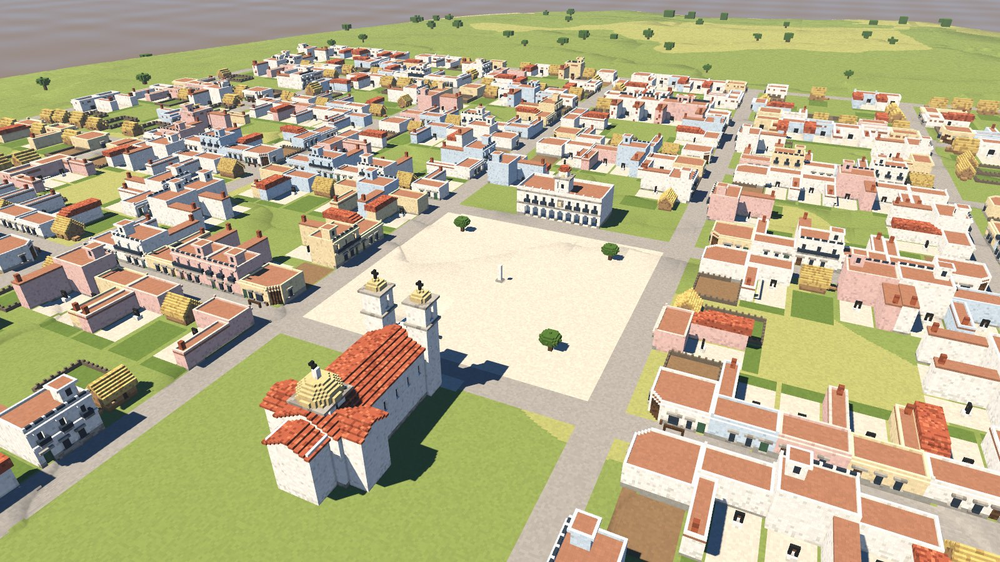

# Motor de vóxeles (Rust)

> Documento de sistema. Complementa al [GDD](../GDD.md).
> Estado: **aplicación interactiva**: ventana con cámara de constructor de ciudades, mundo en
> *streaming* con hilos, sandbox de construir y excavar, y recorrido automático con capturas.
> El modo captura (`--shot`) se mantiene. Optimizado con un banco de pruebas reproducible
> (sección 11). Código en [`engine/`](../../engine).


## 1. Objetivos

- **Estética de vóxeles a la vista** (decisión del proyecto): cada bloque de 0,5 m se nota,
  con su variación de tono, sus bordes y la oclusión ambiental en las esquinas, pero con luz,
  sombras, cielo y niebla cuidados para mantener el "realismo estilizado" rioplatense.
- **Mapas del tamaño de Montevideo** (24 × 24 km) con detalle de 0,5 m cerca de la cámara.
- **Mundo editable**: calles, edificios, terraplenes y, más adelante, excavar, ganar tierra al
  río o dragar el puerto son simplemente cambios de vóxeles.
- **Motor propio en Rust**, sin otro motor de juego: control total del formato de datos, de la
  simulación de agentes y del render.

## 2. Arquitectura

Un solo crate binario, `motor`, organizado en módulos:

| Módulo | Responsabilidad |
|---|---|
| `palette` | Materiales (`u8`, 0 = aire) y paleta de colores rioplatense |
| `terrain` | Geografía del mapa: **puerto exacto** de `scripts/world/terrain_gen.gd` (mismas constantes y fórmulas; ruido FastNoiseLite configurado como el de Godot) |
| `world` / `world::chunk` | Almacén disperso de chunks por nivel, generación por columnas |
| `buildings` | Ediciones de vóxeles, generador aleatorio determinista y vegetación |
| `structures` | Kit modular de estructuras y desgaste por vóxel ([estética](estetica-voxel.md)); `colonial` (catálogo de la época) y `scenes` (escenas `ciudad` y `catalogo`) |
| `lod` | Anillos de nivel de detalle tipo *clipmap* |
| `mesher` | Caras visibles + *greedy meshing* + oclusión ambiental por vértice |
| `camera` | Cámara orbital de constructor de ciudades (Z invertida e infinita) |
| `render` | wgpu: sombras del sol, cielo, vóxeles y agua; captura a PNG/JPG |

Dependencias: `wgpu` (render), `glam` (matemática), `fastnoise-lite` (ruido),
`bytemuck`, `pollster`, `image`.

## 3. Datos

- **Vóxel**: 1 byte de material. Vóxel base de **0,5 m**.
- **Chunk**: 32 × 32 × 32 vóxeles (32 KB). A resolución base cubre 16 m de lado.
- **Disperso**: solo se guardan los chunks que tocan la superficie. Debajo se asume roca
  maciza y encima aire, a partir de la altura de cada columna (`Column.top`), así que un chunk
  enterrado no ocupa memoria.
- **Ediciones**: la ciudad y los árboles se escriben como un mapa de vóxeles a resolución
  base más un mapa de "material de superficie" (calles, plaza, huertas). Cada nivel de detalle
  las reduce a su resolución quedándose con el vóxel fino **más alto** de cada celda, para que
  desde arriba se vea el techo y no un moteado.

## 4. Niveles de detalle

Anillos concéntricos alrededor del foco de la cámara. Cada nivel duplica el tamaño del vóxel
y la distancia que cubre:

| Nivel | Vóxel | Chunk | Anillo (lado) |
|---|---|---|---|
| 0 | 0,5 m | 16 m | 384 m |
| 1 | 1 m | 32 m | 768 m |
| 2 | 2 m | 64 m | 1,5 km |
| 3 | 4 m | 128 m | 3 km |
| 4 | 8 m | 256 m | 6 km |
| 5 | 16 m | 512 m | 12 km |
| 6 | 32 m | 1 km | 24 km |
| 7 | 64 m | 2 km | 49 km |

- Cada anillo tiene 24 × 24 chunks y excluye el hueco que cubre el nivel más fino. Las
  regiones se alinean a la cuadrícula del nivel siguiente, así cada punto del mapa pertenece a
  **exactamente un nivel** (hay un test que lo verifica).
- **Juntas entre niveles**: el mallador trata como aire lo que queda fuera del anillo, y eso
  genera "faldones" verticales que tapan las grietas.
- **Mapa completo**: con 8 niveles ya se cubren los 24 km. Cuando la cámara se mueve, solo
  se regeneran las columnas de chunks que entran en cada anillo (ver §10, *streaming*).

## 5. Render

- **wgpu puro**, con Vulkan, Metal o DirectX 12 según la plataforma. Aquí se probó con el driver
  Vulkan por software (lavapipe).
- **Pase de sombras**: mapa de 4096² ortográfico desde el sol, centrado en la cámara, con
  PCF 3 × 3. El sol pasa por el **norte** (hemisferio sur).
- **Cielo**: degradado del horizonte al cenit, disco y halo del sol, colores según la hora
  (amanecer, mediodía, atardecer y noche).
- **Vóxeles**: color del material con variación por vóxel, bordes marcados que se
  desvanecen con la distancia, oclusión ambiental, luz del sol y del cielo. Las ventanas se
  iluminan de noche con luz de vela.
- **Agua**: plano translúcido al nivel del mar, color "león", con reflejo del cielo
  (Fresnel) y brillo del sol.
- **Niebla de distancia** hacia el color del horizonte, más tenue cuanto más se aleja la cámara.
- **Profundidad con Z invertida** y proyección infinita: precisión de 0,5 m a 40 km.
- MSAA 4×. Pocas llamadas de dibujo: las mallas se agrupan en lotes de hasta 6 millones de
  vértices por nivel.

## 6. Rendimiento medido

Máquina de prueba: 4 núcleos de CPU, **sin GPU** (render por software con lavapipe).
Ciudad de prueba de 7 × 7 manzanas, 1.400 ombúes y monte nativo, 8 niveles.

| Paso | Resultado |
|---|---|
| Ciudad y vegetación | 4,0 millones de vóxeles editados en 1,7 s |
| Generación del mundo | 4.792 chunks en 8 niveles, 3,0 s |
| Mallado (greedy + AO) | 692.000 triángulos en 1,4 s |
| Render 1600 × 900 (CPU) | 0,35–0,6 s por imagen |
| Memoria máxima | ~480 MB |

Triángulos por nivel: 160 k (0,5 m), 150 k (1 m), 99 k (2 m), 50 k (4 m), 49 k (8 m),
51 k (16 m), 29 k (32 m), 105 k (64 m). Con una GPU real el render es de tiempo real holgado;
el costo dominante pasa a ser la regeneración de chunks al mover la cámara.

## 7. Plan para llevar el prototipo de Godot al motor

El prototipo de Godot sigue siendo el banco de pruebas del diseño. Sus sistemas se portan en
este orden:

1. ~~**Ventana e interacción**~~ (hecho, ver §10): cámara con ratón y teclado, selección
   con *raycast* DDA, regeneración incremental de chunks al editar.
2. **Calles**: el grafo de `road_network.gd` (nodos, tramos como polilíneas, Bézier, cruces
   automáticos) se porta tal cual; el trazado se "pinta" en los vóxeles (empedrado o tierra) y
   nivela el terreno bajo la calzada.
3. **Solares y crecimiento**: `lots.gd` (solares a lo largo de la curva, zona mixta, tres
   niveles). Los edificios dejan de ser cajas: se estampan como **plantillas de vóxeles**
   (las de `buildings.rs` son el punto de partida), con variantes y rotación.
4. **Vecinos y conducción**: `agents.gd` (rutinas, A* por tiempo medido, IDM, cesión de
   paso, adelantamiento) se porta a Rust sin cambios de lógica; el render usa instancias
   (*instancing*) de pequeños modelos de vóxeles.
5. **Ciclo día/noche, parcelas, interfaz** (la interfaz probablemente con `egui`).
6. **Guardado**: los chunks editados se guardan comprimidos (RLE o LZ4); el resto se
   regenera desde la semilla.

## 8. Riesgos y decisiones abiertas

- **¿Por qué wgpu puro y no Bevy?** Bevy aporta ECS, ventana e interfaz, pero cambia su API
  en cada versión y su render genérico no está pensado para millones de vóxeles con
  niveles de detalle. Para un juego cuyo núcleo es el mundo de vóxeles y una simulación
  propia, conviene controlar el render y los datos. wgpu da el mismo acceso multiplataforma
  sin imponer arquitectura. Si más adelante hace falta ECS, se puede usar `hecs` o
  `bevy_ecs` sueltos.
- **Juntas entre niveles**: los faldones a veces se ven como líneas finas en la vista lejana.
  Alternativas: transiciones con vóxeles intermedios o un leve desplazamiento vertical.
- **Edificios en niveles gruesos**: a partir de 4 m por vóxel las casas se reducen a
  manchas. Para la vista de toda la ciudad conviene un impostor o un mapa de alturas de
  techos.
- **Memoria**: 4 millones de ediciones viven en un `HashMap`. Para ciudades grandes conviene
  guardarlas directamente en chunks dispersos de ediciones.
- **Generación incremental y en segundo plano**: hecha (§10). Queda pendiente quitar las
  columnas viejas antes, sin esperar a que el *streamer* quede ocioso.
- **Árboles y agua**: el agua es un plano. Los arroyos sobre el nivel del mar, las mareas y
  las sudestadas necesitarán un nivel de agua por zona.
- **Estética**: la variación de tono y los bordes de los vóxeles deben ajustarse con arte
  real (paleta definitiva, materiales con más textura: adoquín, ladrillo visto, paja).

## 9. Cómo ejecutarlo

```
cd engine
cargo run --release -- --shot ciudad.png
cargo run --release -- --shot cerca.png --cam 13470,16190,70,160,24 --hour 9.5
cargo run --release -- --shot lejos.png --cam 12600,15000,9000,190,42 --hour 16.5
cargo run --release                                  # ventana interactiva
cargo run --release -- --msaa 1                      # ventana sin MSAA (más rápida sin GPU)
cargo run --release -- --auto-test salida/           # recorrido automático sin ventana
cargo run --release -- --window --auto-test salida/  # el mismo recorrido en la ventana
cargo run --release -- --frames 300                  # ventana que se cierra sola
cargo test --release
```

Opciones nuevas: `--threads N` (hilos de generación; por defecto núcleos − 1),
`--smooth 0|1` (normal suave del terreno, activada por defecto), `--msaa 1|4`.
En Linux sin pantalla la ventana funciona con `xvfb-run` (probado con lavapipe; hace falta
`libxkbcommon-x11-0`).

`--cam x,z,distancia,giro,inclinación` (metros y grados), `--hour` (0–24), `--size 1600x900`,
`--levels 8`. Hace falta un driver Vulkan, Metal o DirectX 12. En Linux sin GPU sirve el
driver por software de Mesa (`mesa-vulkan-drivers`).

## Novedades: estética de estructuras

- **Kit modular** (`structures`): zócalo, cuerpo, coronación, aberturas y elementos sobre un
  marco de solar; variantes deterministas por semilla y desgaste por vóxel. Detalle en
  [estetica-voxel.md](estetica-voxel.md).
- **Catálogo colonial**: rancho, casa de azotea, casa de altos, pulpería, cabildo, iglesia
  matriz en 5 fases, muralla con portón y garita, muelle, barraca, saladero, estancia,
  atahona y molino.
- **Escenas**: `--scene ciudad` (por defecto) y `--scene catalogo`.
- **Detalle por material en el shader**: el número de material viaja en el alfa del color
  del vértice; el shader dibuja rejas, tejas, paja, sillería y azulejos por debajo del
  tamaño del vóxel.
- **Métricas** (4 núcleos, sin GPU):

| Escena | Vóxeles editados | Generación | Mallado | Triángulos | Memoria máxima |
|---|---|---|---|---|---|
| Ciudad | 4,3 M en 1,8 s | 3,4 s | 1,7 s | 1,24 M (antes 0,69 M) | 478 MB |
| Catálogo | 1,1 M en 0,3 s | 1,3 s | 1,2 s | 0,80 M | 218 MB |

  Los triángulos de la ciudad subieron un 79 %: el desgaste y los detalles cortan las caras
  que antes el *greedy meshing* unía.
- **Tests**: 13 en total (4 nuevos: determinismo por semilla, casas dentro del solar, la
  iglesia crece por fases y termina sin andamios, desgaste determinista).


## 10. Aplicación interactiva y *streaming*


### Controles

| Entrada | Acción |
|---|---|
| WASD / flechas | Desplazar la cámara (velocidad proporcional a la distancia) |
| Q / E | Girar |
| Rueda | Zoom de 15 m a 15 km |
| Botón central (arrastrar) | Orbitar |
| Botón derecho (arrastrar) | Desplazar |
| Clic izquierdo | Colocar la estructura elegida (huella verde bajo el cursor) |
| Clic derecho sin arrastrar | Excavar (radio 3 vóxeles) |
| F | Rellenar terreno (radio 4) |
| 1–9 / Tab | Elegir estructura del catálogo (14: rancho, casas, pulpería, aljibe, ombú, cabildo, iglesia, muralla, atahona, molino, estancia, saladero…) |
| R | Rotar la estructura 90° |
| `[` / `]` | Cambiar la hora |
| P | Pausar el día (un día dura 8 minutos) |
| F12 | Guardar captura PNG |

El título de la ventana muestra FPS, triángulos, columnas cargadas, trabajos pendientes,
memoria y la estructura elegida. La cámara sigue la altura del terreno.

### Arquitectura

| Módulo | Responsabilidad |
|---|---|
| `store` | `EditStore`: ediciones ya reducidas a cada nivel, por chunk. El terreno no se guarda: es una función. A igual altura gana la edición más reciente. |
| `stream` | `Streamer`: hilos de trabajo con cola de prioridad (cercanía al foco; ediciones urgentes), trabajos versionados (se descartan resultados viejos), anillos que se recentran, presupuesto de vértices subidos por cuadro, retiro de columnas lejanas. Cada columna se malla sola: el borde de un vóxel se calcula directamente. |
| `raycast` | Marcha sobre el mapa de alturas y luego DDA (Amanatides–Woo) por los vóxeles editados. |
| `sandbox` | Catálogo de estructuras, colocar con rotación, excavar y rellenar como ediciones. |
| `session` | Estado de juego compartido entre ventana y recorrido: cámara, hora, escena cargada en segundo plano, *overlay* del cursor. |
| `app` | Ventana winit + superficie wgpu (vsync, cambio de tamaño). |
| `tour` | Recorrido automático `--auto-test` con capturas y métricas. |

Al editar, solo se re-mallan las columnas de chunks tocadas y sus vecinas de borde (1 a 6
columnas por edición); hay un test que lo comprueba.

### Líneas oscuras en los escalones del terreno

Cada escalón de 0,5 m dibujaba una cara lateral con borde y oclusión ambiental, y desde lejos
eso se veía como rayas oscuras. Solución: cada vértice de terreno lleva una **normal suave de
la ladera** (gradiente de las alturas vecinas) y el shader la usa para iluminar el terreno; de
cerca, las caras laterales se mezclan con su normal real para que los vóxeles sigan notándose.
Además se suavizó la oclusión y el borde en materiales de terreno.


### Métricas (4 núcleos, sin GPU, lavapipe)

| Medida | Resultado |
|---|---|
| Renderer listo | 65 ms |
| Primer cuadro en la ventana | 0,2–0,7 s (el terreno aparece enseguida; la ciudad se carga en segundo plano) |
| Primeras columnas malladas | 4 ms tras empezar la sesión |
| Escena completa visible | ~3,6–4,3 s |
| Vista general ociosa | 4,9 s; 3.600 columnas; 1,24 M triángulos; mallas 71–102 MB |
| Viaje de 3,3 km | listo en ~1,9 s |
| Re-mallado al editar | 1–6 columnas |
| Memoria | 330–450 MB sin capturas; 540–760 MB con capturas (pico ~800 MB) |
| FPS por software 1280 × 720 | 2,6 con MSAA 4×; 3,6–4,7 con MSAA 1× |
| Recorrido `--auto-test` completo | ~18 s |

Se corrigió un crecimiento de memoria hasta 900 MB: los búferes creados con datos iniciales no
se liberaban sin un `queue.submit` periódico; ahora se envía uno vacío y se hace `poll` en cada
cuadro.




### Problemas conocidos

- Bandas tenues en algunas laderas y líneas finas en las juntas entre niveles.
- FPS bajos por software: con una GPU real no debería ser un problema, pero no está medido.
- Las capturas suben la memoria unos 200 MB (MSAA y compilación JIT de lavapipe).
- Las estructuras se apoyan en una sola altura de base y pueden solaparse con edificios
  existentes (no hay comprobación de colisiones).
- Las columnas retiradas se quitan cuando el *streamer* queda ocioso (o pasado un límite), así
  que al moverse rápido hay mallas solapadas un momento.
- Solo 4 rotaciones (90°).

**Tests**: 18 en total (nuevos: orden de carga por cercanía, re-mallado solo de columnas
tocadas, DDA sobre terreno y edificios, normal suave, edición más reciente gana).

## 11. Optimización (medir → optimizar → verificar)

> **Importante:** todas las medidas son con **lavapipe/llvmpipe, que dibuja con la CPU** (4
> núcleos, sin GPU). El tiempo "total por cuadro" es, en realidad, rasterizar con la CPU. Los
> FPS con una GPU real **no están medidos**; ahí el cuello de botella será otro (sobre todo
> CPU por cuadro y subida de mallas, que también bajaron).

### Banco de pruebas

`motor --bench carpeta [--frames N] [--msaa 1|4] [--size AxB]` arma la escena de la ciudad,
y para cuatro cámaras fijas (ciudad de cerca, península, lejos a 9 km y ciudad de noche):
genera y malla en *streaming* hasta terminar, sube todo a la GPU, dibuja N cuadros fuera de
pantalla y guarda una tabla (`bench.md`) y una captura por vista. Mide tiempo de generación
y mallado (pared y CPU por fase), triángulos, vértices, bytes de vértices e índices en la
GPU, llamadas de dibujo, CPU por cuadro, tiempo total por cuadro (con el mapa de sombras
rehecho y en caché) y memoria.

### Antes y después (1280×720, MSAA 4×, 3 hilos de trabajo, 5 cuadros por vista)

| Métrica | Antes | Después |
|---|---|---|
| Generar + mallar una vista completa (pared) | 2,64–2,78 s | **0,91–1,00 s** (−65 %) |
| CPU de generación del terreno por vista | 3,4–3,6 s | 2,0–2,2 s |
| CPU de mallado por vista | 4,4–4,8 s | **0,69–0,77 s** (−84 %) |
| Triángulos (ciudad) | 1,24 M | 1,24 M (idénticos) |
| Bytes por vértice | 28 | **16** |
| Vértices en GPU (ciudad) | 66,2 MB | **37,8 MB** (−43 %) |
| Índices en GPU (ciudad) | 14,2 MB | **7,1 MB** (−50 %, índices de 16 bits) |
| Dibujos principal / sombras (ciudad de cerca) | 3.600 / 1.872 | 1.323 / 397 |
| CPU por cuadro (grabar comandos) | 6,7–8,0 ms | 2,2–8,1 ms |
| Total por cuadro, ciudad de cerca | 334 ms | 251 ms (sombra rehecha) · **161 ms** (en caché) |
| Total por cuadro, península | 382 ms | 315 ms · **216 ms** |
| Total por cuadro, lejos (9 km) | 282 ms | 262 ms · **163 ms** |
| Total por cuadro, ciudad de noche | 426 ms | 380 ms · **245 ms** |
| Memoria de las ediciones de la escena | 109 MB | **41 MB** |
| Memoria máxima del banco (VmHWM) | 793 MB | 713 MB |
| Ventana 1280×720, MSAA 4× (FPS medio, 150 cuadros) | 2,6 | **4,1** |
| Ventana 1280×720, MSAA 1× | 3,6 | **7,8** |
| Recorrido: viaje de 3,3 km hasta tener todo cargado | ~1,9 s | **0,76 s** |
| Modo captura: mallado de todo el mundo | ~1,4 s | 0,55 s |


### Qué se hizo, en orden de impacto medido

1. **Mallado con máscaras de bits.** Una fila de 34 vóxeles cabe en un `u64`: "sólido aquí y
   aire en el vecino" se calcula por fila con operaciones de bits, y el material y la
   oclusión solo se calculan donde hay una cara. El *greedy meshing* sigue igual, así que la
   malla es idéntica. De ~1 ms a ~0,15 ms por chunk.
2. **Mapa de sombras en caché.** Rehacer el mapa de 4096² en cada cuadro costaba ~90–160 ms
   con lavapipe. Ahora se rehace solo si cambia la luz (hora, encuadre) o la geometría. Además
   la caja de luz se ajusta a la grilla de texels, así las sombras no "titilan" al mover la cámara.
3. **Descarte por frustum** (cámara y caja de luz) por columna, con su caja envolvente, y
   **dibujo de cerca a lejos**: la prueba de profundidad descarta antes lo tapado y el orden de
   dibujo es siempre el mismo.
4. **Solo las caras que miran a la cámara.** Los índices de cada columna se agrupan por
   dirección de cara (arriba, ±x, ±z, abajo) y se dibujan solo los grupos visibles desde la
   cámara, en tramos contiguos. Hay más llamadas de dibujo pero menos vértices procesados.
5. **Vértice compacto de 16 bytes** (antes 28): posición en vóxeles relativa al origen de la
   columna (`u16`), color con el material en el alfa, y en un `u8×4` la dirección de la cara,
   la oclusión y la normal suave de la ladera (x, z; la y se reconstruye). El origen y el tamaño
   del vóxel de cada columna van en un búfer de instancias compartido. Índices de 16 bits.
6. **Alturas del terreno más rápidas, mismo resultado.** La costa depende solo de x y se calcula
   una vez por columna de la grilla (era un ruido de 5 octavas por punto), y la tabla de
   segmentos de los arroyos pasó de un `HashMap` a una grilla densa. 1,85 s → 0,65 s de CPU por
   vista. Hay una prueba que compara ambos caminos punto a punto.
7. **Almacén de ediciones compacto y determinista.** Por chunk, índices ordenados con su altura
   y material (5 bytes por vóxel, en lugar de un `HashMap` por vóxel): 109 → 41 MB. Además, al
   reducir la resolución, los empates de altura dentro de una misma carga se deciden por la
   posición fina y no por el orden aleatorio del `HashMap`: **ahora dos ejecuciones dan
   exactamente la misma imagen** (antes variaba ~1 % de los píxeles de una corrida a otra).
8. **Sombra solo donde da el sol**: las caras que no miran al sol no consultan el mapa de
   sombras (9 lecturas por fragmento). Imagen idéntica, ganancia pequeña.
9. **MSAA automático**: sin `--msaa`, la ventana usa 1× cuando el adaptador es la CPU (lavapipe,
   llvmpipe) y 4× con GPU. Las capturas siguen en 4×.

### Verificación de la imagen

- Tests: 21 en verde. Los nuevos cubren la grilla densa y la costa cacheada (mismo resultado
  punto a punto), el vértice de 16 bytes con su desempaquetado y sus grupos por dirección, el
  almacén compacto (determinismo, bytes por vóxel y unión de ediciones).
- Diferencia de píxeles entre la versión anterior y la nueva, mismas cámaras: 1,16 % (cerca),
  0,42 % (península), 0,03 % (lejos) y 0,63 % (noche) de píxeles con diferencia > 8. Es del mismo
  tamaño que lo que variaba **la versión anterior entre dos ejecuciones** (1,07 / 0,27 / 0,03 /
  0,45 %), y está solo en techos lejanos de los niveles gruesos: el material elegido en los
  empates de altura (punto 7). La nueva versión da diferencia 0 entre ejecuciones.
- La ventana bajo xvfb, `--auto-test` y `--shot` siguen funcionando.

### Lo que no mejoró o no valió la pena

- **El cuadro con la sombra rehecha** sigue costando 250–380 ms con lavapipe: es rasterizar
  4096² con la CPU. Bajar la resolución del mapa o las 9 lecturas del filtro de sombra lo
  aceleraría, pero cambia la imagen y no se hizo.
- **La memoria total del proceso** bajó poco (~80 MB): la mayor parte es del propio lavapipe
  (texturas de MSAA y del mapa de sombras, búferes) y del montículo.
- **La generación del terreno** sigue siendo la mayor parte del tiempo de *streaming* (las
  alturas y el material de superficie usan ruido de varias octavas por punto).
- **El modo captura** (`World::generate`) sigue tardando ~4,5 s en generar, porque reduce las
  ediciones nivel por nivel con tablas hash. El juego usa el *streaming*, que ya está optimizado.
- **Las juntas finas entre niveles de detalle** y **el solapamiento momentáneo al moverse rápido**
  (problemas conocidos de la sección 10) siguen igual.

### Pendiente

- Medir con una GPU real (FPS, tiempo de GPU con *timestamp queries*).
- Reutilizar alturas entre columnas vecinas y re-mallados, o generar el terreno en la GPU.
- Dibujo indirecto en un solo búfer grande (menos llamadas de dibujo con GPU).
- Sombras en cascadas (más baratas lejos y más nítidas cerca).
- Quitar las columnas viejas apenas su zona está cubierta por las nuevas.

