# Motor de vóxeles (Rust)

> Documento de sistema. Complementa al [GDD](../GDD.md).
> Estado: **aplicación interactiva**: ventana con cámara de constructor de ciudades, mundo en
> *streaming* con hilos, sandbox de construir y excavar, y recorrido automático con capturas.
> El modo captura (`--shot`) se mantiene. Optimizado con un banco de pruebas reproducible
> (sección 11). Código en [`engine/`](../../engine).

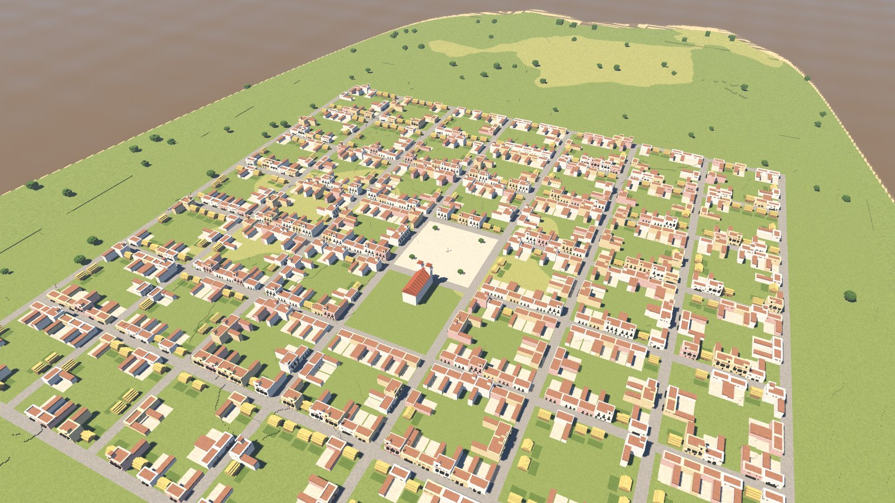

## 1. Objetivos

- **Estética de vóxeles a la vista** (decisión del proyecto): cada bloque se nota (0,25 m en
  el terreno y la vegetación, 0,5 m en los edificios),
  con su variación de tono, sus bordes y la oclusión ambiental en las esquinas, pero con luz,
  sombras, cielo y niebla cuidados para mantener el "realismo estilizado" rioplatense.
- **Mapas del tamaño de Montevideo** (24 × 24 km) con detalle de 0,25 m cerca de la cámara.
- **Mundo editable**: calles, edificios, terraplenes y, más adelante, excavar, ganar tierra al
  río o dragar el puerto son simplemente cambios de vóxeles.
- **Motor propio en Rust**, sin otro motor de juego: control total del formato de datos, de la
  simulación de agentes y del render.

## 2. Arquitectura

Un solo crate binario, `motor`, organizado en módulos:

| Módulo | Responsabilidad |
|---|---|
| `palette` | Materiales (`u8`, 0 = aire) y paleta de colores rioplatense |
| `terrain` | Geografía del mapa: **puerto exacto** de `scripts/world/terrain_gen.gd` (mismas constantes y fórmulas; ruido FastNoiseLite configurado como el de Godot) |
| `world` / `world::chunk` | Almacén disperso de chunks por nivel, generación por columnas |
| `buildings` | Ediciones de vóxeles, generador aleatorio determinista y vegetación |
| `structures` | Kit modular de estructuras y desgaste por vóxel ([estética](estetica-voxel.md)); `colonial` (catálogo de la época) y `scenes` (escenas `ciudad` y `catalogo`) |
| `lod` | Anillos de nivel de detalle tipo *clipmap* |
| `mesher` | Caras visibles + *greedy meshing* + oclusión ambiental por vértice |
| `camera` | Cámara orbital de constructor de ciudades (Z invertida e infinita) |
| `render` | wgpu: sombras del sol, cielo, vóxeles y agua; captura a PNG/JPG |

Dependencias: `wgpu` (render), `glam` (matemática), `fastnoise-lite` (ruido),
`bytemuck`, `pollster`, `image`.

## 3. Datos

- **Vóxel**: 1 byte de material. Vóxel base de **0,25 m** (`lod::BASE_VOXEL`; hasta la §16
  era de 0,5 m).
- **Vóxel de diseño**: los edificios se diseñan en vóxeles de **0,5 m** (`lod::DESIGN_VOXEL`):
  puerta de 3 × 6, solar de 24 × 48. Cada uno ocupa un bloque de 2 × 2 × 2 vóxeles base.
- **Chunk**: 32 × 32 × 32 vóxeles (32 KB). A resolución base cubre 8 m de lado.
- **Disperso**: solo se guardan los chunks que tocan la superficie. Debajo se asume roca
  maciza y encima aire, a partir de la altura de cada columna (`Column.top`), así que un chunk
  enterrado no ocupa memoria.
- **Ediciones**: calles, plaza, puentes y excavaciones se escriben como un mapa de vóxeles a
  resolución base; los edificios, en un mapa aparte en vóxeles de diseño (`Edits::design`). A
  eso se suma un mapa de "material de superficie" (calles, plaza, huertas). En el nivel 0 el
  diseño se guarda sin expandir y se expande al mallar (§16). Cada nivel de detalle
  las reduce a su resolución quedándose con el vóxel fino **más alto** de cada celda, para que
  desde arriba se vea el techo y no un moteado.

## 4. Niveles de detalle

Anillos concéntricos alrededor del foco de la cámara. Cada nivel duplica el tamaño del vóxel
y la distancia que cubre:

| Nivel | Vóxel | Chunk | Anillo (lado) |
|---|---|---|---|
| 0 | 0,25 m | 8 m | 192 m |
| 1 | 0,5 m | 16 m | 384 m |
| 2 | 1 m | 32 m | 768 m |
| 3 | 2 m | 64 m | 1,5 km |
| 4 | 4 m | 128 m | 3 km |
| 5 | 8 m | 256 m | 6 km |
| 6 | 16 m | 512 m | 12 km |
| 7 | 32 m | 1 km | 24 km |
| 8 | 64 m | 2 km | 49 km |

- Cada anillo tiene 24 × 24 chunks y excluye el hueco que cubre el nivel más fino. Las
  regiones se alinean a la cuadrícula del nivel siguiente, así cada punto del mapa pertenece a
  **exactamente un nivel** (hay un test que lo verifica).
- **Juntas entre niveles**: el mallador trata como aire lo que queda fuera del anillo, y eso
  genera "faldones" verticales que tapan las grietas.
- **Mapa completo**: con 9 niveles (`lod::LEVELS`) ya se cubren los 24 km. Cuando la cámara se mueve, solo
  se regeneran las columnas de chunks que entran en cada anillo (ver §10, *streaming*).

## 5. Render

- **wgpu puro**, con Vulkan, Metal o DirectX 12 según la plataforma. Aquí se probó con el driver
  Vulkan por software (lavapipe).
- **Pase de sombras**: mapa de 4096² ortográfico desde el sol, centrado en la cámara, con
  PCF 3 × 3. El sol pasa por el **norte** (hemisferio sur).
- **Cielo**: degradado del horizonte al cenit, disco y halo del sol, colores según la hora
  (amanecer, mediodía, atardecer y noche).
- **Vóxeles**: color del material con variación por vóxel, bordes marcados que se
  desvanecen con la distancia, oclusión ambiental, luz del sol y del cielo. Las ventanas se
  iluminan de noche con luz de vela.
- **Agua**: plano translúcido al nivel del mar, color "león", con reflejo del cielo
  (Fresnel) y brillo del sol.
- **Niebla de distancia** hacia el color del horizonte, más tenue cuanto más se aleja la cámara.
- **Profundidad con Z invertida** y proyección infinita: precisión de 0,5 m a 40 km.
- MSAA 4×. Pocas llamadas de dibujo: las mallas se agrupan en lotes de hasta 6 millones de
  vértices por nivel.

## 6. Rendimiento medido

Máquina de prueba: 4 núcleos de CPU, **sin GPU** (render por software con lavapipe).
Ciudad de prueba de 7 × 7 manzanas, 1.400 ombúes y monte nativo, 8 niveles.

| Paso | Resultado |
|---|---|
| Ciudad y vegetación | 4,0 millones de vóxeles editados en 1,7 s |
| Generación del mundo | 4.792 chunks en 8 niveles, 3,0 s |
| Mallado (greedy + AO) | 692.000 triángulos en 1,4 s |
| Render 1600 × 900 (CPU) | 0,35–0,6 s por imagen |
| Memoria máxima | ~480 MB |

Triángulos por nivel: 160 k (0,5 m), 150 k (1 m), 99 k (2 m), 50 k (4 m), 49 k (8 m),
51 k (16 m), 29 k (32 m), 105 k (64 m). Con una GPU real el render es de tiempo real holgado;
el costo dominante pasa a ser la regeneración de chunks al mover la cámara.

## 7. Plan para llevar el prototipo de Godot al motor

El prototipo de Godot sigue siendo el banco de pruebas del diseño. Sus sistemas se portan en
este orden:

1. ~~**Ventana e interacción**~~ (hecho, ver §10): cámara con ratón y teclado, selección
   con *raycast* DDA, regeneración incremental de chunks al editar.
2. **Calles**: el grafo de `road_network.gd` (nodos, tramos como polilíneas, Bézier, cruces
   automáticos) se porta tal cual; el trazado se "pinta" en los vóxeles (empedrado o tierra) y
   nivela el terreno bajo la calzada.
3. **Solares y crecimiento**: `lots.gd` (solares a lo largo de la curva, zona mixta, tres
   niveles). Los edificios dejan de ser cajas: se estampan como **plantillas de vóxeles**
   (las de `buildings.rs` son el punto de partida), con variantes y rotación.
4. **Vecinos y conducción**: `agents.gd` (rutinas, A* por tiempo medido, IDM, cesión de
   paso, adelantamiento) se porta a Rust sin cambios de lógica; el render usa instancias
   (*instancing*) de pequeños modelos de vóxeles.
5. **Ciclo día/noche, parcelas, interfaz** (la interfaz probablemente con `egui`).
6. **Guardado**: los chunks editados se guardan comprimidos (RLE o LZ4); el resto se
   regenera desde la semilla.

## 8. Riesgos y decisiones abiertas

- **¿Por qué wgpu puro y no Bevy?** Bevy aporta ECS, ventana e interfaz, pero cambia su API
  en cada versión y su render genérico no está pensado para millones de vóxeles con
  niveles de detalle. Para un juego cuyo núcleo es el mundo de vóxeles y una simulación
  propia, conviene controlar el render y los datos. wgpu da el mismo acceso multiplataforma
  sin imponer arquitectura. Si más adelante hace falta ECS, se puede usar `hecs` o
  `bevy_ecs` sueltos.
- **Juntas entre niveles**: los faldones a veces se ven como líneas finas en la vista lejana.
  Alternativas: transiciones con vóxeles intermedios o un leve desplazamiento vertical.
- **Edificios en niveles gruesos**: a partir de 4 m por vóxel las casas se reducen a
  manchas. Para la vista de toda la ciudad conviene un impostor o un mapa de alturas de
  techos.
- **Memoria**: 4 millones de ediciones viven en un `HashMap`. Para ciudades grandes conviene
  guardarlas directamente en chunks dispersos de ediciones.
- **Generación incremental y en segundo plano**: hecha (§10). Queda pendiente quitar las
  columnas viejas antes, sin esperar a que el *streamer* quede ocioso.
- **Árboles y agua**: el agua es un plano. Los arroyos sobre el nivel del mar, las mareas y
  las sudestadas necesitarán un nivel de agua por zona.
- **Estética**: la variación de tono y los bordes de los vóxeles deben ajustarse con arte
  real (paleta definitiva, materiales con más textura: adoquín, ladrillo visto, paja).

## 9. Cómo ejecutarlo

```
cd engine
cargo run --release -- --shot ciudad.png
cargo run --release -- --shot cerca.png --cam 13470,16190,70,160,24 --hour 9.5
cargo run --release -- --shot lejos.png --cam 12600,15000,9000,190,42 --hour 16.5
cargo run --release                                  # ventana con el juego (ver §13)
cargo run --release -- --sandbox                     # ventana con el sandbox (escena colonial)
cargo run --release -- --demo-ciudad salida/         # recorrido del juego sin ventana (§13)
cargo run --release -- --msaa 1                      # ventana sin MSAA (más rápida sin GPU)
cargo run --release -- --auto-test salida/           # recorrido automático sin ventana
cargo run --release -- --window --auto-test salida/  # el mismo recorrido en la ventana
cargo run --release -- --frames 300                  # ventana que se cierra sola
cargo test --release
```

Opciones nuevas: `--threads N` (hilos de generación; por defecto núcleos − 1),
`--smooth 0|1` (normal suave del terreno, activada por defecto), `--msaa 1|4`.
En Linux sin pantalla la ventana funciona con `xvfb-run` (probado con lavapipe; hace falta
`libxkbcommon-x11-0`).

`--cam x,z,distancia,giro,inclinación` (metros y grados), `--hour` (0–24), `--size 1600x900`,
`--levels 8`. Hace falta un driver Vulkan, Metal o DirectX 12. En Linux sin GPU sirve el
driver por software de Mesa (`mesa-vulkan-drivers`).

## Novedades: estética de estructuras

- **Kit modular** (`structures`): zócalo, cuerpo, coronación, aberturas y elementos sobre un
  marco de solar; variantes deterministas por semilla y desgaste por vóxel. Detalle en
  [estetica-voxel.md](estetica-voxel.md).
- **Catálogo colonial**: rancho, casa de azotea, casa de altos, pulpería, cabildo, iglesia
  matriz en 5 fases, muralla con portón y garita, muelle, barraca, saladero, estancia,
  atahona y molino.
- **Escenas**: `--scene ciudad` (por defecto) y `--scene catalogo`.
- **Detalle por material en el shader**: el número de material viaja en el alfa del color
  del vértice; el shader dibuja rejas, tejas, paja, sillería y azulejos por debajo del
  tamaño del vóxel.
- **Métricas** (4 núcleos, sin GPU):

| Escena | Vóxeles editados | Generación | Mallado | Triángulos | Memoria máxima |
|---|---|---|---|---|---|
| Ciudad | 4,3 M en 1,8 s | 3,4 s | 1,7 s | 1,24 M (antes 0,69 M) | 478 MB |
| Catálogo | 1,1 M en 0,3 s | 1,3 s | 1,2 s | 0,80 M | 218 MB |

  Los triángulos de la ciudad subieron un 79 %: el desgaste y los detalles cortan las caras
  que antes el *greedy meshing* unía.
- **Tests**: 13 en total (4 nuevos: determinismo por semilla, casas dentro del solar, la
  iglesia crece por fases y termina sin andamios, desgaste determinista).


## 10. Aplicación interactiva y *streaming*


### Controles

| Entrada | Acción |
|---|---|
| WASD / flechas | Desplazar la cámara (velocidad proporcional a la distancia) |
| Q / E | Girar |
| Rueda | Zoom de 15 m a 15 km |
| Botón central (arrastrar) | Orbitar |
| Botón derecho (arrastrar) | Desplazar |
| Clic izquierdo | Colocar la estructura elegida (huella verde bajo el cursor) |
| Clic derecho sin arrastrar | Excavar (radio 3 vóxeles) |
| F | Rellenar terreno (radio 4) |
| 1–9 / Tab | Elegir estructura del catálogo (14: rancho, casas, pulpería, aljibe, ombú, cabildo, iglesia, muralla, atahona, molino, estancia, saladero…) |
| R | Rotar la estructura 90° |
| `[` / `]` | Cambiar la hora |
| P | Pausar el día (un día dura 8 minutos) |
| F12 | Guardar captura PNG |

El título de la ventana muestra FPS, triángulos, columnas cargadas, trabajos pendientes,
memoria y la estructura elegida. La cámara sigue la altura del terreno.

### Arquitectura

| Módulo | Responsabilidad |
|---|---|
| `store` | `EditStore`: ediciones ya reducidas a cada nivel, por chunk. El terreno no se guarda: es una función. A igual altura gana la edición más reciente. |
| `stream` | `Streamer`: hilos de trabajo con cola de prioridad (cercanía al foco; ediciones urgentes), trabajos versionados (se descartan resultados viejos), anillos que se recentran, presupuesto de vértices subidos por cuadro, retiro de columnas lejanas. Cada columna se malla sola: el borde de un vóxel se calcula directamente. |
| `raycast` | Marcha sobre el mapa de alturas y luego DDA (Amanatides–Woo) por los vóxeles editados. |
| `sandbox` | Catálogo de estructuras, colocar con rotación, excavar y rellenar como ediciones. |
| `session` | Estado de juego compartido entre ventana y recorrido: cámara, hora, escena cargada en segundo plano, *overlay* del cursor. |
| `app` | Ventana winit + superficie wgpu (vsync, cambio de tamaño). |
| `tour` | Recorrido automático `--auto-test` con capturas y métricas. |

Al editar, solo se re-mallan las columnas de chunks tocadas y sus vecinas de borde (1 a 6
columnas por edición); hay un test que lo comprueba.

### Líneas oscuras en los escalones del terreno

Cada escalón de 0,5 m dibujaba una cara lateral con borde y oclusión ambiental, y desde lejos
eso se veía como rayas oscuras. Solución: cada vértice de terreno lleva una **normal suave de
la ladera** (gradiente de las alturas vecinas) y el shader la usa para iluminar el terreno; de
cerca, las caras laterales se mezclan con su normal real para que los vóxeles sigan notándose.
Además se suavizó la oclusión y el borde en materiales de terreno.


### Métricas (4 núcleos, sin GPU, lavapipe)

| Medida | Resultado |
|---|---|
| Renderer listo | 65 ms |
| Primer cuadro en la ventana | 0,2–0,7 s (el terreno aparece enseguida; la ciudad se carga en segundo plano) |
| Primeras columnas malladas | 4 ms tras empezar la sesión |
| Escena completa visible | ~3,6–4,3 s |
| Vista general ociosa | 4,9 s; 3.600 columnas; 1,24 M triángulos; mallas 71–102 MB |
| Viaje de 3,3 km | listo en ~1,9 s |
| Re-mallado al editar | 1–6 columnas |
| Memoria | 330–450 MB sin capturas; 540–760 MB con capturas (pico ~800 MB) |
| FPS por software 1280 × 720 | 2,6 con MSAA 4×; 3,6–4,7 con MSAA 1× |
| Recorrido `--auto-test` completo | ~18 s |

Se corrigió un crecimiento de memoria hasta 900 MB: los búferes creados con datos iniciales no
se liberaban sin un `queue.submit` periódico; ahora se envía uno vacío y se hace `poll` en cada
cuadro.


### Problemas conocidos

- Bandas tenues en algunas laderas y líneas finas en las juntas entre niveles.
- FPS bajos por software: con una GPU real no debería ser un problema, pero no está medido.
- Las capturas suben la memoria unos 200 MB (MSAA y compilación JIT de lavapipe).
- Las estructuras se apoyan en una sola altura de base y pueden solaparse con edificios
  existentes (no hay comprobación de colisiones).
- Las columnas retiradas se quitan cuando el *streamer* queda ocioso (o pasado un límite), así
  que al moverse rápido hay mallas solapadas un momento.
- Solo 4 rotaciones (90°).

**Tests**: 18 en total (nuevos: orden de carga por cercanía, re-mallado solo de columnas
tocadas, DDA sobre terreno y edificios, normal suave, edición más reciente gana).

## 11. Optimización (medir → optimizar → verificar)

> **Importante:** todas las medidas son con **lavapipe/llvmpipe, que dibuja con la CPU** (4
> núcleos, sin GPU). El tiempo "total por cuadro" es, en realidad, rasterizar con la CPU. Los
> FPS con una GPU real **no están medidos**; ahí el cuello de botella será otro (sobre todo
> CPU por cuadro y subida de mallas, que también bajaron).

### Banco de pruebas

`motor --bench carpeta [--frames N] [--msaa 1|4] [--size AxB]` arma la escena de la ciudad,
y para cuatro cámaras fijas (ciudad de cerca, península, lejos a 9 km y ciudad de noche):
genera y malla en *streaming* hasta terminar, sube todo a la GPU, dibuja N cuadros fuera de
pantalla y guarda una tabla (`bench.md`) y una captura por vista. Mide tiempo de generación
y mallado (pared y CPU por fase), triángulos, vértices, bytes de vértices e índices en la
GPU, llamadas de dibujo, CPU por cuadro, tiempo total por cuadro (con el mapa de sombras
rehecho y en caché) y memoria.

### Antes y después (1280×720, MSAA 4×, 3 hilos de trabajo, 5 cuadros por vista)

| Métrica | Antes | Después |
|---|---|---|
| Generar + mallar una vista completa (pared) | 2,64–2,78 s | **0,91–1,00 s** (−65 %) |
| CPU de generación del terreno por vista | 3,4–3,6 s | 2,0–2,2 s |
| CPU de mallado por vista | 4,4–4,8 s | **0,69–0,77 s** (−84 %) |
| Triángulos (ciudad) | 1,24 M | 1,24 M (idénticos) |
| Bytes por vértice | 28 | **16** |
| Vértices en GPU (ciudad) | 66,2 MB | **37,8 MB** (−43 %) |
| Índices en GPU (ciudad) | 14,2 MB | **7,1 MB** (−50 %, índices de 16 bits) |
| Dibujos principal / sombras (ciudad de cerca) | 3.600 / 1.872 | 1.323 / 397 |
| CPU por cuadro (grabar comandos) | 6,7–8,0 ms | 2,2–8,1 ms |
| Total por cuadro, ciudad de cerca | 334 ms | 251 ms (sombra rehecha) · **161 ms** (en caché) |
| Total por cuadro, península | 382 ms | 315 ms · **216 ms** |
| Total por cuadro, lejos (9 km) | 282 ms | 262 ms · **163 ms** |
| Total por cuadro, ciudad de noche | 426 ms | 380 ms · **245 ms** |
| Memoria de las ediciones de la escena | 109 MB | **41 MB** |
| Memoria máxima del banco (VmHWM) | 793 MB | 713 MB |
| Ventana 1280×720, MSAA 4× (FPS medio, 150 cuadros) | 2,6 | **4,1** |
| Ventana 1280×720, MSAA 1× | 3,6 | **7,8** |
| Recorrido: viaje de 3,3 km hasta tener todo cargado | ~1,9 s | **0,76 s** |
| Modo captura: mallado de todo el mundo | ~1,4 s | 0,55 s |

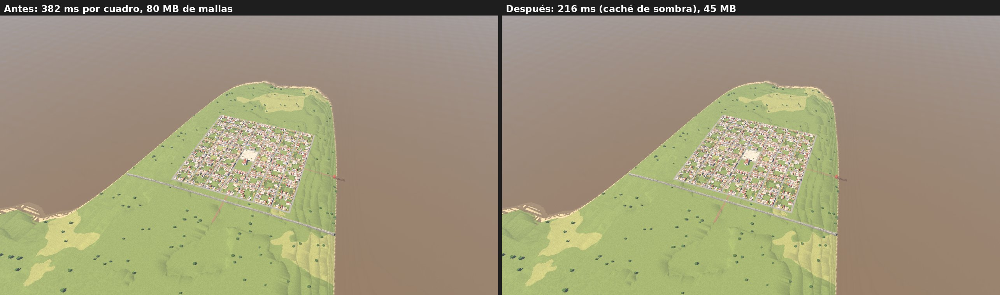

### Qué se hizo, en orden de impacto medido

1. **Mallado con máscaras de bits.** Una fila de 34 vóxeles cabe en un `u64`: "sólido aquí y
   aire en el vecino" se calcula por fila con operaciones de bits, y el material y la
   oclusión solo se calculan donde hay una cara. El *greedy meshing* sigue igual, así que la
   malla es idéntica. De ~1 ms a ~0,15 ms por chunk.
2. **Mapa de sombras en caché.** Rehacer el mapa de 4096² en cada cuadro costaba ~90–160 ms
   con lavapipe. Ahora se rehace solo si cambia la luz (hora, encuadre) o la geometría. Además
   la caja de luz se ajusta a la grilla de texels, así las sombras no "titilan" al mover la cámara.
3. **Descarte por frustum** (cámara y caja de luz) por columna, con su caja envolvente, y
   **dibujo de cerca a lejos**: la prueba de profundidad descarta antes lo tapado y el orden de
   dibujo es siempre el mismo.
4. **Solo las caras que miran a la cámara.** Los índices de cada columna se agrupan por
   dirección de cara (arriba, ±x, ±z, abajo) y se dibujan solo los grupos visibles desde la
   cámara, en tramos contiguos. Hay más llamadas de dibujo pero menos vértices procesados.
5. **Vértice compacto de 16 bytes** (antes 28): posición en vóxeles relativa al origen de la
   columna (`u16`), color con el material en el alfa, y en un `u8×4` la dirección de la cara,
   la oclusión y la normal suave de la ladera (x, z; la y se reconstruye). El origen y el tamaño
   del vóxel de cada columna van en un búfer de instancias compartido. Índices de 16 bits.
6. **Alturas del terreno más rápidas, mismo resultado.** La costa depende solo de x y se calcula
   una vez por columna de la grilla (era un ruido de 5 octavas por punto), y la tabla de
   segmentos de los arroyos pasó de un `HashMap` a una grilla densa. 1,85 s → 0,65 s de CPU por
   vista. Hay una prueba que compara ambos caminos punto a punto.
7. **Almacén de ediciones compacto y determinista.** Por chunk, índices ordenados con su altura
   y material (5 bytes por vóxel, en lugar de un `HashMap` por vóxel): 109 → 41 MB. Además, al
   reducir la resolución, los empates de altura dentro de una misma carga se deciden por la
   posición fina y no por el orden aleatorio del `HashMap`: **ahora dos ejecuciones dan
   exactamente la misma imagen** (antes variaba ~1 % de los píxeles de una corrida a otra).
8. **Sombra solo donde da el sol**: las caras que no miran al sol no consultan el mapa de
   sombras (9 lecturas por fragmento). Imagen idéntica, ganancia pequeña.
9. **MSAA automático**: sin `--msaa`, la ventana usa 1× cuando el adaptador es la CPU (lavapipe,
   llvmpipe) y 4× con GPU. Las capturas siguen en 4×.

### Verificación de la imagen

- Tests: 21 en verde. Los nuevos cubren la grilla densa y la costa cacheada (mismo resultado
  punto a punto), el vértice de 16 bytes con su desempaquetado y sus grupos por dirección, el
  almacén compacto (determinismo, bytes por vóxel y unión de ediciones).
- Diferencia de píxeles entre la versión anterior y la nueva, mismas cámaras: 1,16 % (cerca),
  0,42 % (península), 0,03 % (lejos) y 0,63 % (noche) de píxeles con diferencia > 8. Es del mismo
  tamaño que lo que variaba **la versión anterior entre dos ejecuciones** (1,07 / 0,27 / 0,03 /
  0,45 %), y está solo en techos lejanos de los niveles gruesos: el material elegido en los
  empates de altura (punto 7). La nueva versión da diferencia 0 entre ejecuciones.
- La ventana bajo xvfb, `--auto-test` y `--shot` siguen funcionando.

### Lo que no mejoró o no valió la pena

- **El cuadro con la sombra rehecha** sigue costando 250–380 ms con lavapipe: es rasterizar
  4096² con la CPU. Bajar la resolución del mapa o las 9 lecturas del filtro de sombra lo
  aceleraría, pero cambia la imagen y no se hizo.
- **La memoria total del proceso** bajó poco (~80 MB): la mayor parte es del propio lavapipe
  (texturas de MSAA y del mapa de sombras, búferes) y del montículo.
- **La generación del terreno** sigue siendo la mayor parte del tiempo de *streaming* (las
  alturas y el material de superficie usan ruido de varias octavas por punto).
- **El modo captura** (`World::generate`) sigue tardando ~4,5 s en generar, porque reduce las
  ediciones nivel por nivel con tablas hash. El juego usa el *streaming*, que ya está optimizado.
- **Las juntas finas entre niveles de detalle** y **el solapamiento momentáneo al moverse rápido**
  (problemas conocidos de la sección 10) siguen igual.

### Pendiente

- Medir con una GPU real (FPS, tiempo de GPU con *timestamp queries*).
- Reutilizar alturas entre columnas vecinas y re-mallados, o generar el terreno en la GPU.
- Dibujo indirecto en un solo búfer grande (menos llamadas de dibujo con GPU).
- Sombras en cascadas (más baratas lejos y más nítidas cerca).
- Quitar las columnas viejas apenas su zona está cubierta por las nuevas.


## 12. Optimización inspirada en Tisma engine

Tisma engine es el *slicer* 3D del autor (C++, Vulkan). Se revisaron sus técnicas de rendimiento y
se **reimplementaron** en Rust/wgpu las que sirven para un motor de vóxeles. No se copió código. Cada
técnica cita en un comentario de dónde viene. Vulkan se usa **a través de wgpu**, con sus funciones
opcionales: `MULTI_DRAW_INDIRECT`, `INDIRECT_FIRST_INSTANCE`, *compute shaders* y
`TIMESTAMP_QUERY`. No se escribió Vulkan crudo.

> **Advertencia:** todas las medidas son con **lavapipe/llvmpipe**, que dibuja con la CPU (3 hilos).
> Los milisegundos por cuadro miden sobre todo cuánto le cuesta a la CPU rasterizar. **No se
> midieron FPS con una GPU real.** Con una GPU real, menos llamadas de dibujo y menos bytes deberían
> pesar más que acá. Las medidas con lavapipe varían ±15–20 % entre ejecuciones, así que el antes y
> el después se corrieron alternados.

### Antes y después (`motor --bench`, 1280×720, MSAA 4×, mismas cámaras)

| Vista | Triángulos | Geometría en GPU | Dibujos (principal / sombras) | CPU por cuadro | Cuadro con sombra rehecha | Cuadro con sombra en caché | Generar+mallar |
|---|---|---|---|---|---|---|---|
| Ciudad de cerca | 1,24 M → 1,24 M | 44,9 → **11,8 MB** | 1323 / 397 → **1 / 1** | 2,6 → **0,5 ms** | 280 → 244 ms | 188 → 160 ms | 0,98 → 1,07 s |
| Península | 1,24 M → **0,89 M** | 44,9 → **8,5 MB** | 3672 / 1810 → **1 / 1** | 7,1 → **0,6 ms** | 328 → 264 ms | 207 → 170 ms | 0,98 → **0,70 s** |
| Lejos (9 km) | 0,69 M → **0,42 M** | 25,1 → **4,0 MB** | 4457 / 1825 → **1 / 1** | 7,0 → **0,6 ms** | 259 → 165 ms | 170 → 116 ms | 0,85 → **0,51 s** |
| Ciudad de noche | 1,24 M → 1,24 M | 44,9 → **11,8 MB** | 2534 / 1219 → **1 / 1** | 4,8 → **0,6 ms** | 371 → 389 ms | 244 → 263 ms | 1,06 → 0,97 s |

Memoria máxima del proceso: 703 MB → **573 MB**. "Geometría en GPU" antes son vértices más índices.
Después son caras de 20 bytes. El megabúfer reserva 20 MB y crece si hace falta.

Los cuadros de cerca y de noche (mismos triángulos) cambian dentro del ruido: lavapipe gasta el
tiempo rasterizando, no en dibujar llamadas. En península y lejos se ganó porque la vista desde
arriba ya no genera el nivel más fino que no se ve (punto 6).

**Modos de dibujo** (`--draw directo|indirecto|gpu`; `--gpu-cull 0|1` es un atajo). Cuadro con
sombra en caché, cerca / península / lejos / noche:

| Modo | Cuadro | CPU por cuadro |
|---|---|---|
| Directo (una llamada por rango) | 161 / 186 / 126 / 257 ms | 0,5–1,3 ms |
| Indirecto múltiple, descarte en CPU | 159 / 190 / 117 / 243 ms | 0,5–0,6 ms |
| Indirecto múltiple, descarte en GPU (*compute*) | 179 / 183 / 131 / 261 ms | ~0,2 ms |

Los tres modos dan **la misma imagen, píxel a píxel**. Con lavapipe el descarte en GPU no gana,
porque el *compute shader* también corre en la CPU. Por eso el motor elige solo: **indirecto** en
adaptadores de CPU y **GPU** en GPUs reales, si el adaptador tiene `MULTI_DRAW_INDIRECT`. Si no lo
tiene, usa **directo**.

### Qué se aplicó y dónde

1. **Versión por columna y *pipeline* acotado** (Tisma: `tbb::parallel_pipeline` con fichas
   limitadas en `src/gcode/writer.cpp`).
   - `stream.rs`: cada pedido lleva una versión, y los resultados con versión vieja se descartan.
   - La cola de resultados es un `sync_channel` de 96. Si el hilo principal se atrasa, los
     generadores esperan en vez de acumular mallas.
   - **Arregla el solapamiento momentáneo** de la sección 10: una columna retirada se quita apenas
     su zona queda cubierta por niveles vigentes, en vez de esperar al vaciado completo.
   - Tests `los_resultados_con_version_vieja_se_descartan` y
     `las_columnas_viejas_se_quitan_apenas_su_zona_esta_cubierta`.
2. **Caras compactas e instanciadas con *vertex pulling*** (Tisma: `PreviewInstance` +
   `shaders/preview.vert`).
   - `mesher.rs`: cada cara es un `Quad` de **20 bytes** (posición, tamaño, dirección, AO,
     material, iluminación suave y *slot* de columna). Antes eran 4 vértices + 6 índices: 72 bytes.
   - `voxel.wgsl` arma las esquinas con `vertex_index`, con un búfer de 6 índices compartido.
     Conserva la rotación y el reflejo de la diagonal, así que los triángulos son los mismos.
   - Los colores salen de una paleta uniforme y el origen de cada columna, de un búfer *storage*.
   - Test `la_expansion_de_las_caras_es_igual_a_la_malla_anterior`: compara con el mallador
     anterior, vértice a vértice.
3. **Megabúfer con asignador por bloques y liberación diferida** (Tisma: búferes editables de
   `apps/tisma/vk_view.cpp`).
   - `render/alloc.rs`: un *buddy allocator* sobre un solo búfer de caras.
   - Los bloques liberados se reutilizan recién 2 cuadros después, para no pisar lo que la GPU
     todavía lee. No hace falta `device.poll(Wait)`.
   - Si se llena, el búfer crece copiando en la GPU.
   - Tests de unión de hermanos, crecimiento y determinismo.
4. **Dibujo indirecto múltiple y descarte en GPU** (Tisma: ítem V4 pendiente de su `PLAN.md`).
   - `render/mod.rs`: las caras de cada columna se guardan agrupadas por dirección.
   - En modo indirecto, la CPU escribe los argumentos y se dibuja **todo con una llamada**
     `multi_draw_indexed_indirect`.
   - En modo GPU, `shaders/cull.wgsl` (un hilo por columna) prueba la caja contra el *frustum*,
     descarta las caras que miran para atrás y llena los argumentos. La sombra hace lo mismo
     contra la luz.
5. **Clave de cuadro y clave de sombra** (Tisma: `frame_key()` en `apps/tisma/renderer.cpp`).
   - `app.rs`: si la cámara, la hora, la escena y la interfaz no cambiaron, no se dibuja. La
     ventana espera con `WaitUntil` en vez de girar.
   - La sombra se invalida solo si la columna que cambió cae **dentro del *frustum* de la luz**.
   - El pase de sombra dibuja **solo las caras que miran al sol**. Con eso, el cuadro con sombra
     rehecha quedó igual o mejor que antes, aun con el costo de desempaquetar las caras.
6. **Nivel de detalle por tamaño en pantalla** (Tisma: criterio de medio píxel en
   `far_group()` / `merged_layers()`, `src/ui/scene.cpp`).
   - `lod.rs`: `voxel_pixels()` mide cuántos píxeles ocupa un vóxel a la altura de la cámara.
   - `choose_first_level()` no genera niveles cuyo vóxel mida menos de medio píxel. La histéresis
     (0,45 / 0,55 px) evita que vaya y vuelva entre niveles.
   - `MOTOR_LOD_FIJO=1` lo apaga para comparar.
7. **Claves `u64` y FxHash** (Tisma: tablas con hash de enteros en `src/mesh/indexed_mesh.cpp`).
   `fxhash.rs` reemplaza SipHash en los mapas de columnas, versiones y conjuntos del *streaming*.
8. **Contadores y *timestamps* de GPU sin bloquear**.
   - La barra de título muestra caras, MB en GPU, modo de dibujo, llamadas y MB subidos.
   - El *benchmark* usa `TIMESTAMP_QUERY` para la columna "GPU pase principal".

### Capturas y diferencia de píxeles

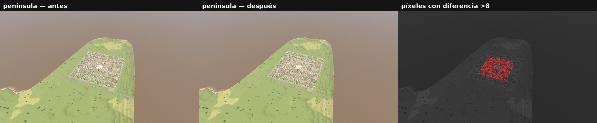
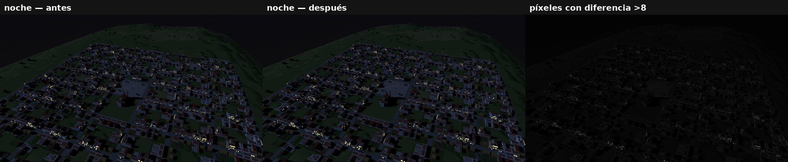

Píxeles con diferencia > 8 contra la versión anterior, con las mismas cámaras:

- Con el nivel de detalle fijo (`MOTOR_LOD_FIJO=1`): **0 %** en cerca, península y lejos, y
  **0,02 %** de noche.
- Con el nivel por tamaño en pantalla: **1,13 %** en península (0,27 % con > 32) y **0,25 %** en
  lejos. Es el detalle de menos de medio píxel que ya no se dibuja: techos de la ciudad vistos de
  muy alto.
- Cerca y noche no cambian.

La ventana bajo xvfb, `--auto-test` y `--shot` siguen funcionando. Hay 29 tests en total.

### Lo que no se hizo o se descartó

- **Descarte en GPU como opción por defecto con lavapipe**: es 0–13 % más lento que el indirecto
  con descarte en CPU (ver la tabla). Queda como opción por defecto solo en GPUs reales, y eso
  todavía no se midió.
- **Dibujo no indexado con *vertex pulling*** (6 vértices por cara sin índices): corría el
  *vertex shader* 6 veces por cara en vez de 4, y era más lento. Se volvió al instanciado indexado.
- ***Hash* de bordes para vecinos**: el mallado ya lee los bordes del anillo de chunks vecinos, y
  no apareció en el perfil.
- **Chunks uniformes con almacenamiento aparte**: los chunks de aire y los enterrados ya se
  saltean (sección 11), así que lo que queda no justificaba otro formato.
- ***Timestamps* en la ventana**: están solo en el *benchmark*. En la ventana habría que leerlos de
  forma asíncrona un cuadro tarde.
- **El costo de desempaquetar las caras en el *shader***: con llvmpipe cuesta un poco. Se
  compensó en el pase de sombra, pero en el pase principal de noche el cuadro quedó en el ruido
  (+5 %).

### Pendiente

- **Hi-Z / descarte por oclusión** en el *compute shader*: necesita una GPU real para que valga
  la pena.
- **Medir con una GPU real**: FPS, tiempo de GPU por pase, y los tres modos de dibujo.
- *Timestamps* asíncronos en la ventana.
- Sombras en cascadas y generación del terreno en la GPU (pendientes de la sección 11).

## 13. El juego en el motor: calles y solares

Fase 2, pasos 1 y 2 de la hoja de ruta: el juego del prototipo (fundar, trazar calles,
zonificar, crecer) ya se juega sobre los vóxeles. `motor` abre directamente el juego; el
sandbox de antes queda en `motor --sandbox` (o con `--scene ...`).

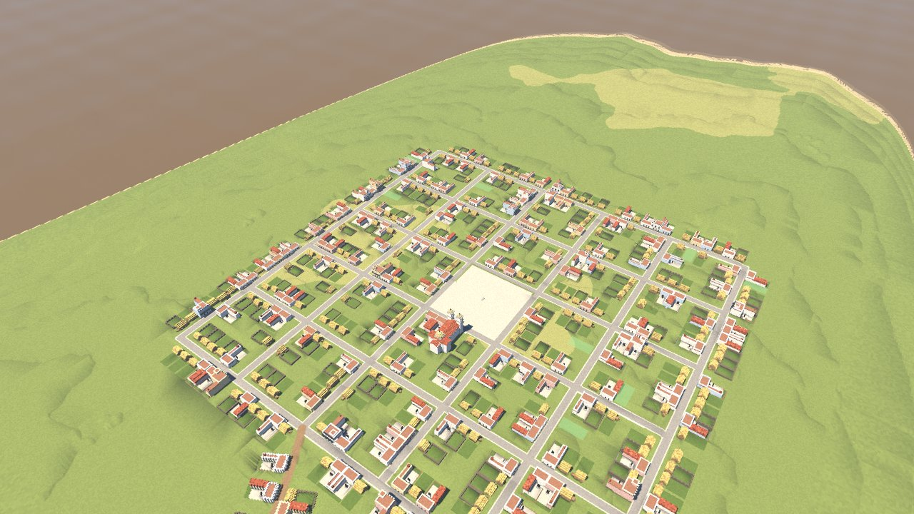

| | |
|---|---|
| 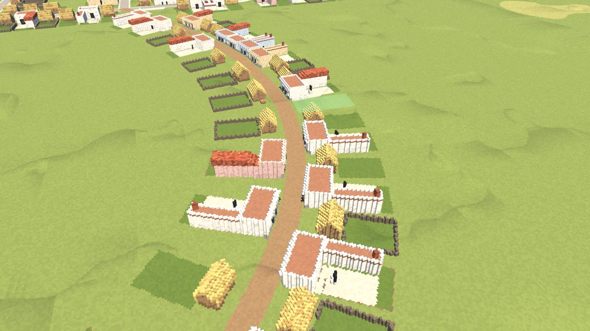 | 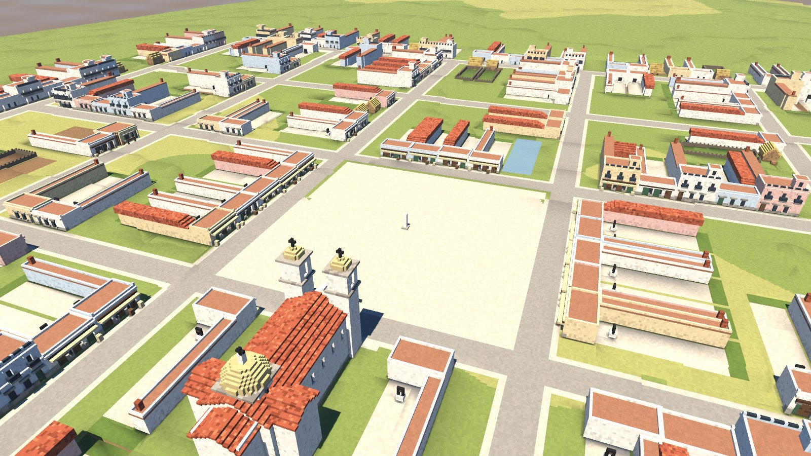 |
| 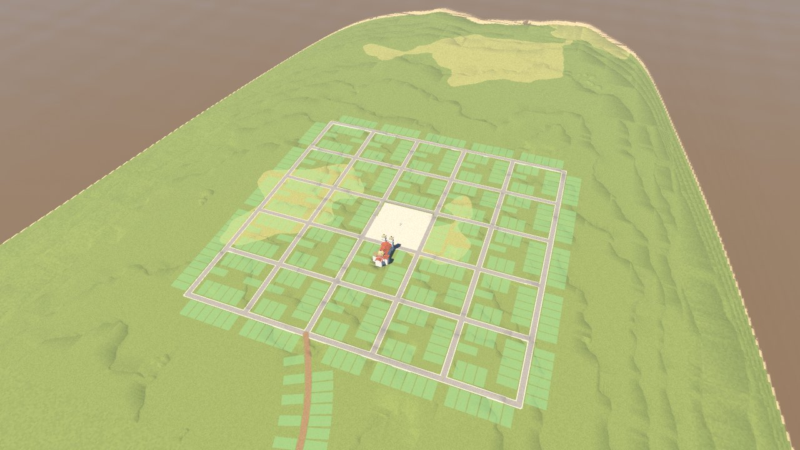 | 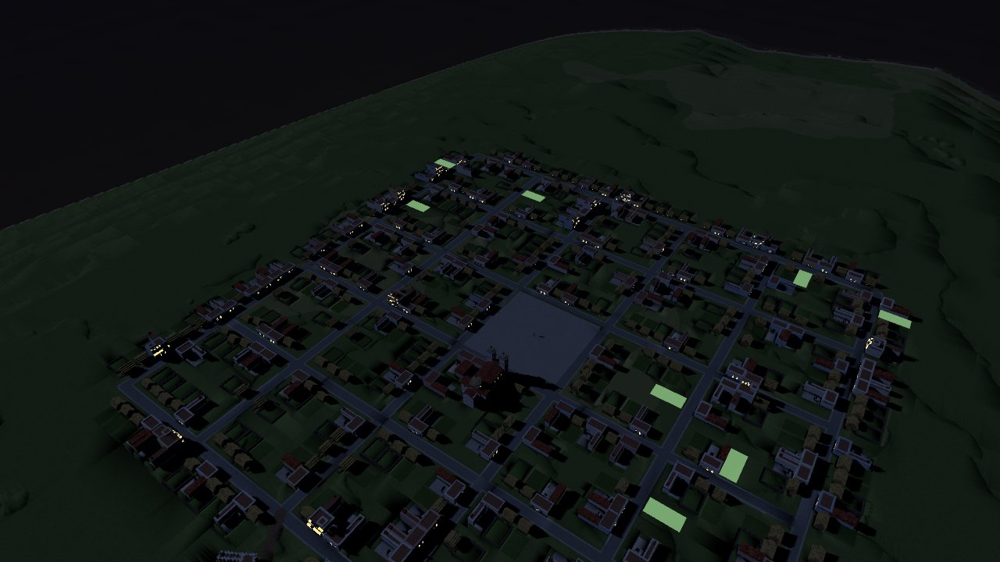 |

### Controles del modo juego

| Entrada | Acción |
|---|---|
| 1 | Fundar la plaza mayor (obligatorio al empezar; R gira la plaza 15°) |
| 2 | Calle recta: clic inicio, clic fin; sigue encadenando desde el último punto |
| 3 | Calle curva: clic inicio, clic fin, el tercer clic da la forma (Bézier cuadrática) |
| 4 | Damero: dos clics marcan un lado, el tercero lo extiende (cuadras de 84 m) |
| 5 / 6 | Zonificar / quitar zona con el pincel (mantener apretado); `[` `]` cambian el radio (10–150 m) |
| 7 | Demoler el tramo de calle bajo el cursor (20 $); los solares que quedan sin frente se van con sus edificios |
| 8 | Inspeccionar (solar, nivel, valor del suelo, tipo de calle) |
| Tab | Camino de tierra (6 m, radio mín. 14 m, 2 $/m) ↔ calle empedrada (8 m, radio mín. 22 m, 7 $/m) |
| Espacio / 0 | Pausa / velocidad ×1, ×2, ×4 |
| , / . | Hora del día |
| Esc, clic derecho | Cancela el trazado en curso; Esc sin nada que cancelar abre el menú de pausa (sección 15) |
| F5 / F9 | Guardar la partida / cargar la última guardada |

La cámara se maneja igual que en el sandbox. Las vistas previas se dibujan con la capa
translúcida: verde si se puede construir, rojo si no (con el motivo en el título); solares
libres en verde claro, zonificados en verde; contorno de la plaza; círculo del pincel;
tramo a demoler resaltado. El título de la ventana es la línea de estado: fecha (desde
marzo de 1726), pesos, población, pobladores que esperan casa, solares, herramienta, tipo
de calle, pincel y el último aviso.

### Arquitectura (`engine/src/city/`)

| Módulo | Qué hace |
|---|---|
| `roads.rs` | Grafo de calles (porte de `road_network.gd`): polilíneas, enganche a nodos y tramos a 9 m, cruces automáticos (parte los tramos), radio mínimo, índice espacial por celdas de 40 m, `clearance` (distancia al borde de la calzada más cercana) |
| `lots.rs` | Solares de 12×24 m a ambos lados de cada tramo, cada uno mirando a su calle (sigue las curvas); misma validación que el prototipo (altura, pendiente, no pisar calzada, sin superponerse, SAT); pincel; crecimiento rancho → azotea → altos con el cupo de pobladores (los altos piden calle empedrada); valor del suelo por distancia a la plaza |
| `voxelize.rs` | Calzada en vóxeles, plaza y edificios girados (abajo) |
| `mod.rs` | `City`: dinero, pobladores, meses (llegadas, barco cada 4 meses, impuestos), validaciones con mensajes, fundación, construir/demoler calles, crecimiento con sus ediciones |
| `game.rs` | Herramientas, clics, vistas previas, línea de estado |
| `game_demo.rs` | Acciones del recorrido automático |

Todo devuelve `Edits`; `Session::apply_edits` las pasa al streamer, que re-malla solo las
columnas tocadas (como el sandbox).

**Calzada.** La altura de la calle en un punto es el promedio del terreno en un disco de
6 m alrededor de ese punto: solo depende del lugar, así que dos calles que se cruzan dan la
misma altura en el cruce sin coordinarse. Cada columna dentro del ancho se corta o se
rellena a esa altura (tierra debajo, aire encima) y se pinta: camino de tierra, o empedrado
con 1 m de vereda de piedra a cada lado (la vereda no se pinta dentro de otra calzada, para
que los cruces queden limpios). Afuera, 3 m de banquina en rampa al terreno natural.
Demoler restaura el terreno y vuelve a pintar las calles vecinas que compartían cruce.

**Plaza.** Explanada de 76 m nivelada, de piedra, con el rollo al centro; la iglesia
(fase 5 del constructor de `colonial.rs`) se construye del otro lado de la calle, mirando a
la plaza; las cuatro calles que la rodean son empedradas. Plaza e iglesia son obstáculos
para calles y solares.

**Edificios girados.** Los constructores del catálogo solo saben de ejes cardinales. Para
cualquier ángulo: se construye el edificio sin girar alrededor del centro del solar, y
luego cada columna del mundo dentro del rectángulo girado se lleva de vuelta al sistema
del edificio (rotación inversa) y toma el vóxel más cercano. Si el ángulo está a menos de
1,5° de uno cardinal se usa exacto (las cuadras del damero quedan nítidas, sin dientes).
Los vóxeles del constructor por debajo del piso se descartan y los cimientos se rehacen
por columna desde 4 vóxeles bajo el terreno natural (así la banquina de la calle nunca
deja el frente colgando). El edificio se apoya en el punto más alto de su planta.
Mejorar un solar borra (aire) los vóxeles del edificio viejo que el nuevo no ocupa y
escribe el nuevo; cada solar guarda la lista de sus vóxeles.

Con vóxeles de 0,5 m, el giro se nota en las fachadas como escalones de medio vóxel
(ver la captura de la curva): se lee bien a distancia de juego; de muy cerca, las paredes
oblicuas se ven dentadas.

**Cambio en el almacén de ediciones (`store.rs`).** Antes, al reducir a los niveles
gruesos, ganaba el vóxel más alto entre todas las ediciones acumuladas: al reemplazar una
casa de altos por otra cosa o al demoler, los niveles lejanos seguían mostrando el piso
alto. Ahora, dentro de una misma carga lo sólido le gana al aire (para que un muro fino no
desaparezca de lejos), y una carga nueva reemplaza a la anterior en cada vóxel grueso que
toca. Prueba: `reemplazar_o_demoler_no_deja_restos_en_los_niveles_gruesos`. El overlay
admite ahora hasta 196 608 vértices (los solares de una ciudad grande no entraban).

### Prueba automatizada

```
cd engine
cargo run --release -- --demo-ciudad salida/            # sin ventana
xvfb-run -a -s "-screen 0 1280x720x24" \
  cargo run --release -- --window --demo-ciudad salida/ # en la ventana
```

Funda la plaza en (13500, 16300), traza un damero empedrado de 5×5 cuadras y un camino de
tierra curvo hacia el norte de la península, zonifica con un pincel de 480 m, avanza 60
meses, mide un mes más al ritmo del juego y saca cinco capturas
(`motor-ciudad-trazado|general|curva|plaza|noche`). Probado en las dos formas.

Pruebas nuevas (`cargo test --release`, 42 en total, todas pasan): cruces que parten tramos,
enganche, radio mínimo, distancia a la calzada; solares a ambos lados de una recta sin
superponerse, solares que siguen una curva, una calle nueva quita los solares que pisa;
edificio girado a 0°, 17°, 33°, 90°, 141° y 225° dentro de su solar con la fachada hacia la
calle; ángulo casi cardinal igual al constructor; la calle aplana y pinta calzada y vereda;
fundar-trazar-zonificar-crecer sin ningún vóxel de edificio sobre una calzada; el flujo de
clics de todas las herramientas; la regla nueva del almacén.

### Métricas (4 núcleos, sin GPU, lavapipe)

| Medida | Valor |
|---|---|
| Fundar plaza, iglesia y 4 calles | 66 000 vóxeles, 53 columnas, 0,11 s |
| Damero 5×5 (79 tramos, 407 solares) | 165 000 vóxeles, 318 columnas, 1,2 s (casi todo es validar y generar solares) |
| Calle curva (radio mín. 112 m, +50 solares) | 11 600 vóxeles, 14 columnas, 0,1 s |
| Simulación de un mes (≈450 solares, 20 pasos de crecimiento) | ≈19 ms (sin re-mallar) |
| 60 meses de golpe | 448 edificios, 2,5 M vóxeles, 650 columnas; 1,2 s de simulación + 1,7 s de encolado; re-mallado 0,27 s |
| Un edificio nuevo o mejorado | ≈9 000 vóxeles, ≈3 columnas, re-mallado ≈2–5 ms con los hilos de trabajo |
| Paso de crecimiento al ritmo del juego (0,5 s) | medio 0,8 ms, peor 16 ms |
| Triángulos con la ciudad crecida | 0,46 M → 0,99 M |
| Memoria | 137 MB recién trazado → ≈490 MB con la ciudad crecida (pico 780 MB durante el avance de 60 meses) |
| Ventana bajo xvfb (lavapipe, render por CPU) | ≈7 FPS medio durante el recorrido (no representa una GPU) |

### Problemas conocidos

- **Memoria.** Con la ciudad crecida la memoria residente pasa de ≈140 a ≈490 MB; el pico
  de 780 MB es del avance de 60 meses (todas las ediciones juntas en un mapa). Cada solar
  guarda sus vóxeles (`Vec<IVec3>`, ≈100 KB por casa). Falta medir dónde está el resto y
  aplicar las ediciones en lotes.
- **Encolar muchas ediciones bloquea el hilo principal** (1,7 s para 2,5 M vóxeles en el
  avance rápido). Al ritmo del juego no se nota (≤16 ms por paso), pero un avance rápido
  en la ventana congela un momento.
- Al zonificar con un pincel grande todo crece con ranchos a la vez y la ciudad queda
  pareja; en el prototipo pasa lo mismo, falta la variedad por valor del suelo y demanda.
- Demoler una calle se lleva sin aviso los solares (y casas) que quedan sin frente.
- Cada cambio de calles revisa todos los solares (O(n)); con miles de solares habrá que
  usar el índice espacial también ahí.
- Los puentes no existen: una calle que toca agua se rechaza ("aún no hay puentes").
- La capa de vistas previas no se oscurece de noche (zonas en verde brillante).
- La interfaz gráfica ya existe (sección 14); el título de la ventana sigue mostrando la
  línea de estado para depurar.
- Las paredes oblicuas de 0,5 m se ven dentadas de cerca; no hay suavizado por subvóxel.

## 14. Interfaz del juego

Fase 2, paso 3: la interfaz del modo juego dibujada dentro del motor, con la estructura de
los constructores de ciudades modernos y el aspecto de un plano colonial (papel, tinta
sepia, bordes marrones, esquinas redondeadas).

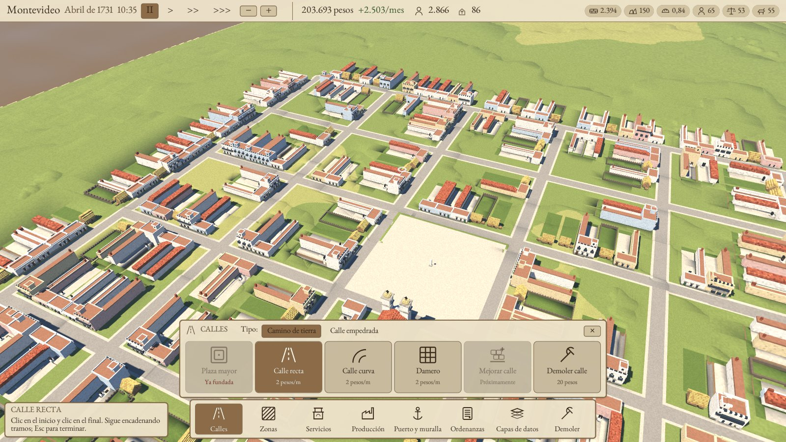

### Estructura de la pantalla

- **Barra superior compacta.** Izquierda: nombre de la ciudad, fecha, hora y velocidad
  (pausa, ×1, ×2, ×4) con − / + para la hora. Centro: tesoro con el balance del último mes
  (verde o rojo), población y pobladores que esperan casa. Derecha: fichas de ladrillos,
  piedra, precio del pan y opinión de vecinos, comerciantes y hacendados, leídas de la
  economía de la ciudad (`city/economy.rs`); el globo de cada ficha da el detalle.
- **Barra inferior de categorías** con ícono y nombre: Calles, Zonas, Servicios,
  Producción, Puerto y muralla, Ordenanzas, Capas de datos, Demoler. Un subrayado marca la
  categoría de la herramienta en uso.
- **Cajón de tarjetas** encima de la barra al elegir una categoría: ícono, nombre y costo.
  Una tarjeta desactivada dice por qué en la propia tarjeta ("Falta la plaza", "Ya
  fundada", "Sin fondos", "Próximamente") y lo explica en el globo. Calles lleva el
  interruptor tierra / empedrado; Zonas, el pincel. Lo que el motor todavía no tiene
  (servicios, producción, puerto, capas de datos, mejorar calle, demoler edificio) aparece
  como tarjeta desactivada "Próximamente".
- **Ficha de información** a la derecha (herramienta Inspeccionar): cabecera con ícono y
  título, sección de datos, "¿Por qué no crece?" con el motivo concreto según las reglas de
  crecimiento, y botones de acción (zonificar / quitar zona en un solar; demoler o
  continuar una calle). Lo inspeccionado se marca en el mundo con un contorno dorado.
- **Pista de la herramienta** abajo a la izquierda: qué hace, el costo en vivo mientras se
  traza y el motivo de error en rojo (agua, pendiente, fondos…).
- **Gaceta**: los avisos del juego aparecen arriba al centro, se ven 6 s y se desvanecen
  (hasta tres a la vez).
- **Panel de listado genérico** (`ListPanel`): título, introducción e ítems con título,
  descripción, costo mensual, efectos (+ en verde, − en rojo) y botón Aprobar / Derogar
  desactivado con motivo. Hoy muestra las 9 ordenanzas reales de la economía (aprobar
  cobra los 100 pesos de papeleo y avisa en la gaceta); sirve igual para cualquier otra
  lista de decisiones.
- **Presupuesto** (tarjeta en Ordenanzas): impuestos con − / + (0 a 20 %, en rojo si pasan
  de lo habitual), renglones del último mes, ingresos, gastos y balance.

Los atajos de teclado van en los globos de ayuda, no en los botones. Esc cancela el
trazado; si no hay trazado cierra, en orden, el listado, el presupuesto, la ficha y el
cajón; si no queda nada abierto, abre el menú de pausa (sección 15).

| Captura | Qué muestra |
|---|---|
| `motor-ui-barra.jpg` | Barra de categorías con el cajón de calles abierto (recta elegida, interruptor de tipo) |
| `motor-ui-cajon-servicios.jpg` | Cajón de servicios: tarjetas "Próximamente" y el pincel de zonas en el mundo |
| `motor-ui-ficha.jpg` | Ficha de un rancho con el motivo por el que no crece y el solar marcado |
| `motor-ui-gaceta.jpg` | Aviso de la gaceta y pista con costo y error en vivo (calle que cruza el agua) |
| `motor-ui-panel.jpg` | Ordenanzas del cabildo y presupuesto con datos reales de la economía |
| `motor-ui-ventana.jpg` | La ventana real (Xvfb + lavapipe) tras clics de prueba con xdotool |

### Arquitectura (`engine/src/ui/`)

- **egui 0.29 + egui-wgpu 0.29 + egui-winit 0.29**, compatibles con el wgpu 22 y el winit
  0.30 del motor (un solo wgpu en el árbol de dependencias).
- `ui/mod.rs`: `GameUi` (estado entre cuadros: categoría abierta, avisos, paneles, balance)
  y `draw()`, que arma toda la interfaz a partir de `Game` y devuelve una lista de
  `UiAction`; `apply()` las aplica al juego después de dibujar. La lógica (tarjetas y sus
  motivos, textos de la barra, fichas, acciones, avisos, Esc) está separada del dibujo y
  tiene pruebas.
- `ui/icons.rs`: los íconos se dibujan con trazos (líneas, arcos, polígonos) en código; no
  hay imágenes de terceros.
- `ui/theme.rs`: colores (papel `#E8DEC5`, tinta `#3D2B1A`, borde `#8A6F4D`), tamaños de
  letra y estilo de los controles. Fuente: **EB Garamond** (SIL OFL 1.1, en
  `engine/assets/fonts/` con su licencia). Esta copia tiene las cifras de altura de
  mayúscula (el 0 no se confunde con la o) y los contornos pasados de CFF a TrueType: el
  rasterizador de egui dibujaba la V, la W y la Y del original como cajas grises.
- `ui/paint.rs`: `UiPainter` teselada y pinta la salida de egui en una pasada propia con
  `LoadOp::Load` sobre la imagen ya dibujada (sin MSAA, después de la resolución).
- `render/mod.rs`: `render_surface(..., ui)` y `capture_with(..., ui)` reciben un gancho que
  pinta la interfaz en la misma entrega del cuadro o de la captura.
- **Ratón**: cada evento pasa primero por egui. Si el cursor está sobre un área de la
  interfaz (se compara la posición de ese instante con las áreas del cuadro anterior, porque
  un clic puede llegar sin cuadros en medio) o egui está arrastrando un control, el clic y
  la rueda no llegan al mundo. El clic en el mundo vuelve a calcular el punto bajo el
  cursor en ese instante.
- **Escala**: `zoom_for` ajusta la interfaz al alto de la ventana (800 px = 1; entre 0,75 y
  2, sin volver a agrandar en pantallas de densidad doble).
- **Redibujo**: el bucle sigue en reposo si nada cambia; la interfaz lo despierta mientras
  hay avisos visibles, animaciones de egui o acciones.
- **Capturas**: el recorrido `--demo-ciudad` tiene pasos `UiShot` que preparan la escena
  (herramienta, cajón, ficha, aviso, paneles) y capturan con la interfaz encima, igual con
  o sin ventana. Las pasadas de egui que no se pintan suben igual sus texturas.

### Costo medido (4 núcleos, sin GPU, lavapipe)

| Medición | Resultado |
|---|---|
| Ventana 1280×720 bajo Xvfb, 900 cuadros con clics | interfaz **1,0 ms de CPU por cuadro** de media (mediana 0,9; peor 9,7 en el primer cuadro, al crear la fuente) |
| El mismo cuadro completo | ≈143 ms (7 FPS de media con render por CPU): la interfaz es < 1 % |
| Capturas 1600×900 con interfaz (egui + pintar) | 0,4 a 3 ms por captura (la primera incluye la fuente) |

Es tiempo de CPU (armar, teselar y subir); el dibujo de la interfaz en lavapipe no se midió
aparte. Con GPU real falta medir.

### Prueba

```
cd engine
cargo build --release && cargo test --release
./target/release/motor --demo-ciudad /tmp/demo   # 1600×900, capturas motor-ui-*.png
xvfb-run -a -s "-screen 0 1280x720x24" ./target/release/motor --size 1280x720 --frames 900
```

La prueba de ventana se hizo con `xdotool`: un clic sobre la barra de categorías y otro
sobre una tarjeta (encima del mundo) no fundan la plaza; un clic en el mundo libre sí.

### Problemas conocidos

- Faltan las herramientas de Servicios, Producción, Puerto y muralla, Capas de datos,
  mejorar calle y demoler edificio (tarjetas "Próximamente").
- El balance arriba es el del presupuesto de la economía; hasta que cierra el primer mes
  muestra "—/mes".
- La ficha de una calle o del terreno tiene pocos datos (tipo y largo; posición).
- Falta elegir el idioma (los menús, el guardado y las opciones están en la sección 15).
- Los globos de ayuda no se ven en las capturas (no hay cursor en el modo sin pantalla).

## 15. Menú principal, pausa y partidas guardadas

Fase 2, paso 6: el juego abre en un menú principal y se puede guardar y cargar la ciudad.
Todo usa el mismo papel y tinta de la interfaz (sección 14).

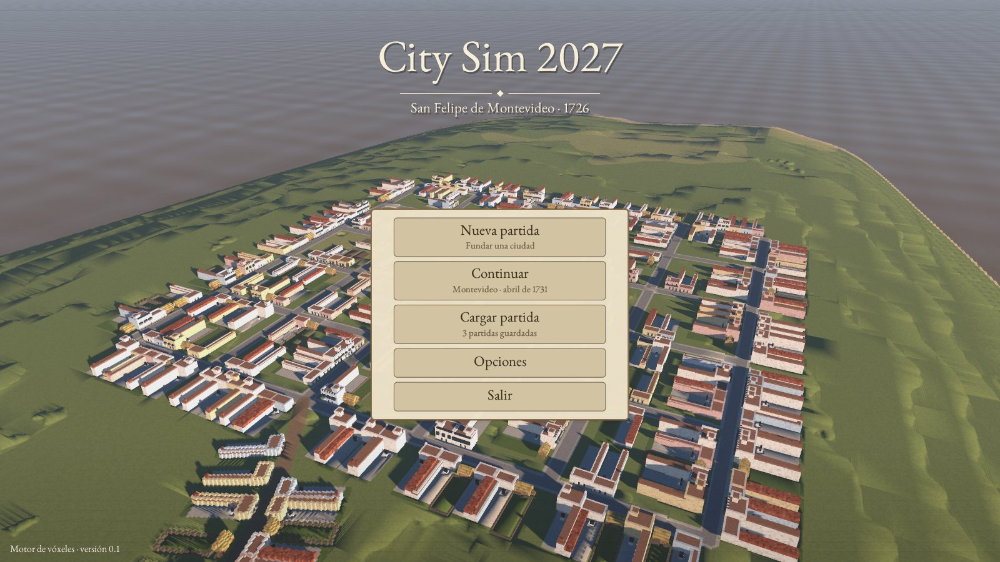

- **Menú principal** (`motor` sin argumentos): la escena colonial gira despacio detrás
  (2,5° por segundo alrededor de la plaza, a las 16:30) bajo el título. Opciones:
  *Nueva partida* (pide el nombre de la ciudad y empieza en la fundación, marzo de 1726),
  *Continuar* (la partida más reciente; desactivada si no hay), *Cargar partida*,
  *Opciones* y *Salir*. `motor --juego` sigue entrando directo a una partida nueva.
- **Cargar partida**: lista de la carpeta de partidas, la más reciente primero, con el
  nombre, la fecha del juego, vecinos, pesos y cuándo se guardó («hace 5 horas»); marca el
  autoguardado y la partida en curso. *Borrar* pide confirmación en el mismo renglón. Un
  archivo dañado o de una versión más nueva aparece al final con el motivo y sin *Cargar*.
- **Menú de pausa** (Esc cuando no queda trazado ni panel que cerrar): *Volver al juego*,
  *Guardar*, *Guardar como…*, *Cargar*, *Opciones*, *Salir al menú principal*, *Salir del
  juego*. Mientras está abierto la simulación y el día se detienen (se restituyen al
  cerrarlo) y el mundo no recibe clics ni teclas. Si hay cambios sin guardar, salir pide
  *Guardar y salir / Salir sin guardar / Cancelar*. Esc vuelve a la pantalla anterior.
- **F5** guarda y **F9** carga la última partida (la actual o la más reciente), con aviso
  en la gaceta.
- **Opciones** (se guardan en `opciones.json`): tamaño de la interfaz (75 a 150 % sobre la
  escala automática), sincronización vertical, contador de FPS, distancia de dibujo (6, 7 u
  8 niveles de detalle; se aplica al empezar o cargar una partida), suavizado de bordes
  (automático, desactivado o 4×; al volver a abrir el juego) y autoguardado cada 6, 12 o 24
  meses de juego (o nunca).

| Captura | Qué muestra |
|---|---|
| `motor-menu-principal.jpg` | Menú principal con la ciudad del recorrido de fondo |
| `motor-menu-cargar.jpg` | Lista de partidas: la normal, otra ciudad y un autoguardado |
| `motor-menu-pausa.jpg` | Menú de pausa sobre la partida, con la interfaz del juego detrás |
| `motor-menu-opciones.jpg` | Opciones |
| `motor-menu-ventana.jpg` | La ventana real (Xvfb + lavapipe) con la escena colonial detrás |

### Formato de las partidas

- Carpeta: Windows `%APPDATA%\CitySim2027\partidas\`, Linux
  `~/.local/share/city-sim-2027/partidas/` (o `$XDG_DATA_HOME`); la variable
  `CITYSIM_DATOS` la cambia (pruebas). Un archivo por partida, con el nombre de la ciudad
  sin acentos (`san-felipe-de-montevideo.json`; `-2` si ya existe); el autoguardado va a
  `<ciudad>-autoguardado.json`.
- JSON (`serde` + `serde_json`) con `formato: 1`; una partida de un formato más nuevo no se
  carga. Se escribe a un temporal y se renombra (nunca queda a medias). La ciudad de la
  demostración (355 solares, 79 tramos) ocupa 82 KB y se guarda en menos de 1 ms.
- Se guarda el estado, no los vóxeles (`city/save.rs`): calles (nodos, tramos con sus
  puntos y tipo, contadores de id), solares (centro, frente, zona, nivel, antigüedad,
  semilla), obstáculos de la plaza e iglesia, tesoro, pobladores, mes, plaza, economía
  (existencias, impuestos, ordenanzas, opinión, pósito, sequía, último presupuesto) y el
  estado de los dos generadores de azar, además de la cámara, la hora, el tipo de calle, el
  pincel, la zona y la velocidad.
- **Al cargar** se regeneran los vóxeles: plaza e iglesia, todas las calles y el edificio de
  cada solar (`City::rebuild_edits`, determinista por semillas, en paralelo y juntado en
  orden de id). Se arma una sesión nueva con el almacén de ediciones ya lleno y el
  streaming genera las columnas como al empezar; el renderizador vacía sus mallas. Empezar o
  cargar se hace un cuadro después del clic para mostrar «Cargando…».
- Como también se guarda el azar, la ciudad cargada sigue creciendo igual que si no se
  hubiera guardado (lo comprueba la prueba).

### Prueba

- `city::save::tests::guardar_y_cargar_da_la_misma_ciudad`: JSON ida y vuelta, mismas
  calles, índices, solares, niveles, dinero y economía; los mismos edificios regenerados; 12
  meses más dan la misma ciudad; las calles cargadas se pueden demoler.
- `save::tests`: nombres de archivo, fechas relativas, listar / leer / borrar, formato
  futuro, opciones con valores fuera de rango.
- `menu::tests`: pantallas y Esc del menú principal, el orden de Esc en el juego (trazado →
  listado → cajón → pausa → juego), la pausa detiene y restituye la simulación, y el ciclo
  nueva partida → guardar → guardar como → F9 → menú principal → borrar → opciones.
- El recorrido `--demo-ciudad` guarda la ciudad crecida, la carga en una sesión nueva,
  compara (`IGUAL`) y saca `motor-ciudad-cargada.png` con la misma cámara que
  `motor-ciudad-general.png` (iguales a la vista); después captura los menús.
- En la ventana (Xvfb + xdotool): nueva partida con nombre, fundar, Esc → pausa, F5,
  salir con cambios (pide confirmación), *Continuar*, F9, opciones (vsync y FPS) y salir.

| Medición (4 núcleos, lavapipe) | Resultado |
|---|---|
| Guardar la ciudad de la demostración | 0,6 ms, 82 KB |
| Cargarla (leer, regenerar 4,3 M vóxeles, llenar el almacén) | ≈3,2 s (1,7 s regenerando) |
| Cargar una fundación | 80 ms |

### Problemas conocidos

- Cargar una ciudad grande traba la ventana unos segundos (se ve «Cargando partida…»); se
  podría regenerar en otro hilo mostrando el terreno mientras tanto.
- Los edificios vecinos que se pisan en un borde pueden quedar apenas distintos al
  cargar (se regeneran en orden de solar, no en el orden en que crecieron).
- El suavizado de bordes elegido se aplica recién al volver a abrir el juego.
- El contador de FPS de las opciones es una etiqueta de la interfaz (abajo a la derecha).

## 16. Vóxel de 0,25 m

El vóxel base pasó de 0,5 m a **0,25 m**: el doble de resolución lineal en el terreno, el
monte, las rocas, la flora baja, las calles y los puentes, con los mismos tamaños reales y la
misma distancia de dibujo.

### Qué cambió

- **Niveles**: `lod::BASE_VOXEL = 0.25` y un nivel más (`lod::LEVELS = 9`): el último sigue
  siendo de 64 m por vóxel y cubre los 24 km. Las opciones guardadas con el vóxel de 0,5 m
  (sin `voxel_cm`) suman un nivel al cargarse, así "corta / media / larga" siguen viendo igual
  de lejos (ahora 7 / 8 / 9 niveles).
- **Criterios en metros, no en índices de nivel**: árboles hasta 4 m por vóxel
  (`stream::TREE_MAX_VOXEL`), sombras hasta 4 m (`render::SHADOW_MAX_LOD` se calcula),
  flora baja en los niveles de 0,25 y 0,5 m (`trees::PLANT_MAX_VOXEL`), plantas de hasta
  2,4 m (`trees::PLANT_SLOTS` vóxeles), hebras de las ramas colgantes de 1,5 m, mezcla de
  biomas por vóxel base (`terrain::dither`), celdas del agua desde 0,25 m. El nivel más fino
  que vale la pena generar ya se elegía en píxeles (`lod::choose_first_level`).
- **Edificios en vóxeles de diseño**: el catálogo (`structures`, `buildings`, la escena de
  muestra) sigue contando en vóxeles de **0,5 m** (`lod::DESIGN_VOXEL`; puerta de 3 × 6,
  solar de 24 × 48). `Frame` trabaja todo en esa grilla (origen, base, medidas) y escribe en
  `Edits::design` / `Edits::design_surface`; nada del catálogo se reescribió. La altura del
  terreno en esa grilla (`buildings::design_top_at`) toma lo más bajo de las cuatro columnas
  base, así los cimientos siempre llegan al suelo. Los edificios girados del juego se
  re-muestrean en la grilla de diseño, como antes.
- **Calles, plaza y puentes en la grilla base**: anchos y alturas en metros (tablero de 1 m,
  pretiles de 0,5 o 1 m, rollo de 2 × 2 m con fuste de 1 × 1 × 4,5 m). Las banquinas de las
  calles ya no pintan pasto sobre el empedrado de la plaza (antes se veían franjas verdes en
  el borde; con 0,25 m eran más).
- **Almacén**: en el nivel 0 los vóxeles de diseño se guardan **sin expandir** (un mapa
  aparte por chunk de diseño, `LevelStore::design`); al mallar, cada uno se expande a su
  bloque de 2 × 2 × 2. Lo base gana en la misma carga y un vóxel de diseño nuevo borra los
  vóxeles base viejos de su bloque. En los niveles 1 en adelante un vóxel de diseño ya cabe
  en un vóxel del nivel y se reduce como siempre. Expandiendo todo, la escena de muestra
  pasaba de 50 MB a 300 MB de ediciones (48 M de vóxeles); así queda en 121 MB.
- **Shader**: los materiales de obra marcan bordes y tinte por vóxel de diseño (0,5 m), no por
  vóxel del mundo, para que las fachadas se vean como antes. El resto del detalle por
  material ya estaba en metros.
- El empaquetado de las caras (11 bits de altura por columna: 512 m a 0,25 m) alcanza.

### Antes y después (`motor --bench`, 1280×720, MSAA 4×, 3 hilos, lavapipe, dos corridas)

| Vista | Columnas | Triángulos | Generar+mallar | Cuadro (sombra en caché) | RSS |
|---|---|---|---|---|---|
| Ciudad de cerca | 3600 → 4032 | 1,35 → 1,45 M | 0,96–1,00 → 1,14–1,20 s | 204–224 → 226–262 ms | 520–554 → 654–661 MB |
| Península | 3168 → 3168 | 0,95 → 0,94 M | 0,72 → 0,70–0,76 s | 205–209 → 213–236 ms | 514–548 → 630–637 MB |
| Lejos (9 km) | 2304 → 2304 | 0,42 → 0,42 M | 0,51–0,53 → 0,54–0,62 s | 144–146 → 141–147 ms | 544–579 → 661–667 MB |
| Ciudad de noche | 3600 → 4032 | 1,35 → 1,45 M | 0,91–0,95 → 1,22–1,25 s | 294–306 → 326–364 ms | 592–651 → 717–724 MB |

Escena de muestra: armada en 3,2–3,5 → 3,8–3,9 s; ediciones 50 → 121 MB (6,3 → 11,6 M de
vóxeles guardados en todos los niveles: el nivel de 0,5 m, que ahora es el 1, se suma al
diseño sin expandir del 0). Memoria máxima del banco: 592–651 → 736–742 MB.

De lejos no cambia nada (mismos niveles en metros). De cerca hay un anillo más, de 0,25 m
(≈ +430 columnas) y en el monte y los bañados de cerca hasta un 60 % más de triángulos (copas
y flora baja con el doble de detalle). Capturas antes y después: mismos edificios y del mismo
tamaño, calles, plaza y puentes alineados, sin grietas entre anillos.

