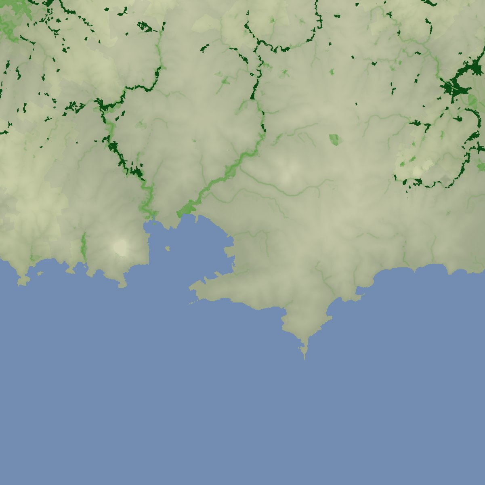
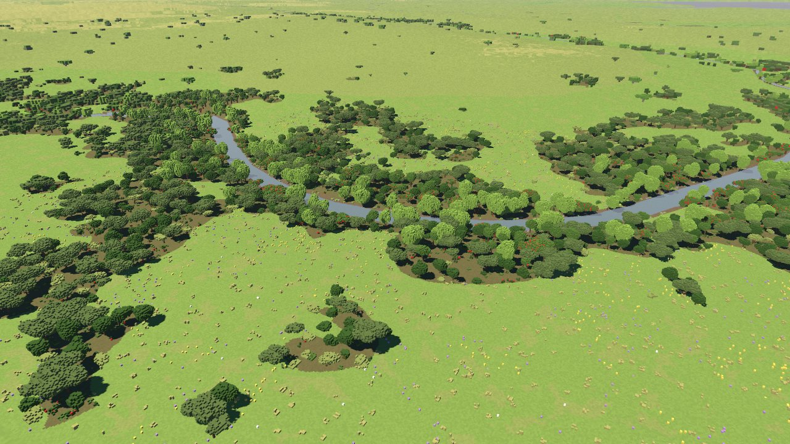
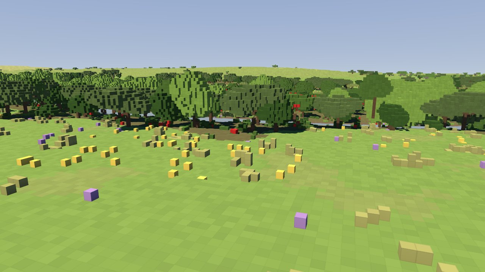
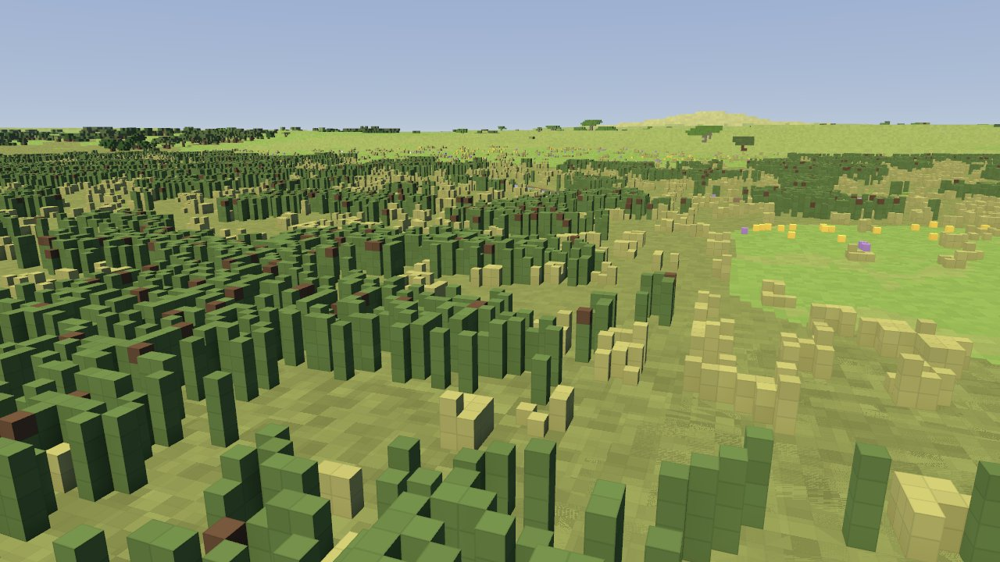

# Vegetación de 1726: monte nativo, árboles y flora baja

> Documento de sistema. Estado: **implementado** en el constructor del mapa
> (`tools/mapa_real/construir_mapa.py`, paso `--bosque dgf`) y en el motor
> (`engine/src/terrain.rs`: `forest_cover`, `forest_density`, `bank_fringe`, `trees_in`, `biome`;
> `engine/src/trees.rs`: formas de los árboles y flora baja; `engine/src/stream.rs`: vóxeles).






## Qué había hacia 1726

La campaña de Montevideo era una **pradera abierta** (pastizal de flechillas, pajas y hierbas, con
flores en primavera) cruzada por **montes ribereños o de galería** a lo largo de los arroyos. Los
montes eran más anchos y cerrados en los arroyos grandes (Miguelete, Pantanoso, Carrasco, Las
Piedras, Toledo y, fuera del mapa, el Santa Lucía) y se reducían a franjas angostas o a árboles y
arbustos sueltos en las cañadas. En los bajos había **bañados** con juncales, totorales y paja
brava; detrás de las playas, **médanos** con espartillo y senecio; en la costa y en el Cerro,
**matorrales** bajos de coronilla, molle y tala. Fuera de los montes casi no había árboles: algún
ombú, tala o espinillo suelto.

Lo que dicen las fuentes:

- **Zonación del monte ribereño**: la franja más cercana al agua tiene especies hidrófilas
  (sauce criollo, sarandíes, mataojo, guayabo blanco, ceibo); hacia afuera aparecen especies con más
  necesidad de luz y menos de agua (canelón, aruera, molle) y en el borde exterior, especies
  mesoxerófilas y espinosas (coronilla, molle, espina corona, tala); afuera del monte, el espinillar.
  Relevamiento del Parque Nacional San Miguel (Major y Torighelli, 1987) y otros casos recopilados por
  Carrere (1990), y la guía de montes del Zoológico de Montevideo.
- **Anchos**: muy variables según el relieve y el área inundable del valle. Casos documentados:
  100–200 m en el arroyo Tres Cruces Grande (Praderi, 1958; 500–800 m donde llegan tributarios);
  150–200 m a cada lado en el arroyo Lunarejo (quebrada; Berrutti y Majó, 1981); hasta 300–360 m
  desde la orilla en el arroyo de San Miguel; de pocos cientos de metros a casi 4 km en el
  Cebollatí (Porcile, 1987). La Carta Forestal de la Dirección Forestal solo inventariaba montes
  ribereños de **25 m o más** de ancho: las franjas más angostas de las cañadas no se cartografían.
- **Alturas**: monte ribereño de unos 5 m de altura media en el sur y el este (San Miguel), hasta
  8 m en Cerro Largo; árboles dominantes de 15–20 m solo en las quebradas del norte; monte serrano
  de unos 3 m; espinillos de 2–4 m.
- **Historia del uso**: el bosque fluvial es el tipo de bosque nativo más abundante del Uruguay; la
  gran cantidad de rebrotes de cepa y pocos árboles de un solo fuste muestran el corte para leña;
  en el sur el monte se degradó sobre todo con la expansión agropecuaria de 1930–1970 y se recupera
  desde hace unos 30 años (MGAP, Estrategia Nacional de Bosque Nativo). Hoy hay problemas de
  invasión de especies exóticas (ligustro, acacia negra, fresno).
- **Montevideo colonial**: desde 1727 se repartieron chacras a lo largo del Miguelete (37 en 1727,
  84 en 1730); los vecinos tenían en común el uso de "pastos, aguas, montes, leñas y frutas
  silvestres". La leña de los montes del Miguelete, el Pantanoso y, más tarde, del Santa Lucía, fue
  el combustible de la ciudad, y el monte cercano retrocedió rápido en el siglo XVIII. Los
  viajeros describen campos llanos "hasta donde alcanzaba la vista" con "muchos ríos arbolados a lo
  largo de ellos" (Pernetty, 1763, citado en W. Rela, *Viajeros, marinos y naturalistas en la
  Banda Oriental del siglo XVIII*, 1992).
- **Incertidumbre**: no hay estudios históricos sistemáticos de la extensión del monte nativo
  antes del siglo XX (Carrere, 1990). Ninguna fuente da el ancho del monte del Miguelete en 1726: lo
  que usamos es una reconstrucción a partir del monte que sobrevive hoy en arroyos rurales parecidos.

## Datos usados

| Dato | Fuente | Uso |
|---|---|---|
| Monte nativo de hoy | **Cartografía de Bosque Nativo 2021**, Dirección General Forestal (MGAP), clasificación de imágenes Sentinel. Servicio ArcGIS REST del SNIG: `https://web.snig.gub.uy/arcgisserver/rest/services/DGF/Monte_Nativo_2021/MapServer/1` (polígonos "Monte Nativo", campos `HA`, `Especie`) | `bosque_actual.bin`; calibración del modelo |
| Ciudad actual | `ideuy:areas_urbanizadas_3` (IDE Uruguay, WFS) | dejar la ciudad fuera de la calibración |
| Relieve y cauces | los mismos del mapa (MDT 30 m e hidrografía de la IDE; ver `mapa-real.md`) | distancia al agua, ancho del cauce, altura sobre el agua |

- La capa de la DGF trae **solo monte nativo** (sin plantaciones de eucaliptos ni pinos, que están
  en otras capas: `DGF/Especies_2024`). Dentro del mapa jugable hay 648 ha (1818 polígonos en el
  mapa más el entorno de 25 km).
- **Licencia**: el MGAP publica la cartografía de bosque nativo como datos públicos (descarga de
  shapes en <https://www.gub.uy/ministerio-ganaderia-agricultura-pesca/cartografia-bosque-nativo>,
  página de datos abiertos del MGAP). Los términos del portal del MGAP dicen que, salvo indicación en
  contrario, la información es de carácter público; no nombran una licencia (consultado el
  17/11/2026). Lo más probable es que rija la Licencia de Datos Abiertos del Uruguay, como para la
  IDE, pero **no está verificado**: antes de publicar el juego conviene confirmarlo con la DGF.
  Atribución (también en `meta.json`): *Monte nativo: Cartografía de Bosque Nativo 2021, Dirección
  General Forestal (MGAP), servicio del SNIG; reconstrucción de 1726 propia.*
- Alternativas evaluadas y no usadas: MapBiomas Uruguay (30 m, clase "bosque y arbustal cerrado";
  datos públicos citando la fuente; útil para comparar), ESA WorldCover y Hansen GFC (no separan
  monte nativo de plantaciones), el `.rar` de 385 MB del MGAP (mismo contenido que el servicio REST,
  pero la descarga se corta).

## Método (constructor, `bosque_nativo`)

1. **Monte de hoy**: los polígonos se rasterizan a 5 m y se promedian por celda: cobertura 0..1 en
   la grilla de 20 m del mapa (`bosque_actual.bin`) y a 10 m en la grilla de calibración.
2. **Calibración**: en todo el entorno (74 × 74 km a 20 m: Montevideo rural, Canelones y San José
   hasta el Santa Lucía), fuera de las áreas urbanizadas actuales y 300 m alrededor
   (149 000 ha rurales, 6,0 % de monte), se mide la cobertura media de monte según la **distancia
   al borde del agua** (0–350 m, nueve clases), el **ancho del cauce** (seis clases, de cañadas de
   menos de 3 m al Santa Lucía) y la **altura sobre el agua** del cauce más cercano (cinco
   clases; casi no cambia nada en esta zona llana). La distancia se calcula con una transformada de
   chaflán desde los cauces dibujados en la grilla, llevando el ancho y el nivel del agua de cada
   cauce. Las clases con menos de 150 celdas toman el promedio de sus vecinas.
3. **Fondo**: lejos de todo cauce queda un 4,4 % de monte (serrano, de parque, costero). Eso no
   es monte ribereño y no se extrapola: se resta de cada clase.
4. **1726**: `cobertura = min((media − fondo) × 2,5; 0,9)` por clase. La ganancia de 2,5 es una
   **suposición**: hace que los arroyos grandes tengan una galería casi continua junto al agua
   (80 % de copas), como describen los viajeros y los relevamientos de montes poco tocados; los
   montes rurales de hoy están raleados por la leña, el fuego, el ganado y la agricultura. Rango
   razonable: 1,5–3.
5. **Reconstrucción**: en cada celda, el máximo entre el monte de hoy y el del modelo (el monte que
   sobrevive se queda; donde la ciudad lo borró, el modelo lo repone a lo largo de los cauces del
   mapa, incluidos los entubados que el mapa repone desde el relieve). Cero en el agua, las playas,
   los bancos de arena y las lagunas. Resultado en el mapa jugable: **1445 ha** de copas en 1726
   (4,4 % de la tierra) contra 648 ha hoy; 861 ha de esas están dentro de la ciudad actual (hoy 310).
6. **Entorno** (`bosque_contexto.bin`, 100 m): promedio de bloques de 5 × 5 de la grilla de
   calibración reconstruida.

Perfil medido (cobertura rural de hoy / reconstruida para 1726) por distancia al borde del agua:

| Ancho del cauce | 0–15 m | 15–30 | 30–50 | 50–75 | 75–105 | 105–140 | 140–190 | 190–260 | 260–350 |
|---|---|---|---|---|---|---|---|---|---|
| < 3 m (cañadas) | 0,06 / 0,04 | 0,05 / 0,02 | 0,04 / 0 | 0,03 / 0 | 0,03 / 0 | 0,02 / 0 | 0,02 / 0 | 0,02 / 0 | 0,02 / 0 |
| 3–5 m | 0,14 / 0,25 | 0,11 / 0,16 | 0,06 / 0,05 | 0,05 / 0,01 | 0,04 / 0 | … | | | |
| 5–8 m | 0,20 / 0,39 | 0,15 / 0,28 | 0,08 / 0,09 | 0,05 / 0,02 | 0,04 / 0 | … | | | |
| 8–14 m | 0,29 / 0,62 | 0,19 / 0,36 | 0,15 / 0,26 | 0,12 / 0,20 | 0,10 / 0,14 | 0,10 / 0,15 | 0,09 / 0,11 | 0,08 / 0,10 | 0,08 / 0,09 |
| 14–25 m | 0,37 / 0,82 | 0,32 / 0,69 | 0,27 / 0,56 | 0,22 / 0,45 | 0,20 / 0,38 | 0,20 / 0,39 | 0,20 / 0,40 | 0,21 / 0,43 | 0,23 / 0,46 |
| > 25 m | 0,29 / 0,62 | 0,30 / 0,65 | 0,30 / 0,63 | 0,29 / 0,61 | 0,30 / 0,65 | 0,31 / 0,67 | 0,28 / 0,59 | 0,27 / 0,55 | 0,27 / 0,57 |

(El perfil completo, por altura sobre el agua también, queda en `meta.json`, `bosque`.)

## En el motor

- **Raster**: `bosque.bin` y `bosque_contexto.bin` van embebidos (`include_bytes!`, tamaños de
  `meta.json`). `forest_cover(x, z)` interpola la cobertura (20 m dentro del mapa, 100 m afuera).
- **Manchas**: una cobertura del 30 % no son árboles ralos repartidos parejo, son manchas de monte
  cerrado con claros. `forest_density` compara la cobertura con un ruido de manchas de unos 100 m:
  hay monte donde el ruido queda por debajo (y la fracción del terreno con monte da la cobertura).
- **Franja de la orilla** (`bank_fringe`, de la bibliografía, no del raster): sauces, sarandíes y
  ceibos sueltos en los primeros 2,5 m + 1,2 × medio ancho desde el agua, en la mitad de los tramos
  (más seguido en los arroyos anchos). Así las cañadas tienen alguna mata y algún sauce aunque el
  satélite no vea monte. La cartografía no distingue franjas de menos de unos 25 m.
- **Suelo**: hojarasca (`FOREST_FLOOR`) bajo el monte cerrado, pasto verde en el borde de las
  manchas; la pradera es más seca y amarillenta en las lomas, las laderas y la franja costera.
- **Especies** (`trees_in`), por cada celda de 7 m:

  | Dónde | Especies |
  |---|---|
  | Pegado al agua | sauce criollo, sarandí, ceibo |
  | Monte cerrado de la galería (a menos de 45 m del agua) | canelón, tala, coronilla, ceibo, sauce, molle |
  | Borde exterior del monte | coronilla, tala, espinillo, molle |
  | Laderas y quebradas (pendiente > 25 %) | coronilla, molle, tala, canelón, espinillo |
  | Pradera, árbol suelto (0,35 % de las celdas) | ombú, tala, espinillo |
  | Matorral costero (110–400 m de la costa) | coronilla, molle, tala |
  | Cerro (más de 100 m) | espinillo, coronilla, molle |

- **Formas** (`engine/src/trees.rs`): tronco y ramas como cilindros que se afinan y copa de
  varias masas de follaje que empieza abajo (ya no un "chupetín"). Cada especie tiene su forma:
  sauce alto, verde claro y de ramas colgantes (hebras verticales); sarandí en mata de varios tallos
  sin tronco; ceibo de tronco torcido, copa abierta y flores rojas; coronilla y molle densos y
  oscuros; tala de copa irregular y extendida; canelón recto de copa ovalada; espinillo de copa rala
  y chata en sombrilla; ombú de tronco enorme y gris, ramas gruesas casi horizontales y copa muy
  ancha. **Cuatro variantes por especie** (por ejemplo, sauce derecho, inclinado sobre el agua, de
  tronco partido en V y viejo y ancho; ombú redondo, asimétrico, de troncos soldados y joven), y
  dentro de cada variante el azar del árbol cambia ángulos y medidas. Todo es determinista (la
  misma celda da el mismo árbol en todos los niveles de detalle); la prueba
  `trees::tests::cada_especie_tiene_variantes_distintas` verifica que las variantes de cada especie
  son distintas entre sí. En el monte cerrado las copas son algo más grandes para que se toquen.
- **Flora baja** (`trees::ground_plant`, solo en los niveles de 0,25 y 0,5 m, hasta 2,4 m de alto): por cada columna de suelo
  natural (sin calles ni obras), según el material del suelo, en macollos de 1,5 m y manchas de 7 y
  15 m:

  | Zona | Plantas |
  |---|---|
  | Pradera | matas de flechilla y paja; cola de zorro en el pasto seco; parches de flores (margaritas blancas, macachines violetas, flores amarillas); algún cardo |
  | Bañado | juncales y totorales cerrados en manchas (totora con la espiga parda), matas de paja brava |
  | Orillas con barro | camalotes (con flor lila) y redondita de agua |
  | Médanos y arena | espartillo, senecio (*Senecio crassiflorus*, gris verdoso con flor amarilla), redondita de agua |
  | Monte | helechos y caraguatá (roseta espinosa, con el centro rojo cuando florece) |
  | Piedra | gramilla, matas y tunas |

  La paleta del render tiene 64 lugares y quedaron todos ocupados: flores amarilla, violeta y
  blanca, mata de paja y junco; además hojas de sauce, espinillo y tala, flor de ceibo y corteza
  gris para los árboles.

## Costo

Medido con `MOTOR_VISTAS=vegetacion motor --mapa real --auto-test` (llvmpipe, 1280 × 720), contra
el commit anterior: la vista de la galería a media distancia pasa de 2,5 a 3,8 millones de
triángulos y la del bañado de cerca de 1,4 a 2,5 (casi todo, más monte y copas con más forma; la
flora baja solo existe en el nivel más fino). La generación de columnas no cambió de forma visible.
De lejos (2 y 4 m por vóxel) las copas tienen menos huecos para no sumar caras.

## Supuestos y límites

- La ganancia de 2,5 y el ruido de manchas son decisiones de diseño, no datos: el monte de 1726
  podría haber sido más angosto (si la leña ya lo raleaba) o más ancho.
- La cartografía de hoy incluye montes con exóticas invasoras (ligustro, acacia) que el satélite no
  separa del monte nativo.
- La calibración mezcla cuencas del sur (Santa Lucía, Canelones) con suelos y valles algo distintos
  de los de Montevideo.
- La franja de orilla y la flora baja salen de la bibliografía general, no de un relevamiento de
  Montevideo. La flora no cambia con la estación (el ceibo tiene siempre alguna flor).
- No hay palmares ni monte serrano en el mapa jugable (no los hay en Montevideo).

## Cómo regenerar

```
python3 tools/mapa_real/construir_mapa.py --cache /ruta/a/una/carpeta
```

El paso del monte va por omisión con la hidrografía de la IDE (`--bosque no` lo saltea y deja los
`bosque*.bin` como están). Baja 1818 polígonos del SNIG (de a 1000) y las áreas urbanizadas de la
IDE la primera vez; después usa la caché (`snig_monte_nativo_2021_25000.geojson`). Tarda unos 20 s
más que antes. Escribe `bosque.bin`, `bosque_contexto.bin`, `bosque_actual.bin`, la sección `bosque`
de `meta.json` y la vista previa `docs/capturas/vegetacion-mapa.jpg`.

## Fuentes

- MGAP, Dirección General Forestal: Cartografía de Bosque Nativo 2021 (servicio
  <https://web.snig.gub.uy/arcgisserver/rest/services/DGF/Monte_Nativo_2021/MapServer>; página
  <https://www.gub.uy/ministerio-ganaderia-agricultura-pesca/cartografia-bosque-nativo>; informe de
  metodología y resultados, marzo de 2023,
  <https://sslburuguay.mef.gub.uy/innovaportal/file/30705/14/ibn_2021.pdf>).
- MGAP, Estrategia Nacional de Bosque Nativo, "Bosque fluvial":
  <https://www.gub.uy/ministerio-ganaderia-agricultura-pesca/comunicacion/publicaciones/estrategia-nacional-bosque-nativo/31-situacion-del-bosque-nativo-1>.
- R. Carrere, *El bosque natural uruguayo: inventario y evolución del recurso* y *caracterización
  general y estudios de caso*, CIEDUR, Serie Investigaciones 78, 1990:
  <https://www.guayubira.org.uy/monte/Ciedur6i.html>, <https://www.guayubira.org.uy/monte/Ciedur5ii.html>
  (con los relevamientos de Praderi 1958, Berrutti y Majó 1981, Gallinal et al. y Rosengurtt 1943,
  Porcile 1987, Major y Torighelli 1987).
- Intendencia de Montevideo: Jardín Botánico, "Bosque ribereño"
  (<https://jardinbotanico.montevideo.gub.uy/sites/jardinbotanico.montevideo.gub.uy/files/articulos/descargas/bosque_ribereno.pdf>)
  y Zoológico, "Montes del Uruguay"
  (<https://zoo.montevideo.gub.uy/sites/zoo.montevideo.gub.uy/files/articulos/descargas/6_montes_del_uruguay.pdf>);
  solo se leyeron los resúmenes del buscador (el servidor cortó la descarga).
- Intendencia de Canelones, "Paisaje de riberas" (material educativo):
  <https://www.imcanelones.gub.uy/sites/default/files/2024-03/paisaje_de_riberas_material_eductivo__1.pdf>.
- Arroyo Miguelete (reparto de chacras de 1727 y 1730): <https://es.wikipedia.org/wiki/Arroyo_Miguelete>.
- W. Rela, *Viajeros, marinos y naturalistas en la Banda Oriental del siglo XVIII*, 1992 (Pernetty,
  1763), citado en "El Uruguay hispánico en la segunda mitad del siglo XVIII"
  (<https://www.frdelpino.es/wp-content/uploads/2014/10/en_01_Cap-1-AMOR.pdf>); el pasaje de los
  "ríos arbolados" se tomó de una cita secundaria y conviene verificarlo en el original.
- MapBiomas Uruguay (alternativa, no usada): <https://uruguay.mapbiomas.org/>.
